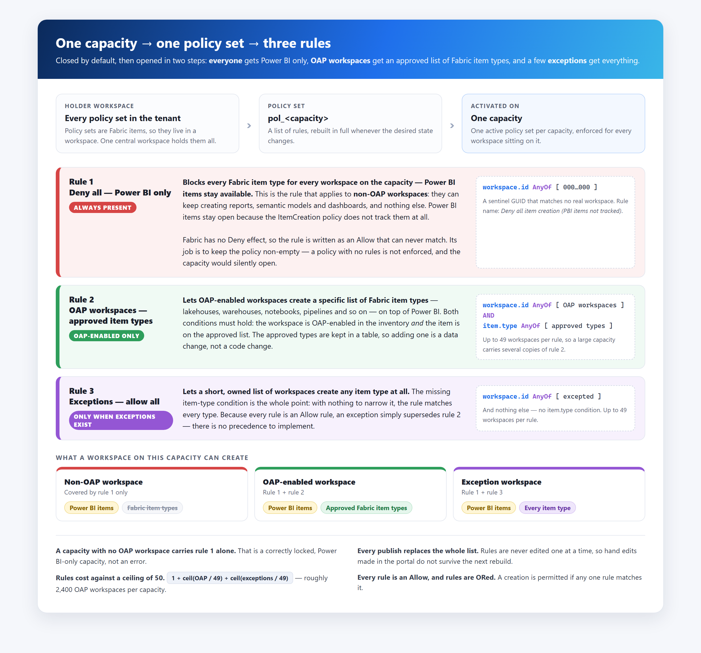

# Fabric Capacity Policies - Architecture

## Scope of this document

This document describes the architecture of the **Fabric Capacity Policies** solution - a set of Power Automate cloud flows that govern **which Fabric item types may be created, in which workspaces, on which capacity**. It does so by publishing capacity-scoped `ItemCreation` policy sets to Microsoft Fabric from desired state held in Dataverse.

---

## Contents

1. The problem
2. Solution overview
   - 2.1 What a Fabric policy is, and what it does
   - 2.2 What a policy set contains here - three rules
   - 2.3 Keeping every capacity current - Dataverse rows are the trigger
   - 2.4 What the solution delivers
   - 2.5 What the solution is deliberately not responsible for

> **Sections 3 to 10 have been moved out for rewriting** and are held, unchanged, in [ARCHITECTURE-v2-TEMP-sections-3-10.md](./ARCHITECTURE-v2-TEMP-sections-3-10.md): component inventory, identity model, ownership boundary, functional architecture, flow inventory, migration, data model and the Fabric REST API surface.

---

## 1. The problem

### We need to control what users can create

Out of the box, anyone with Contributor on a Fabric workspace can create **any item type** the workspace's capacity supports - lakehouses, warehouses, notebooks, pipelines, eventhouses and the rest. The platform needs the opposite posture: only workspaces that are Outbound Access Protected may create the governed Fabric item types, and every other workspace should be able to create only Power BI items.

### Policies provide the control, but only per capacity

Fabric's mechanism for this is the **`ItemCreation` policy set** - a Fabric item that holds a list of allow and deny rules and is activated against **one capacity**. There is no tenant-wide or workspace-level equivalent: a policy set governs exactly the capacity it is activated on, and a capacity can have only one active at a time.

The estate runs on **200-300 Fabric capacities** hosting thousands of workspaces. Governing item creation therefore means **creating, populating and activating more than 200 policy sets - one per capacity** - and keeping each one current as workspaces are created, approved, moved between capacities and retired, and as capacities themselves come and go. The policy API is also still in preview.

### Doing that by hand is neither efficient nor secure

| | Why manual management fails |
|---|---|
| **Not efficient** | Every approval, revocation, workspace move or new capacity means finding the right policy set and editing its rules by hand. At 200+ capacities and thousands of workspaces, the change rate alone makes that a standing job, and nothing changes until somebody gets to it |
| **Not secure** | Manual edits drift from the record of which workspaces are actually approved, so access is granted that nobody approved, or kept after it should have been revoked. The API offers no locking: `PATCH` on a rule replaces its whole `conditions` array with no ETag, so two concurrent edits silently lose one of them. A capacity whose policy set was never created, or never activated, stays open with nothing reporting it |
| **Not auditable** | Rules edited one at a time have no single source of truth to compare against, so there is no reliable way to answer *who is allowed to create what, and why* |

### What is required

The requirement is therefore to make the platform team's **existing inventory** the source of truth for item-creation policy, to publish it to Fabric as that inventory changes, and to do so **without this project ever writing the inventory**.

---

## 2. Solution overview

### 2.1 What a Fabric policy is, and what it does

**A Fabric policy is a centrally defined set of governance rules that Fabric evaluates whenever somebody attempts a governed action, and the outcome is that the action is allowed or blocked.** A policy is itself a Fabric item, held in a workspace, fixed at creation to one **admin scope** - Tenant or Capacity - and inert until it is **activated**, after which only one policy can be active per scope.

Fabric evaluates an attempted action in a fixed order: it resolves the admin scope, loads the active policy for that scope, and tests the action against the policy's rules. **If a rule matches, the action is allowed. If rules exist and none matches, the action is blocked.** If the policy has no rules at all, Fabric applies the policy default instead - which is why an empty policy is not a closed one.

Three properties of that model shape the whole solution:

| Fabric's rule | What it forces on us |
|---|---|
| **Scope is chosen at creation and cannot be changed, and only one policy may be active per scope** | Governing item creation across the estate means **one policy set per capacity** - more than 200 of them, each activated separately |
| **A rule is a set of conditions ANDed together plus an effect, and the only effect is `Allow`** | There is nothing to deny with. "Closed by default" has to be built out of Allow rules (2.2) |
| **Rules do nothing until the policy is activated, and activation cannot be done through Git** | Creating and filling a policy set is not enough - the solution has to activate it as well |

This solution uses exactly one policy type - **`ItemCreation`**, at **Capacity** scope - which governs *which item types may be created in which workspaces*. Power BI items fall outside it entirely and are never affected.

### 2.2 What a policy set contains here - three rules

> Source for the diagram: [`diagrams/policy-set-rules.html`](./diagrams/policy-set-rules.html). Re-render it to `policy-set-rules.png` after any edit.

Each governed capacity gets one policy set, and every policy set is built from the same three rules. The capacity starts closed, and each rule opens it a step further for a narrower group of workspaces:

| Rule | Who it is for | What it allows |
|---|---|---|
| **Rule 1 - Deny all, Power BI only** | **Every workspace on the capacity** - in practice, the **non-OAP workspaces**, which should hold Power BI content only | **Power BI items and nothing else.** Every Fabric item type is blocked. Power BI items stay available because the `ItemCreation` policy does not track them at all. Always present |
| **Rule 2 - OAP workspaces, approved item types** | **OAP-enabled workspaces**, as marked in the platform team's inventory | **A specific list of Fabric item types** - lakehouses, warehouses, notebooks, pipelines and so on - on top of Power BI. Both conditions must hold: the workspace is OAP-enabled *and* the item is on the approved list, which is kept in a table |
| **Rule 3 - Exceptions, allow all** | **A short, owned list of exception workspaces** | **Any item type at all.** The rule has no item-type condition, and an unspecified condition matches everything. Present only when there are active exceptions |

Rules 2 and 3 can each hold up to 49 workspaces, so a large capacity carries several copies of them.

Four consequences are worth stating plainly, because each is a way the design can be got wrong:

- **Rule 1 is how "deny" is built.** Fabric has no `Deny` effect, so rule 1 is an `Allow` rule whose condition can never match - a sentinel workspace GUID that does not exist. Its job is to keep the policy non-empty: **a policy with no rules is not enforced**, and the capacity silently opens. Every publish therefore emits rule 1 first, unconditionally.
- **A capacity with only rule 1 is correct, not broken.** It is a Power BI-only capacity with no OAP workspace yet.
- **An exception supersedes rule 2 rather than adding to it.** Every rule is an `Allow` and Fabric ORs them, so a workspace in both lists is simply unrestricted - there is no precedence to implement.
- **Rules are a budget.** Capacity scope allows **50** rules, and the list costs `1 + ceil(OAP / 49) + ceil(exceptions / 49)` - about 2,400 OAP workspaces before a capacity runs out of room.

### 2.3 Keeping every capacity current - triggers on Dataverse rows 

**Every change this solution makes begins as a row written in Dataverse, and nothing else starts anything.** There is no user interface, no schedule and no queue for somebody to work. The platform team already maintains the estate's inventory - which capacities exist, which workspaces sit on each of them, and which workspaces are approved - and those rows *are* the input. They are written for their own reasons, by people who need not know this solution exists.

Adding or changing one of those rows wakes an automation that:

1. **Derives the affected capacity** from the row. A row that affects no governed capacity stops there.
2. **Checks that the change means what it appears to mean**, and refuses rather than publishing a guess if the desired state cannot be read with confidence.
3. **Reads the complete desired state for that capacity** and builds its whole rule list from scratch.
4. **Replaces every rule on that capacity's policy set in one call**, and records the outcome.

Two paths follow from that one mechanism, and they differ only in whether the policy set already exists:

| | **Creating policy for a new capacity** | **Updating policy as the estate changes** |
|---|---|---|
| **What happened in Dataverse** | A capacity row appeared in the inventory | A workspace was approved or revoked, moved capacity, or an exception was granted or withdrawn |
| **What the automation does** | Creates a policy set for it, builds its rules, and activates it against the capacity | Rebuilds the affected capacity's rule list from the current desired state and replaces what was there |
| **Where it leaves the capacity** | **Born locked** - no workspace is OAP-enabled yet, so rule 1 stands alone and the capacity is Power BI-only | Enforcing exactly what the inventory now says, within minutes |

Three properties make that safe to run unattended:

- **It is reactive, not scheduled.** A change publishes within minutes of the row being saved - there is no sweep to wait for and nothing to catch up on.
- **It is idempotent.** The same desired state always produces the same rule list, so repeated or overlapping rebuilds converge rather than conflict.
- **It fails closed.** A run that cannot resolve the desired state publishes nothing at all, rather than an empty list that would lock a capacity on somebody else's data-entry error.

> **Dataverse holds the desired state; Fabric holds nothing that is not rebuilt from it.** Every publish is a full rebuild, never a partial edit, so whatever was in Fabric is overwritten - hand-made edits included. Which workspaces are approved is read from the inventory at rebuild time and never stored or written back. That is what makes Dataverse the source of truth in practice rather than only in intent.

### 2.4 What the solution delivers

| Capability | What it means |
|---|---|
| **Closed-by-default capacities** | Every governed capacity carries rule 1, so it is Power BI-only unless a later rule opens it further |
| **A derived OAP list** | A workspace may create the approved Fabric item types on its capacity when the platform team's inventory marks it OAP-enabled. Nothing in this solution decides that |
| **Exceptions** | A short, owned and reviewable list of workspaces allowed to create *any* item type, on whichever capacity they sit on |
| **Approved item types in data** | The list of Fabric item types rule 2 allows is a table, so approving a new type is a row and a rebuild, not a code change |
| **Capacity lifecycle** | A capacity appearing in the inventory gets a policy set created, built and activated. |
| **Visibility** | Every governed capacity's policy set, rule counts and last rebuild can be read without calling Fabric |
| **Estate-wide repair** | A single manual run rebuilds every capacity from Dataverse, overwriting anything changed by hand in Fabric |

### 2.5 What the solution is deliberately not responsible for

Each of these was a considered decision rather than an omission:

| Not in scope | Who owns it instead |
|---|---|
| **Deciding which workspaces are approved** | The platform team, in their inventory. This solution publishes that decision; it never makes it |
| **Populating or correcting the inventory** | The platform team. A wrong workspace GUID, a missing row or a stale capacity assignment is a request to them, not a local fix |
| **Validating workspace GUIDs** | Wherever the inventory row is created. Fabric accepts any well-formed GUID and silently never matches a wrong one |
| **Creating capacities, or granting the rights to administer them** | Capacity provisioning. A capacity this solution cannot administer is invisible to it |
| **Telling a capacity owner that a new capacity is locked** | The provisioning process. A policy set activates with nobody deciding |
| **Governing Power BI items** | Nobody - `ItemCreation` policy does not cover them |
| **Scheduled convergence or drift detection** | Nobody, by decision. Nothing in the solution runs on a schedule |
| **Emergency unlock at scale** | An operator procedure that sits outside this solution |
