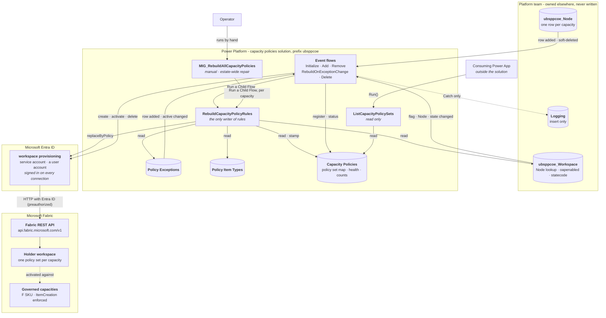
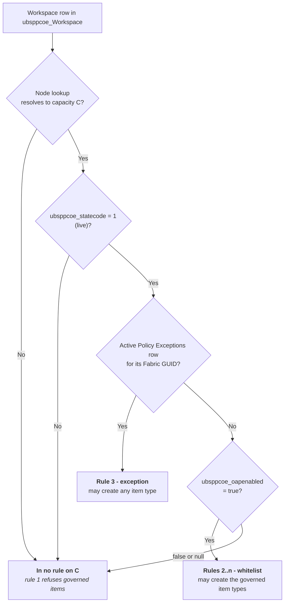
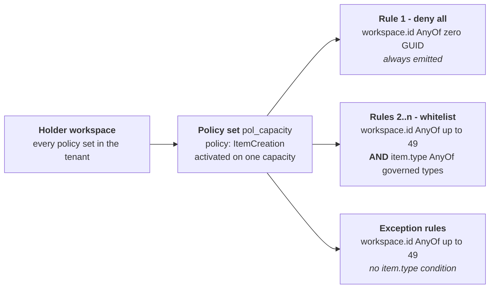
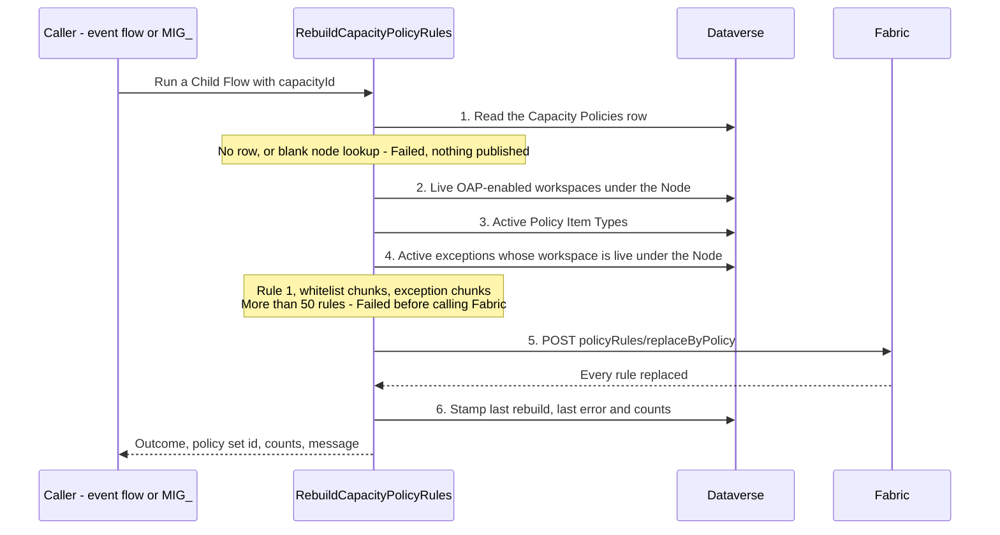
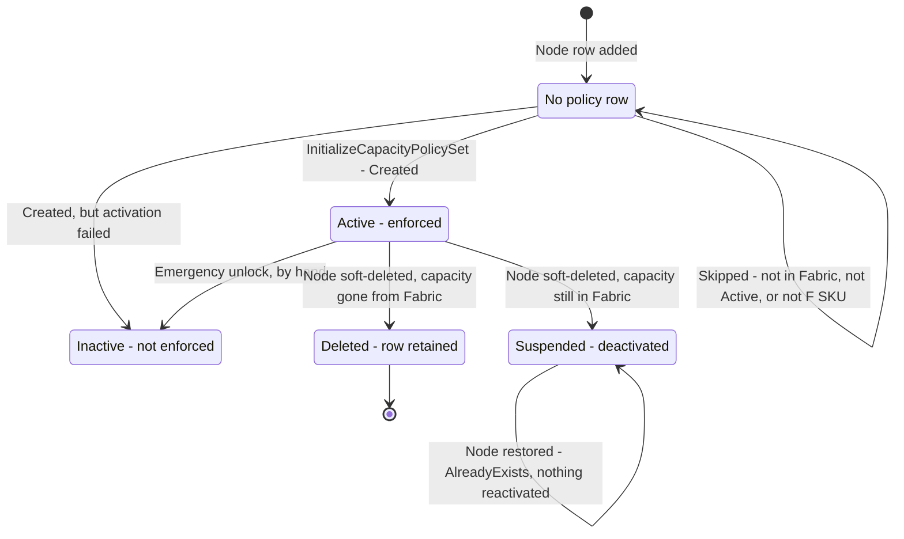
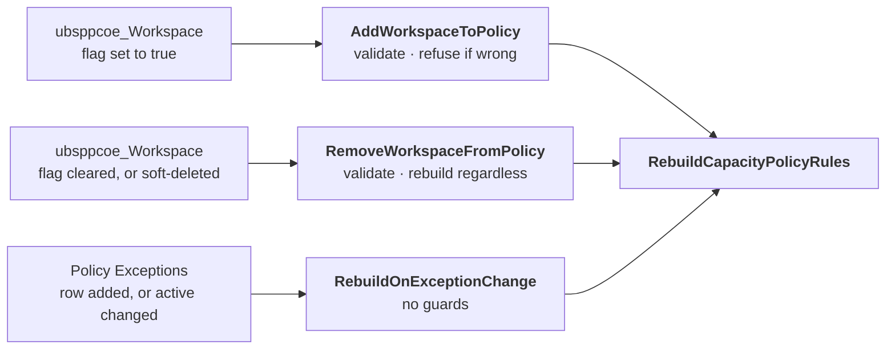
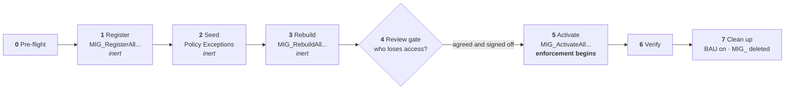
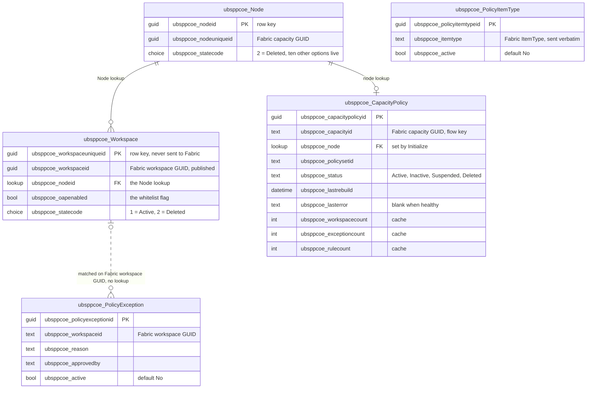

# Fabric Capacity Policies - Architecture

## Scope of this document

This document describes the architecture of the **Fabric Capacity Policies** solution - a set of Power Automate cloud flows that govern **which Fabric item types may be created, in which workspaces, on which capacity**. It does so by publishing capacity-scoped `ItemCreation` policy sets to Microsoft Fabric from desired state held in Dataverse.

---

## Contents

1. The problem
2. Solution overview
3. Component inventory
4. Identity model
5. Ownership boundary - derived, never stored
6. Functional architecture - the policy model
7. Flow inventory
8. Migration - the one-off cutover
9. Data model
10. Integration surface - Fabric REST API

---

## 1. The problem

### We need to control what users can create

Out of the box, anyone with Contributor on a Fabric workspace can create **any item type** the workspace's capacity supports - lakehouses, warehouses, notebooks, pipelines, eventhouses and the rest. The platform needs the opposite posture: only workspaces that are Outbound Access Protected may create the governed Fabric item types, and every other workspace should be able to create only Power BI items.

### Policies provide the control, but only per capacity

Fabric's mechanism for this is the **`ItemCreation` policy set** - a Fabric item that holds a list of allow and deny rules and is activated against **one capacity**. There is no tenant-wide or workspace-level equivalent: a policy set governs exactly the capacity it is activated on, and a capacity can have only one active at a time.

The estate runs on **200-300 Fabric capacities** hosting thousands of workspaces. Governing item creation therefore means **creating, populating and activating more than 200 policy sets - one per capacity** - and keeping each one current as workspaces are created, approved, moved between capacities and retired, and as capacities themselves come and go. The policy API is also still in preview.

### Doing that by hand is neither efficient nor secure

| | Why manual management fails |
|---|---|
| **Not efficient** | Every approval, revocation, workspace move or new capacity means finding the right policy set and editing its rules by hand. At 200+ capacities and thousands of workspaces, the change rate alone makes that a standing job, and nothing changes until somebody gets to it |
| **Not secure** | Manual edits drift from the record of which workspaces are actually approved, so access is granted that nobody approved, or kept after it should have been revoked. The API offers no locking: `PATCH` on a rule replaces its whole `conditions` array with no ETag, so two concurrent edits silently lose one of them. A capacity whose policy set was never created, or never activated, stays open with nothing reporting it |
| **Not auditable** | Rules edited one at a time have no single source of truth to compare against, so there is no reliable way to answer *who is allowed to create what, and why* |

### What is required

The requirement is therefore to make the platform team's **existing inventory** the source of truth for item-creation policy, to publish it to Fabric as that inventory changes, and to do so **without this project ever writing the inventory**.

### The governing design principle

> **Dataverse holds the desired state. Fabric holds nothing that is not rebuilt from it.**

Every publish is a **full rebuild** of one capacity's rule list through `replaceByPolicy` - never a partial edit. Whatever was in Fabric is overwritten, including rules somebody added by hand. That is what makes Dataverse the source of truth in practice rather than only in intent, and it removes the incremental-edit problems outright: the chunking is recomputed from the full list every time, rule names cannot go stale, and the awkward last-workspace-in-a-rule case cannot arise because an empty chunk is simply never emitted.

Two consequences of that principle run through every flow:

- **Membership is derived, never stored.** Whether a workspace is whitelisted is read at rebuild time from the Dataverse tables `Workspace` and `Node`. No policy flow writes to these tables (§5).
- **When the desired state cannot be seen, refuse.** A flow that cannot resolve which workspaces belong to a capacity stops, rather than publishing an empty list that would lock the capacity on the strength of somebody else's data-entry error (§5).

---

## 2. Solution overview

### It runs on Dataverse row triggers, so there is no interface to use

**Every change this solution makes begins as a row added or changed in Dataverse.** A Power Automate flow wakes on that row, works out which capacity it affects, and republishes that capacity's rules to Fabric minutes later. There is no screen to open, no form to fill in and no queue for somebody to work: the platform team's inventory rows *are* the input, and they are written for their own reasons by people who need not know this solution exists.

The clearest case is a new capacity. **The platform team adds a row to `ubsppcoe_Node`** - the capacity table - and that insert alone fires `InitializeCapacityPolicySet`, which creates a policy set for the capacity in the holder workspace, builds its rules and activates it. Nobody is asked, and nothing waits.

| When this row changes | This flow wakes | And this is published |
|---|---|---|
| **`ubsppcoe_Node`** added, or given its capacity GUID | `InitializeCapacityPolicySet` | A policy set for that capacity, built and activated - the capacity starts closed |
| **`ubsppcoe_Node`** soft-deleted (`ubsppcoe_statecode` = `2`) | `DeleteCapacityPolicySet` | The retired capacity's policy set, suspended or deleted |
| **`ubsppcoe_Workspace`** - `ubsppcoe_oapenabled` set to `true` | `AddWorkspaceToPolicy` | That capacity's whitelist, rebuilt with the workspace in it |
| **`ubsppcoe_Workspace`** - flag cleared, or row soft-deleted | `RemoveWorkspaceFromPolicy` | That capacity's whitelist, rebuilt without it |
| **`Policy Exceptions`** - row added, or `ubsppcoe_active` changed | `RebuildOnExceptionChange` | That capacity's exception rule, rebuilt |

Two flows sit outside the pattern: **`RebuildCapacityPolicyRules`**, the child flow each of the five calls to do the actual writing, and **`ListCapacityPolicySets`**, a read-only flow that a Power App outside this solution calls for status. **No flow runs on a schedule**, and the changes no trigger covers are listed in §6.5.

### What the solution is

**Fabric Capacity Policies is a back-end solution - seven business-as-usual cloud flows, three Dataverse tables of its own and one Fabric holder workspace - that keeps one `ItemCreation` policy set per governed capacity in step with the platform team's workspace inventory.** Five of those flows are the event flows above, one is the child flow that performs every write of rules, and one is the read-only status flow. It has no user interface of its own.

A capacity under this system is **closed by default**: nothing governed can be created on it until a workspace is whitelisted. **Power BI items are not governed** and are unaffected throughout.

**The existing estate was brought onto the solution by a separate one-off cutover**, run with four `MIG_` flows that are no part of business as usual. That work is described on its own in §8.

### What it delivers

| Capability | What it means |
|---|---|
| **Closed-by-default capacities** | Every governed capacity carries a deny-all baseline. A governed item type can be created only where a later rule allows it |
| **A derived whitelist** | A workspace may create the governed item types on its capacity when the platform team's inventory marks it OAP-enabled. Nothing in this solution decides that |
| **Exceptions** | A short, owned and reviewable list of workspaces allowed to create *any* item type, on whichever capacity they sit on |
| **Governed item types in data** | The list of item types the whitelist covers is a table, so governing a new type is a row and a rebuild, not a code change |
| **Capacity lifecycle** | A capacity appearing in the inventory gets a policy set created, built and activated. A retired one has its policy set suspended or deleted, according to what Fabric says |
| **Visibility** | One read-only flow returns every governed capacity with its policy set, rule counts and last rebuild |
| **Estate-wide repair** | One manual flow rebuilds every capacity from Dataverse, overwriting anything changed by hand in Fabric |

### How it works, in short

**This solution never decides who is whitelisted - it publishes what the platform team's data already says.** That team maintains two Dataverse tables: `ubsppcoe_Node`, one row per capacity, and `ubsppcoe_Workspace`, one row per workspace carrying a lookup to its Node and a boolean `ubsppcoe_oapenabled`. The solution reads both and writes neither.

The event flow that wakes on one of those rows derives which capacity is affected, checks that the change means what it appears to mean, and calls **`RebuildCapacityPolicyRules`** - the only flow that writes rules. The rebuild reads the complete desired state for that capacity, builds the whole rule list, and replaces every rule on the capacity's policy set in a single call. It records the result on the solution's own `Capacity Policies` row.

Every Fabric call goes through the **HTTP with Microsoft Entra ID (preauthorized)** connector, whose connection is signed in as the **`workspace provisioning` service account** - a user account. The connector attaches the bearer token itself, so there is no service principal, no token flow and no client secret anywhere in the solution (§4).



### Walking the diagram - one change, end to end

The commonest change is a workspace becoming whitelisted:

1. **The platform team sets `ubsppcoe_oapenabled` to `true` on a workspace row.** Nothing in this solution caused that, and nothing in it could have.
2. **`AddWorkspaceToPolicy` fires.** Its trigger runs at **Organization** scope, wakes only when the flag or the Node lookup changes, and filters to rows that are enabled, assigned to a Node and live (`ubsppcoe_statecode eq 1`).
3. **The flow derives the capacity.** It reads `Capacity Policies` through its `node` lookup. No row means the capacity is not governed, and the run ends as `WrongCapacity` without rebuilding anything.
4. **The flow validates.** It finds the workspace row by its Fabric GUID, confirms the row's Node is the capacity's Node, and confirms the flag is still `true`. If any of these fail it **refuses** - rebuilding and reporting success would tell somebody they have access they do not have (§6.4).
5. **It calls the rebuild** with the capacity id - `Run a Child Flow`, and nothing else.
6. **The rebuild reads the whole desired state.** Every live, OAP-enabled workspace under the Node; every active governed item type; every active exception whose workspace is live under the same Node. It builds rule 1, the whitelist chunks and the exception chunks, checks the 50-rule ceiling, and posts `replaceByPolicy` as the service account (§6.2).
7. **Fabric replaces every rule on the policy set**, and the new rules are enforced on the capacity.
8. **The outcome is recorded.** The rebuild stamps `ubsppcoe_lastrebuild`, `ubsppcoe_lasterror` and the three counts on the `Capacity Policies` row. The event flow records its own outcome in the run history. If an action fails outright, the flow's Catch writes the error to the policy row and a `Logging` row, and ends the run **Failed**. **Nothing retries a failure.**

Every other event follows the same shape - trigger, derive, validate, rebuild - with a different validation in step 4. Five kinds of change fire no event at all and wait for an operator; §6.5 covers them.

### Five tiers, one responsibility each

| Tier | Responsibility | Holds credentials? |
|---|---|---|
| **Platform team's tables** | The desired state - which workspaces exist, which capacity each sits on, which are OAP-enabled. Read, never written | No |
| **Solution tables** | The capacity → policy set map, rebuild health and cached counts, the governed item types and the exceptions | No |
| **Event flows** | Notice a change, derive the capacity it affects, check that the change means what it appears to mean, call the rebuild, record the outcome | No - the platform holds the connections |
| **Rebuild flow** | Build the complete rule list for one capacity and replace it in Fabric. **The only writer of rules** | No |
| **Connections** | Fabric, Dataverse and Outlook, all signed in as the one service account | **Yes** - the account's sign-in, held by Power Platform |

The separation matters for the same reason everywhere: the logic that decides *what* to publish never sees a credential, and the one thing that does hold a credential - the connection - holds nothing but a sign-in.

> **No flow acquires a token, and no flow holds a secret.** Fabric calls use the **HTTP with Microsoft Entra ID (preauthorized)** connector, which attaches the bearer token for the account its connection signed in as. There is no client-credentials grant, no `Authorization` header and no `accessToken` variable anywhere in the solution, and the plain `HTTP` action is not used at all.

### What the solution is deliberately not responsible for

Each of these was a considered decision rather than an omission:

| Not in scope | Who owns it instead |
|---|---|
| **Deciding which workspaces are whitelisted** | The platform team, through `ubsppcoe_oapenabled`. This solution publishes the flag; it never sets it |
| **Populating or correcting the inventory** | The platform team. A wrong workspace GUID, a missing row or a stale Node assignment is a request to them, not a local fix |
| **Validating workspace GUIDs** | Wherever the inventory row is created. Fabric accepts any well-formed GUID and silently never matches a wrong one (§12) |
| **Creating capacities, or granting Capacity Admin on them** | Capacity provisioning. A capacity the service account does not administer is invisible to every flow here |
| **Telling a capacity owner that a new capacity is locked** | The provisioning process. The policy set activates with nobody deciding (§6.3) |
| **Governing Power BI items** | Nobody - `ItemCreation` policy does not cover them |
| **Scheduled convergence or drift detection** | Nobody, by decision. There is no scheduled flow in the solution (§6.5, §11) |
| **Emergency unlock at scale** | An operator procedure that sits outside this solution |

---

## 3. Component inventory

> ### One prefix, two owners - ownership is stated by table name
>
> **Every table this solution touches carries `ubsppcoe_`, including the platform team's.** The solution's own tables were deliberately created with the same publisher prefix, so the prefix no longer tells you who owns a table. Every "never write this" rule in this document set is therefore stated **by table name**, never by prefix.
>
> `crbab_` belongs to the Fabric Workspace Settings application and appears nowhere in this solution.

| Component | Count | Detail |
|---|---|---|
| **Cloud flows - business as usual** | 7 | Six event and worker flows, plus one read-only helper. Listed in §7 |
| **Cloud flows - migration** | 4 | Prefixed `MIG_`. Three are deleted after cutover; one is kept, switched off. §8 |
| **Dataverse tables created by this solution** | 3 | `Capacity Policies`, `Policy Item Types`, `Policy Exceptions` |
| **Dataverse tables required, owned elsewhere** | 3 | `ubsppcoe_Workspace`, `ubsppcoe_Node`, `Logging` - all the platform team's |
| **Environment variables** | 7 | §9 |
| **Connection references** | 3 | Fabric (*HTTP with Microsoft Entra ID (preauthorized)*), Microsoft Dataverse, Office 365 Outlook |
| **Fabric holder workspace** | 1 | Holds every policy set in the tenant. Created by this project, but a Fabric object rather than a solution component |
| **Seed files** | 2 | `PolicyItemTypes.csv` and `PolicyExceptions.csv` - import templates for the two hand-maintained tables |

**The platform team's three tables do not travel with this solution.** A target environment without them cannot run any of it - the flows read them on every path. **To confirm:** the solution's name, whether it is managed or unmanaged, and whether the three tables live in the same solution as the flows.

**Designs considered and rejected** - a scheduled drift scan, a token flow and a try/catch sandbox - are not part of the solution and should not be built.

---

## 4. Identity model

**One identity is used everywhere: the `workspace provisioning` service account.**

| | **`workspace provisioning` service account** |
|---|---|
| Type | **A user account** - email and password |
| App registration, client ID, client secret | **None.** There is no service principal anywhere in this solution |
| OAuth flow | **Signed in on the connection.** The connector attaches the token, so every call is delegated - the account acting as itself |
| Connections signed in as it | Fabric (*HTTP with Microsoft Entra ID (preauthorized)*), Microsoft Dataverse, Office 365 Outlook |
| Fabric rights | **Contributor** on the holder workspace and **Capacity Admin** on every governed capacity - nothing else |
| Dataverse rights | Organization-depth privileges on six tables (below) |

It is a **service account, not a named person**, deliberately: the estate-wide rebuild runs against 200-300 capacities, and tying that to an individual would make the solution one leaver away from stopping.

> ### Why there is no service principal
>
> A service principal with a client secret was the obvious alternative, and it was not taken. Because the connection is a user account:
>
> - **There is no app registration, client ID or client secret** to manage or rotate.
> - **There are no application API permissions** and no admin consent to obtain for them.
> - **The tenant setting *Service principals can use Fabric APIs* is irrelevant**, as is every Admin API setting - all of them are scoped to service principals.
> - **Every right the account has, it has because a role was granted to it directly.**
>
> The cost is that the connection carries a user account's failure modes, which is the largest operational risk in the design (below).

### Fabric access comes from two roles, and nothing on the governed workspaces

| # | Role | Scope | Why |
|---|---|---|---|
| F1 | **Contributor** (or Admin) | The **holder workspace** - one workspace | A policy set is a Fabric item. Creating, updating and deleting items needs it on the workspace that holds them |
| F2 | **Capacity Admin** | **Every governed capacity** | Required to activate a policy set on the capacity, and to see the capacity in `GET /v1/capacities` at all |

**The account holds no role on any governed workspace.** The workspaces in a whitelist are never touched as resources - they are GUIDs inside `predicate.values`, data in a rule rather than objects being acted on. Every write path is `/v1/workspaces/{holderWorkspace}/policySets/...`, and the only workspace in it is the holder. **Nor is the account a Fabric Administrator**: that is needed only for the tenant-scope `/v1/admin/policySets/*` operations, which nothing here uses.

> **F2 must be granted on every new capacity as it is provisioned.** A capacity the account does not administer is simply absent from `GET /v1/capacities`. `InitializeCapacityPolicySet` then reports `Skipped` - indistinguishable from a capacity that does not exist - and the capacity stays silently ungoverned.

**One tenant-level action may be needed:** if user consent to applications is disabled, a tenant administrator must consent to the *HTTP with Microsoft Entra ID (preauthorized)* connector before the connection can be created. One-off. The environment's **DLP policy** must also place that connector, Dataverse and Office 365 Outlook in the same data group, or the flows will neither save nor run.

### Dataverse access

All privileges at **Organization** depth - the rows belong to another team, so User or Business Unit depth is not sufficient.

| Table | Read | Create | Write | Delete |
|---|---|---|---|---|
| `ubsppcoe_Workspace` | Yes | - | **Never** | **Never** |
| `ubsppcoe_Node` | Yes | - | **Never** | **Never** |
| `Capacity Policies` | Yes | Yes | Yes | - |
| `Policy Item Types` | Yes | - | - | - |
| `Policy Exceptions` | Yes | - | - | - |
| `Logging` | - | Yes | **Never** | **Never** |

**No flow deletes a Dataverse row anywhere in the solution.** A retired capacity's row is updated to `Deleted`, never removed.

> **Every Dataverse trigger must run at `Organization` scope.** The default is `User`, at which a trigger fires only for changes the connection's own account made. Every change that matters here is made by the platform team, by an import or by an exception approver - so at `User` scope a flow simply never runs, with no error, no failed run and an empty run history.

### What breaks a user-account connection

A delegated connection has failure modes an application identity does not, and they all present the same way.

| Symptom | Meaning |
|---|---|
| **`401` on every capacity at once** | **The connection, not Fabric.** The account's password rotated or expired, MFA or Conditional Access blocked it, or it was disabled or unlicensed. Re-authenticate the connection |
| `GET /v1/capacities` returns far fewer capacities than exist | The account is not Capacity Admin on the missing ones - **or the connection was signed in by the wrong account**, which looks identical |
| Creating a policy set fails | Contributor is missing on the holder workspace |
| Activation fails after the policy set was created | Capacity Admin is missing on that one capacity |

> **The run history never says "the connection is the problem".** A lapsed credential presents as `401` against every capacity simultaneously. If an estate-wide run fails wholesale, suspect the account before suspecting Fabric - and before suspecting the data.

**The account must be exempt from password expiry and interactive MFA, not blocked by Conditional Access, kept licensed, and excluded from leaver reviews** - or the solution stops on a schedule nobody set. **Naming an owner for the account and monitoring it is currently unassigned** (§12).

---

## 5. Ownership boundary - derived, never stored

**The fact this solution publishes - which workspace may create what, on which capacity - is not recorded anywhere the solution owns.** It is derived on every rebuild from columns the platform team owns, and that is the boundary everything else is designed around.

### The membership rule

| A workspace is in... | ...for capacity *C* if and only if |
|---|---|
| **The whitelist** - rules 2..n | Its `Node` lookup resolves to *C*, it is live (`ubsppcoe_statecode` = `1`), and `ubsppcoe_oapenabled` is `true` |
| **The exceptions** - rule 3 | Its `Node` lookup resolves to *C*, it is live, and an **active** `Policy Exceptions` row carries its Fabric GUID. `ubsppcoe_oapenabled` is **not** consulted |
| **Neither** | Every other case - flag `false` or null, no Node, soft-deleted. It is not added to any rule, explicitly or otherwise; rule 1's deny-all is what refuses it |



The diagram shows **effective** access. A workspace that is both OAP-enabled and excepted is published in both lists - the rebuild does not cross-check them - and rule 3 simply supersedes rule 2.

**`false` and null are treated identically.** The filter `ubsppcoe_oapenabled eq true` excludes both, so no flow needs to tell them apart and no message tries to.

**Both lists are keyed on the same `Node` lookup, and that is the point.** A workspace that moves capacity, or is soft-deleted, drops out of *every* rule of its old capacity - rule 3 included - on that capacity's next rebuild. Nothing has to remember to clean it up.

### No flow writes the platform team's tables. Ever.

`ubsppcoe_oapenabled` is an internal flag meaning *this workspace has OAP enabled and receives the rest of the Fabric treatment*. Capacity policy is one consumer of it, and a late one. Writing to it would repurpose a field other systems already act on, with a blast radius that has nothing to do with policy rules. The same holds for the `Node` lookup and every other column on `ubsppcoe_Workspace` and `ubsppcoe_Node`.

| Table | Read by | Written by |
|---|---|---|
| `ubsppcoe_Workspace` | Rebuild, Add, Remove, RebuildOnExceptionChange | **No flow. Ever** |
| `ubsppcoe_Node` | Initialize (the trigger row), Delete (the trigger row), Add | **No flow. Ever** |
| `Logging` | **No flow. Ever** | The Catch blocks of the five event flows - **insert only** |
| `Capacity Policies` | Every flow, directly or through a child | Initialize and `MIG_Initialize` (insert), Rebuild (stamp), Delete and `MIG_ActivateAll` (status), Catch blocks (`ubsppcoe_lasterror`) |
| `Policy Item Types` | Rebuild | **No flow** - maker portal or app |
| `Policy Exceptions` | Rebuild, Remove, RebuildOnExceptionChange | **No flow** - maker portal or app |

**`Policy Exceptions` is the only thing in the design that can widen access without the platform team** - an exception grants a workspace they have not enabled. It cannot grant on a capacity the workspace does not belong to, because the capacity is still derived from their data. That is why `ubsppcoe_reason` and `ubsppcoe_approvedby` are columns rather than niceties.

### What reading a foreign table costs

Reading the platform team's tables removed a whole class of problem - there is no junction table to seed at cutover and no second copy of the whitelist to drift. It introduced a coupling instead:

| Coupling | Consequence |
|---|---|
| **Whitelist changes originate outside these flows** | A bulk import, a CMDB sync or a hand edit changes what the rules should be. Every rebuild is reactive, and the trigger design (§6.4) is the whole story |
| **Schema** | A renamed column makes a filter return nothing, the rebuild emits rule 1 alone, and the capacity **locks down silently**. The platform team has undertaken not to rename columns. It is an undertaking, not a control - nothing warns this side if it lapses |
| **Meaning** | `ubsppcoe_oapenabled` means *gets the Fabric treatment*, not *is whitelisted for item creation*. They coincide today. If the flag's meaning is widened or narrowed for OAP reasons, capacity policy changes with it, with every signal reporting healthy |
| **Moves** | Repointing a workspace's `Node` silently moves it between whitelists, and **two** capacities need rebuilding. No event fires for a move (§6.5) |

### Fail closed - and in which direction

Refusing is not always the cautious choice, so each flow fails in the direction that cannot widen access:

| Situation | Behaviour | Why |
|---|---|---|
| The rebuild cannot find the policy row, or its `node` lookup is blank | **Refuse.** Nothing is published | A blank lookup looks exactly like a capacity whose workspaces were all disabled. Falling through would strip a live whitelist and report success |
| `AddWorkspaceToPolicy` finds reality differs from the trigger | **Refuse** to rebuild | Rebuilding and reporting `Added` would assert access nobody checked |
| `RemoveWorkspaceFromPolicy` finds an odd-looking row | **Rebuild anyway** | Republishing current truth can only narrow or preserve access. Refusing would leave in place access somebody asked to remove |
| A new option appears on the workspace `ubsppcoe_statecode` | **Excluded** - filters use `eq 1` | An unknown state stays out of the whitelist until somebody looks |
| A new option appears on the Node `ubsppcoe_statecode` | **Governed** - filters use `ne 2` | An over-inclusive Node filter governs a capacity nobody asked about; an under-inclusive one leaves capacities unprotected |

---

## 6. Functional architecture - the policy model

### 6.1 One policy set per capacity, three kinds of rule

Each governed capacity has exactly one policy set, named `pol_<capacity display name>` (sanitised), held in the single holder workspace and activated against that capacity.



| Rule | Display name | Conditions | Emitted |
|---|---|---|---|
| **1 - deny all** | `Deny all item creation (PBI items not tracked)` | `workspace.id AnyOf [00000000-0000-0000-0000-000000000000]` | **Always**, even when the capacity has no whitelisted workspace |
| **2..n - whitelist** | `Approved item types for whitelisted workspaces (i/n)` | `workspace.id AnyOf [≤49]` **AND** `item.type AnyOf [governed types]` | One per 49 OAP-enabled workspaces |
| **Exceptions** | `Unrestricted item creation for exception workspaces (i/n)` | `workspace.id AnyOf [≤49]` - **and nothing else** | One per 49 active exceptions; **none** when there are no exceptions |

Every rule's effect is `Allow`, and rules are ORed. **Fabric has no `Deny` effect**, so rule 1 is an `Allow` rule whose condition can never match - the sentinel is not a real workspace. It grants nothing; its presence is what keeps the policy in force, so that anything no later rule allows is refused.

> ### The single most dangerous property in the design
>
> **A policy with no rules is not an empty allow-list - it is an unenforced policy, and the capacity silently unlocks.** `replaceByPolicy` overwrites every rule, rule 1 included, so the rebuild must never emit an empty list. Rule 1 is a hard-coded first element of the rules array, not the output of a loop that happens to run at least once.

Four further properties follow from the rule shapes:

- **The exception rule's missing condition is the feature.** With no `item.type` condition it matches every item type. An exception rule that accidentally keeps the second condition degrades into an ordinary whitelist entry, and nobody notices until someone tries to create the item type they were excepted for.
- **An exception supersedes the whitelist rather than supplementing it.** All rules are `Allow`, so a workspace in both lists is simply unrestricted. There is no precedence to implement.
- **`Policy Item Types` has no effect on exceptions.** Adding or retiring a governed type changes nothing for excepted workspaces.
- **Rules cost against a ceiling.** Total rules = `1 + ceil(enabled / 49) + ceil(exceptions / 49)`, and the service allows **50**. That caps a capacity at roughly 2,400 whitelisted workspaces. The rebuild checks the total **before** calling Fabric, so an over-large capacity fails with a sentence rather than an opaque rejection.

### 6.2 The rebuild - the only writer of rules

`RebuildCapacityPolicyRules` is a child flow with one input, the capacity id. Every other flow that changes rules reaches Fabric through it, which is why it is the one place the rule algorithm lives.



Properties worth carrying:

- **Three guards, all failing closed.** Missing policy row, blank `node` lookup, too many rules. Each answers `Outcome = Failed` and then terminates the run as **Succeeded** - deliberately, so the parent flow can read the answer instead of receiving a child-flow fault.
- **Zero enabled workspaces is not an error.** Under a Node that resolves, it produces rule 1 alone - a locked capacity, which is correct.
- **It is idempotent.** The same Dataverse state always produces the same rules, so any flow may call it at any time, and a bulk change that fires twenty rebuilds of one capacity ends in the right state.
- **It cannot serialise itself.** A request-response flow cannot have trigger concurrency control, so two rebuilds of one capacity may overlap and the later write wins. Both read the same state, so they agree unless the data changed in between, and the next rebuild converges it. The estate-wide `MIG_RebuildAllCapacityPolicies` - where volume would make overlap likely - runs strictly one capacity at a time.
- **Throttling is absorbed, failure is not retried.** The connector's default retry policy covers `408`, `429` and `5xx`. A failure that survives it stamps `ubsppcoe_lasterror` and returns `Failed`, and nothing calls the rebuild again.

### 6.3 Capacity lifecycle - born locked, retired by asking Fabric

The capacity's own row in `ubsppcoe_Node` drives its lifecycle. Its status lives in `ubsppcoe_status` on the `Capacity Policies` row.



**`InitializeCapacityPolicySet`** fires when a `ubsppcoe_Node` row is added or modified with a capacity GUID and a live state (`ubsppcoe_statecode ne 2`). It:

1. Stops with `AlreadyExists` if a `Capacity Policies` row already exists - the common outcome, since the trigger fires on modifications too.
2. Asks Fabric (`GET /v1/capacities`) whether the capacity exists, is `Active` and is an **F SKU**. Anything else is `Skipped`, not `Failed`.
3. Creates the policy set in the holder workspace. Creation may answer `201` with the set, or `202` with an operation to poll.
4. Registers the `Capacity Policies` row, including the `node` lookup that every later rebuild depends on.
5. Calls the rebuild - normally rule 1 alone, because a new capacity has no OAP-enabled workspaces yet.
6. Activates the policy set. A `400` with `PolicySetAlreadyActive` is treated as success. **It never passes `allowReplace`**: a conflict on a freshly provisioned capacity means another policy set already governs it, which needs a human, not a silent takeover.

> **A new capacity is born locked, and nobody decides.** Rule 1 blocks every governed item type, and the capacity has no whitelisted workspace yet. Under a row trigger there is no screen and no acknowledgement - the platform team adds an inventory row and the capacity locks within minutes. **What unlocks it is `ubsppcoe_oapenabled` on its workspaces, not a flow here.** Whoever provisions a capacity must tell its owner, or the first ticket gets "fixed" by deactivating the policy set - the one state this design cannot detect.

> **Nothing retries a `Skipped` capacity.** A row trigger fires once per change. If Fabric does not yet know about a capacity whose Node row already exists, and the row is never touched again, the capacity is **never initialised and nothing reports it**.

**`DeleteCapacityPolicySet`** fires when a Node row is soft-deleted (`ubsppcoe_statecode eq 2`). **It is the only flow in the design that removes enforcement**, and it does so on another team's signal, so it asks Fabric before acting:

| Fabric says | Meaning | Action | Status |
|---|---|---|---|
| Capacity **absent** | Genuinely deprovisioned. Capacity GUIDs are not reissued, so the set can never apply again | **Delete the policy set.** No deactivate - it would return `404 Capacity not found` every time | `Deleted` |
| Capacity **present** | Inventory and Fabric disagree. The capacity is live and may still need governing | **Deactivate only**, and record the disagreement in `ubsppcoe_lasterror` | `Suspended` |
| No `Capacity Policies` row | The capacity was never governed - the majority case | Nothing | `NotGoverned` outcome |

The `Capacity Policies` row is **always retained** and updated only **after** the Fabric call succeeds, so a partial failure is recoverable. A sanity check refuses the delete branch if `GET /v1/capacities` comes back empty - a list that has lost every entry signals lost permissions, not an estate decommissioned overnight.

> **Reversing a soft-delete does not restore enforcement.** If the platform team clears the flag, `InitializeCapacityPolicySet` finds the row, answers `AlreadyExists` and reactivates nothing. The capacity returns **ungoverned while looking registered**.

### 6.4 Workspace and exception events

Three flows turn changes in the platform team's workspace table and the solution's exception table into rebuilds.



None of the three writes anything except an error. **"Add" and "Remove" are the old application vocabulary, not descriptions of writes**: membership is derived (§5), so what each flow actually does is confirm that the platform team's data says what the event implies, and then publish it.

**Add and Remove validate in opposite directions, on purpose:**

| Outcome | Flow | Meaning | Rebuilds? |
|---|---|---|---|
| `Added` | Add | Confirmed whitelisted; rules republished | Yes |
| `NotFound` | Add | The workspace's Fabric GUID is blank or duplicated - an inventory defect | No |
| `WrongCapacity` | Add | The capacity is not governed, or our recorded capacity id disagrees with the Node row | No |
| `NotEnabled` | Add | The flag was cleared between trigger and run | No |
| `Removed` | Remove | The workspace no longer qualifies, and the rules now say so | Yes |
| `StillEnabled` | Remove | Another live row for the same workspace is still enabled - it **remains whitelisted** | Yes, and warns |
| `StillExcepted` | Remove | Still on this capacity with an active exception - it can still create **anything** | Yes, and warns |

Add **refuses** whenever reality does not match, because reporting `Added` for a workspace that is not in the rules is worse than reporting nothing. Remove **always rebuilds**, because republishing the current truth can only narrow access - and for a leaver or an incident, refusing is the wrong way to be cautious. `StillExcepted` exists because the alternative is a correct rebuild described wrongly: the flag was cleared, the operator stops looking, and the exception still grants everything.

**Both flows exist rather than one bare refresh** because a refresh cannot say anything about the workspace that triggered it. The validation is the value; the rebuild is the easy part.

**`RebuildOnExceptionChange`** has no guards and never refuses: activating and deactivating an exception both need exactly the same rebuild. Its one distinctive outcome is **`NoWorkspace`** - the exception's GUID matches no live workspace, so it grants nothing. That turns a mistyped GUID, otherwise invisible until the requester complains, into a visible result within a minute of saving the row.

#### Exceptions follow the workspace, and are revoked by deactivation

- **There is no capacity column on `Policy Exceptions`.** The capacity an exception applies to is derived from the workspace's `Node` at rebuild time. A move therefore needs no cleanup - and an exception follows its workspace to a new capacity **with nobody on that capacity re-approving it**.
- **Deactivate, never delete.** Setting `ubsppcoe_active` to No publishes within a minute. A hard-deleted row cannot be read, the capacity cannot be derived, and nothing publishes the change - **the workspace keeps unrestricted creation** until an estate-wide rebuild.
- **`ubsppcoe_active` defaults to No.** An exception that appears to do nothing is almost always an unset flag.

> ### One exception row is infrastructure, not a grant
>
> **The holder workspace needs its own active exception** whenever it sits on a governed capacity. Otherwise rule 1 applies to it like any other workspace, and what it blocks is **creating policy set items** - so `InitializeCapacityPolicySet` fails for every capacity provisioned afterwards, and the policy system locks itself out of its own store. The row looks like an over-broad exception with no business owner, which is exactly what an access review removes; `ubsppcoe_reason` is the only thing that stops that. **Placing the holder workspace on an ungoverned capacity removes the dependency altogether**, and is the better answer where possible.


---

## 7. Flow inventory

**No flow runs on a schedule** - every trigger is a Dataverse row change, a manual start or a Power Apps call.

### Business as usual - 7 flows

| Flow | Trigger | Calls Fabric? | Purpose |
|---|---|---|---|
| `RebuildCapacityPolicyRules` | **Manual** (child) - `capacityId` | Yes - `replaceByPolicy` | **The only writer of rules.** Rebuilds one capacity from the tables |
| `InitializeCapacityPolicySet` | Dataverse - `ubsppcoe_Node` added or modified. `ubsppcoe_nodeuniqueid ne null and ubsppcoe_statecode ne 2` | Yes - list capacities, create, poll, activate | Creates, registers, builds and **activates** a new capacity's policy set |
| `DeleteCapacityPolicySet` | Dataverse - `ubsppcoe_Node` modified. `ubsppcoe_statecode eq 2` | Yes - list capacities, deactivate or delete | Stands down a retired capacity's policy set. **The only flow that removes enforcement** |
| `AddWorkspaceToPolicy` | Dataverse - `ubsppcoe_Workspace` added or modified. `ubsppcoe_oapenabled eq true and _ubsppcoe_nodeid_value ne null and ubsppcoe_statecode eq 1` | No - through the child | Validates and publishes a workspace becoming whitelisted |
| `RemoveWorkspaceFromPolicy` | Dataverse - `ubsppcoe_Workspace` modified. `(ubsppcoe_oapenabled ne true or ubsppcoe_statecode ne 1) and _ubsppcoe_nodeid_value ne null` | No - through the child | Validates and publishes a workspace losing its whitelist, by flag or soft-delete |
| `RebuildOnExceptionChange` | Dataverse - `Policy Exceptions` added or modified, on `ubsppcoe_active` | No - through the child | Publishes an exception being granted or revoked |
| `ListCapacityPolicySets` | Power Apps (V2), no inputs | No | Returns every governed capacity's status as one JSON string |

**Outcomes:**

| Flow | Outcomes |
|---|---|
| `RebuildCapacityPolicyRules` | `Rebuilt` · `Failed` |
| `InitializeCapacityPolicySet` | `Created` · `AlreadyExists` · `Skipped` · `Failed` · `Caught` |
| `DeleteCapacityPolicySet` | `Deleted` · `Suspended` · `NotGoverned` · `Failed` · `Caught` |
| `AddWorkspaceToPolicy` | `Added` · `NotFound` · `WrongCapacity` · `NotEnabled` · `Failed` · `Caught` |
| `RemoveWorkspaceFromPolicy` | `Removed` · `StillEnabled` · `StillExcepted` · `Failed` · `Caught` |
| `RebuildOnExceptionChange` | `Rebuilt` · `NoWorkspace` · `Failed` · `Caught` |

`Failed` means the flow handled a bad state and reported it - **the run is green**. `Caught` means an action failed outright and the Catch ran - **the run is red**. Neither is retried by anything.

**The five event flows run with concurrency control at degree 1**, so a bulk change queues rather than collides. Degree 1 serialises a bulk change; it does not shrink it - 500 workspaces enabled in one import is 500 runs.

### Migration - 4 flows, covered in §8

They are manual, they were run once, and each one's fate after cutover is listed in §8.

### How every flow handles failure

The event flows share one error-handling shape, and its details are not arbitrary - each was established by experiment against the platform.

- **The body runs in `Scope_try`; `Scope_catch` runs when it fails.** The Catch extracts only the failed action's name, code and message from `result()` - never the raw output, which carries every input and output verbatim.
- **The Catch writes two places.** `ubsppcoe_lasterror` on the `Capacity Policies` row holds *what went wrong*. A `Logging` row - category `Error`, the flow's display name and a link to the run - records *that it went wrong and where to look*. `Logging` has no message column, so the run link is the whole value of the row.
- **Every Catch ends in `Terminate` with status Failed.** A Catch that only logs turns a loud failure into a green run, and nobody watches a table.
- **No action inside `Scope_try` may run after *has failed*,** except where a handled failure is deliberately recorded with Fabric's own message. Anywhere else it silently disables the Catch.

`RebuildCapacityPolicyRules` and the `MIG_` flows do not write `Logging`: the rebuild already stamps `ubsppcoe_lasterror`, and the `MIG_` flows are supervised by the person running them.

---

## 8. Migration - the one-off cutover

**This section describes work that happened once, to bring an estate that already existed under the flows in §7.** Nothing here runs as business as usual, and nothing in §2-§7 depends on it. One of the four flows outlives the cutover, as the estate-wide repair tool of §6.5.

### The four `MIG_` flows

| Flow | Trigger | Purpose | After cutover |
|---|---|---|---|
| `MIG_RegisterAllCapacityPolicySets` | Manual | Walks `GET /v1/capacities` and registers each eligible capacity, deactivated | Deleted |
| `MIG_InitializeCapacityPolicySet` | Manual (child) | Creates and registers one policy set. No rules, no activation. **Unsafe standalone** | Deleted |
| `MIG_RebuildAllCapacityPolicies` | Manual | Rebuilds every registered capacity, one at a time, and mails a failure summary | **Kept, switched off** - the estate-wide repair tool |
| `MIG_ActivateAllCapacityPolicySets` | Manual | Puts the deny-all baseline into force across the estate. `Report` mode is the dry run | Deleted |

### Register, rebuild and activate as separate runs

The flows were run by hand in phases. **Everything before activation is inert**: policy sets with no rules, or with rules but deactivated, change nobody's access, so a wrong run is undone by deleting items and rows.



### Design points that carry beyond cutover

- **Registration walks Fabric, not the inventory.** `MIG_RegisterAllCapacityPolicySets` loops `GET /v1/capacities`, so its most valuable output is the list of live capacities **with no Node row** - the ones that would fail every rebuild until the platform team adds one.
- **Exceptions are seeded before the first rebuild**, holder workspace first. Rule 3 membership is derived from nothing else, so an exception that is not seeded disappears silently at activation.
- **The review gate is the decision point.** Per capacity, *workspaces under the Node − whitelisted − excepted* is the number of workspaces about to lose item creation. `MIG_ActivateAllCapacityPolicySets` has a `Report` mode that serves as a dry run.
- **The `MIG_` flows are copies, not a mode switch on the BAU flows.** A Power Apps trigger cannot be called as a child flow and a trigger cannot be swapped afterwards, so a separate copy avoids re-testing anything already verified for BAU.
- **After cutover**, three `MIG_` flows are deleted. `MIG_InitializeCapacityPolicySet` in particular is **unsafe standalone** - it has no eligibility check, because the loop did that. `MIG_RebuildAllCapacityPolicies` is **kept, switched off**: it is the only estate-wide repair tool.

---

## 9. Data model



| Table | Owner | Role |
|---|---|---|
| `ubsppcoe_Workspace` | Platform team | **The desired state.** Node lookup, OAP flag and live state per workspace. Read only |
| `ubsppcoe_Node` | Platform team | **The capacity inventory.** Its rows trigger Initialize and Delete. Read only |
| `Logging` | Platform team | Shared, append-only log. Insert only, never read back |
| `Capacity Policies` | This solution | **The capacity → policy set map.** One row per governed capacity: policy set id, status, last rebuild, last error, cached counts |
| `Policy Item Types` | This solution | The governed item types. Seeded from the `PolicyItemTypes.csv` import template, maintained by hand |
| `Policy Exceptions` | This solution | Rule 3. Seeded from the `PolicyExceptions.csv` import template - whose example rows must be deleted first - and maintained by hand |

### Rules that hold across all tables

- **Create tables and columns in the maker portal, never by editing `customizations.xml`.**
- **Pick tables and columns from the designer dropdowns rather than typing logical names.** The shared prefix makes near-miss names easy to reach for, and an expression that resolves to blank in a filter returns **every row** - which would whitelist every workspace in the tenant on one capacity.
- **Do not cache Fabric state.** `Capacity Policies` holds the map and the outcome of the last rebuild, not a copy of the rules. The three counts are a cache of *Dataverse* state, stamped for display.

### Why `Capacity Policies` is a table of its own

It is genuinely one row per capacity, so columns on `ubsppcoe_Node` look tempting. Four things decide against it, and cardinality is the weakest argument in play:

- **Ownership** - it would make these flows writers to the platform team's table.
- **Churn** - an estate-wide rebuild would stamp 200-300 of their rows each run, and fire anything of theirs that triggers on a modified Node.
- **Lifecycle** - a Node row exists for every capacity, governed or not. The **presence of our row** is the answer to "is this capacity governed?"
- **Deletion** - a Node row deleted and recreated would take `policy_set_id` with it, orphaning a live policy set.

### The names that cause the most mistakes

| Name | Where | What it is |
|---|---|---|
| `ubsppcoe_nodeid` | `ubsppcoe_Node` | The **row key**. Not the capacity id |
| `ubsppcoe_nodeuniqueid` | `ubsppcoe_Node` | The **Fabric capacity GUID**, in an ordinary column despite its name. Resolve a capacity with a filtered `List rows`, never `Get a row by ID` |
| `ubsppcoe_nodeid` | `ubsppcoe_Workspace` | The **Node lookup**. Filter it as `_ubsppcoe_nodeid_value eq <unquoted Node row GUID>` |
| `ubsppcoe_node` | `Capacity Policies` | **Our** Node lookup, four characters away. Filter it as `_ubsppcoe_node_value` |
| `ubsppcoe_workspaceid` | `ubsppcoe_Workspace` | The **Fabric workspace GUID** - the only value ever published to Fabric. A Unique identifier column, read-only in the maker portal |
| `ubsppcoe_workspaceuniqueid` | `ubsppcoe_Workspace` | The **row key**. Published by mistake, it is a well-formed GUID that Fabric accepts and never matches |
| `ubsppcoe_statecode` | Both platform tables | A **custom Choice column**, unrelated to Dataverse's system `statecode`. Live is `eq 1` on workspaces and `ne 2` on Nodes - do not standardise them (§5) |

### Environment variables

Seven, all created inside the solution. All are Text except `PolicyApiBeta`.

| Schema name | Value | Read by |
|---|---|---|
| `ubsppcoe_PolicyHolderWorkspaceId` | The holder workspace's GUID | Initialize, Rebuild, Delete, `MIG_` |
| `ubsppcoe_PolicySentinelWorkspaceId` | `00000000-0000-0000-0000-000000000000` | Rebuild - rule 1 |
| `ubsppcoe_PolicyMaxWorkspacesPerRule` | `49` | Rebuild |
| `ubsppcoe_PolicyMaxRulesPerPolicy` | `50` | Rebuild |
| `ubsppcoe_PolicyNamePrefix` | `pol_` | Initialize, `MIG_Initialize` |
| `ubsppcoe_PolicyApiBeta` | **Two options.** No today; Yes while the API is in public-preview beta | The six policy-API calls (§10) |
| `ubsppcoe_PolicyMailRecipients` | A semicolon-separated address list - **per environment** | The report mails of the `MIG_` flows |

**Set a Current Value, not only a Default Value** - variable values do not reliably travel with a solution import. A missing holder-workspace or sentinel value is pasted into a URL or a rule and fails quietly; a missing `PolicyApiBeta` or `PolicyMailRecipients` value fails loudly, and the flows that read it will not publish. `PolicyMailRecipients` is the one that **should** differ per environment, so a test run never mails the platform team, and it can never be blank - "send to nobody" is not expressible. There is deliberately no variable for the policy type: `ItemCreation` is a literal in the rebuild body.

---

## 10. Integration surface - Fabric REST API

Base: `https://api.fabric.microsoft.com/v1`

**Every call is an *Invoke an HTTP request* action on the *HTTP with Microsoft Entra ID (preauthorized)* connector**, whose Base Resource URL and Entra ID Resource URI are both `https://api.fabric.microsoft.com`. A `POST` with a body sets `Content-Type: application/json`, and nothing else - **never an `Authorization` header**, which the connector supplies. Retry policy stays at Default.

### Endpoints

| Endpoint | Used by | Behaviour |
|---|---|---|
| `GET /capacities` | Initialize, Delete, `MIG_RegisterAll` | Returns **only capacities the account administers**. Not part of the policy API |
| `POST /workspaces/{holder}/policySets` | Initialize, `MIG_Initialize` | `201` with the set, or `202` + `x-ms-operation-id` - a long-running operation |
| `GET /operations/{id}` and `/result` | Initialize, `MIG_Initialize` | Long-running-operation polling. Not part of the policy API |
| `POST .../policySets/{id}/policyRules/replaceByPolicy` | Rebuild | **Replaces every rule on the set, rule 1 included** |
| `POST .../policySets/{id}/activate` | Initialize, `MIG_ActivateAll` | Body needs `capacityId` (below). `400 PolicySetAlreadyActive` is success |
| `POST .../policySets/{id}/deactivate` | Delete (suspend branch), emergency unlock | `404 Capacity not found` once the capacity is gone |
| `DELETE .../policySets/{id}` | Delete | Works even after the capacity is gone |

### Request bodies - what is actually required

**`replaceByPolicy`** - the whole rule list, every time:

```json
{
  "policy": "ItemCreation",
  "policyRules": [
    {
      "displayName": "Deny all item creation (PBI items not tracked)",
      "conditions": [
        { "type": "Dynamic", "targetProperty": "workspace.id",
          "predicate": { "operator": "AnyOf", "values": [ "00000000-0000-0000-0000-000000000000" ] } }
      ],
      "effects": [ { "type": "Allow" } ]
    },
    {
      "displayName": "Approved item types for whitelisted workspaces (1/2)",
      "conditions": [
        { "type": "Dynamic", "targetProperty": "workspace.id",
          "predicate": { "operator": "AnyOf", "values": [ "<up to 49 workspace GUIDs>" ] } },
        { "type": "Dynamic", "targetProperty": "item.type",
          "predicate": { "operator": "AnyOf", "values": [ "<active governed item types>" ] } }
      ],
      "effects": [ { "type": "Allow" } ]
    }
  ]
}
```

An exception rule is the whitelist rule with the `item.type` condition removed.

**`activate`** - `{ "scopeType": "Capacity", "scopeId": "<capacityId>", "capacityId": "<capacityId>" }`. **`capacityId` is undocumented but required**; without it the service returns `PropertyCannotBeDefault`. `PolicySetActivationConflict` means another set already governs the capacity and can only be overridden with the `?allowReplace=True` **query parameter** - which no BAU flow passes.

### Behaviours the design depends on

| Behaviour | Consequence |
|---|---|
| **No `Deny` effect** | The deny-all baseline is an `Allow` rule that can never match (§6.1) |
| **A policy with no rules is unenforced** | Rule 1 is always emitted. The most important invariant in the solution |
| **`PATCH` on a rule replaces its whole `conditions` array, and there is no ETag** | The reason the design never edits a rule in place |
| **An empty `values` list is rejected** (`PropertyMinCount`) | Cannot arise - an empty chunk is never emitted |
| **Workspace GUIDs in `predicate.values` are never validated** | Any well-formed GUID is accepted and simply never matches. No error, anywhere |
| **`properties.scope.id` is frequently absent from list responses** | Resolving a set's capacity needs a `GET` per set - why the solution keeps its own map |
| **Enum values are validated server-side** | A wrong item type string gives `400 Failed to convert value...` |
| **Limits** | 49 workspaces per rule, 50 rules per policy, 60-character rule names, F SKU capacities only |

### The release-stage switch

The capacity-policy API is in **private preview**. At **public preview** it is re-released as beta and every policy call needs `?beta=true`; at **GA** the parameter goes away again. Six calls in four flows - create, activate, `replaceByPolicy` and delete - end their URL with an expression that reads **`ubsppcoe_PolicyApiBeta`**, so both transitions are a toggle in the solution rather than an edit to any flow. `GET /capacities` and the operation-polling calls are unaffected and do not read it.

**A toggle pointing the wrong way fails every capacity at once, at Fabric, naming nothing.** It was built as Two options after a Text variable failed every way it was tried: an empty value cannot be stored, a cleared value is silently ignored, and a bare `?` is rejected by Fabric.
