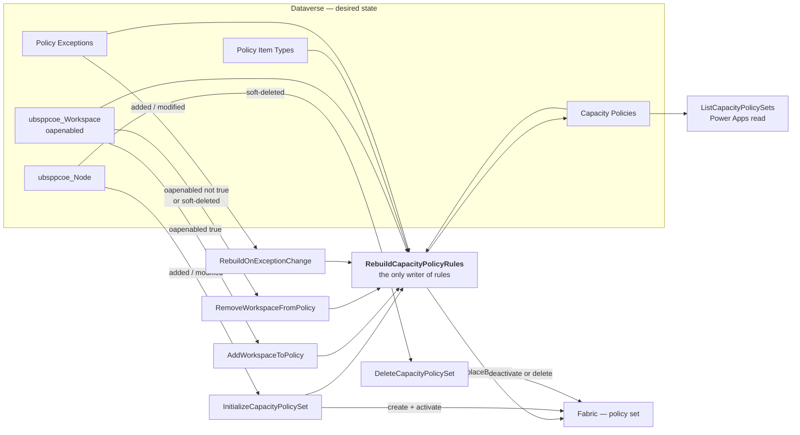

# Capacity policies — architecture

What this subsystem is, how it is built, and why each structural decision was taken.

**This is the entry point for anyone who has to reason about the system as a whole.** The other documents go deeper on one axis each: [CAPACITY-POLICY-FLOWS.md](CAPACITY-POLICY-FLOWS.md) on behaviour, [CAPACITY-POLICY-TABLES.md](CAPACITY-POLICY-TABLES.md) on schema, [SECURITY-AND-IDENTITY.md](SECURITY-AND-IDENTITY.md) on identity, [ADR.md](ADR.md) on the decision history.

> **This is not the workspace-settings app.** It shares the tenant, the Fabric REST conventions and the connectivity pattern of §4 — nothing else. No component, table, identity, publisher prefix or environment variable is common to both. That solution is documented in [`workspace-settings/`](../../workspace-settings).

---

## 1. What it governs

**Which Fabric item types can be created, in which workspaces, on which capacity.**

A capacity under this system is **closed by default**: nothing governed can be created on it until a workspace is explicitly whitelisted. Power BI items are not governed by `ItemCreation` policy and are unaffected throughout.

The estate is **200–300 F-SKU capacities** and roughly four thousand workspaces. Only F SKUs can host a policy set.

### The problem it replaces

Policy sets were published by PowerShell in the `ubs-policies` repository — `migrate_policy_sets.ps1` and its siblings — run by hand from a workstation against CSV files. That works for a one-off migration and fails as an operating model: the CSVs are not reachable from any governed process, the run is attributable to whoever happened to execute it, and nothing connects a change in the estate to a change in the published rules.

This subsystem keeps the scripts' **algorithm** exactly and moves the **inputs** into Dataverse and the **execution** into Power Automate.

> **Keeping the algorithm identical is a requirement, not a nicety.** The PowerShell remains the authority on chunk sizes, rule naming, sanitisation and route shapes. A flow that derives rules differently does not coexist with the scripts — it fights them, one rebuild at a time, and the last writer wins.

---

## 2. The model

### 2.1 One policy set per capacity, all in one workspace

| | |
|---|---|
| Policy type | `ItemCreation` |
| Granularity | **One policy set per capacity** |
| Where the item lives | A **single holder workspace**, the same one for the whole estate |
| What it is scoped to | The capacity it governs |
| Name | `pol_<capacityDisplayName>`, sanitised — `_` substituted for `\ / : * ? " < > \|`, trimmed, ≤256 characters |

A policy set is an ordinary Fabric **item**. That single fact decides most of the permission model in §4: creating and updating items needs Contributor on the workspace that holds them, and the holder workspace is the only workspace this solution has any rights on.

### 2.2 Three kinds of rule

| Rule | Conditions | What it does |
|---|---|---|
| **1 — deny all** | `workspace.id AnyOf [00000000-0000-0000-0000-000000000000]` | An `Allow` rule that can never match. Fabric has **no `Deny` effect**, so this is how "refuse everything not allowed below" is expressed. **Always emitted** |
| **2..n — whitelist** | `workspace.id AnyOf […]` **AND** `item.type AnyOf […]` | The listed workspaces may create the listed item types |
| **3 — exceptions** | `workspace.id AnyOf […]`, **no `item.type` condition** | The listed workspaces may create *anything*. **Supersedes** rule 2 rather than adding to it |

Workspaces are chunked **49 per rule**; the service ceiling is **50 rules per policy**. Rule display names are capped at **60 characters** by the service. Exceptions chunk the same way, with their own numbering.

The whitelist and the exception list are **independent**. Neither is cross-checked against the other, and a workspace may appear in either, both or neither.

> ### The invariant the whole design rests on
>
> **A policy with no rules is not an empty allow-list. It is an unenforced policy, and the capacity silently unlocks.**
>
> Every publish is a `replaceByPolicy` that overwrites the entire rule list, rule 1 included. So a capacity with zero whitelisted workspaces must still receive rule 1 on its own. Rule 1 is built as a hard-coded first element of the rules array — never as the output of a loop that happens to run at least once.
>
> This is the single most dangerous property in the system. Nothing downstream detects the failure: the call returns `200`, the row is stamped healthy, and the capacity is wide open.

### 2.3 Full rebuild, never a partial edit

**Nothing edits a live rule in place.** One writer flow regenerates every rule for one capacity in a single `replaceByPolicy` call, from whatever Dataverse says at that moment. Whatever was in Fabric is overwritten — including rules somebody added by hand in the portal.

That is what makes Dataverse the source of truth in practice rather than only in intent.

| | Incremental `PATCH` — rejected | Full rebuild — chosen |
|---|---|---|
| Concurrency | `PATCH` replaces the conditions array wholesale and the API has **no ETag or `If-Match`**. Two simultaneous adds, one silently lost | A row-level problem in Dataverse, which has optimistic concurrency |
| Chunking at 49 | Re-derived from partial information on every call | Recomputed from the full list every time, so it cannot drift |
| Rule names `(1/3)` | Go stale as rules come and go | Regenerated on every rebuild |
| Relationship to the PowerShell | Diverges | Identical algorithm |
| Auditability | The policy set is the only record | The table is queryable, and answers the app without calling Fabric |

The cost is a drift story, and it is real — see §8.

### 2.4 Membership is derived, never stored

A workspace is whitelisted because **`ubsppcoe_oapenabled` is `true` on its row** and its **`Node` lookup points at the capacity**. There is no junction table, and no flow in this solution writes either column.

`false` and null are treated identically: the workspace is in **no rule at all** — not an explicit deny, not an entry in rule 1 — and rule 1's deny-all is what refuses it.

> A `CapacityWorkspace` junction table was designed and **dropped**. It would have been a second copy of a list that is already mastered elsewhere, with a synchronisation problem attached.

---

## 3. Components

| Component | Count | Detail |
|---|---|---|
| Cloud flows | **11** | 7 BAU (including the app-facing read), 4 `MIG_` |
| Dataverse tables created | **3** | `Capacity Policies`, `Policy Item Types`, `Policy Exceptions` |
| Dataverse tables read, not owned | **3** | `ubsppcoe_Workspace`, `ubsppcoe_Node`, `Logging` |
| Environment variables | **7** | [DEPLOYMENT-ALM.md](DEPLOYMENT-ALM.md) §3 |
| Connection references | **3** | Fabric HTTP (preauthorized), Dataverse, Office 365 Outlook |
| Custom connectors | **0** | See §4.3 |
| Service principals | **0** | See §4.2 |
| Scheduled flows | **0** | See §8 |

**Publisher prefix is `ubsppcoe`** — the same as the platform team's, by decision. **So the prefix does not tell you who owns a table.** Ownership is stated by table name throughout this documentation set, and should be stated that way in anything written about it.

### 3.1 The flows

**No flow in this solution runs on a schedule.** Every trigger is a Dataverse row change, a manual start, or a Power Apps call.

#### BAU — seven

| Flow | Trigger | Purpose | Calls Fabric |
|---|---|---|---|
| [RebuildCapacityPolicyRules](../bau/RebuildCapacityPolicyRules.md) | Manual — child flow | **The only writer of rules.** Rebuilds one capacity from the tables | Yes |
| [InitializeCapacityPolicySet](../bau/InitializeCapacityPolicySet.md) | `ubsppcoe_Node` added/modified | Creates, registers, builds and **activates** a new capacity's policy set | Yes |
| [AddWorkspaceToPolicy](../bau/AddWorkspaceToPolicy.md) | `ubsppcoe_Workspace`, `oapenabled eq true` | Publishes a workspace becoming whitelisted | Via the child |
| [RemoveWorkspaceFromPolicy](../bau/RemoveWorkspaceFromPolicy.md) | `ubsppcoe_Workspace`, `oapenabled ne true` or soft-deleted | Publishes a workspace losing its whitelist | Via the child |
| [RebuildOnExceptionChange](../bau/RebuildOnExceptionChange.md) | `Policy Exceptions` added/modified | Publishes an exception being granted or revoked | Via the child |
| [DeleteCapacityPolicySet](../bau/DeleteCapacityPolicySet.md) | `ubsppcoe_Node` soft-deleted | Stands down a retired capacity's policy set. **The only flow that removes enforcement** | Yes |
| [ListCapacityPolicySets](../helper/ListCapacityPolicySets.md) | Power Apps (V2) | What the app reads. One table read | **No** |

**Add and Remove write nothing.** They are read-only validators that resolve the named workspace, decide whether it is genuinely in or out, call the child, and report on *the workspace the caller named* — which a bare refresh could not do honestly.

#### Migration — four

Run by hand during cutover. Three are deleted afterwards; `MIG_RebuildAllCapacityPolicies` is **kept, switched off**, as the only estate-wide repair tool.

| Flow | Purpose |
|---|---|
| [MIG_RegisterAllCapacityPolicySets](../migration/MIG_RegisterAllCapacityPolicySets.md) | Walks `GET /v1/capacities`, registers each |
| [MIG_InitializeCapacityPolicySet](../migration/MIG_InitializeCapacityPolicySet.md) | The child it calls. **Unsafe standalone** — no eligibility check |
| [MIG_RebuildAllCapacityPolicies](../migration/MIG_RebuildAllCapacityPolicies.md) | Rebuilds the whole estate in one pass |
| [MIG_ActivateAllCapacityPolicySets](../migration/MIG_ActivateAllCapacityPolicySets.md) | Puts deny-all into force. Has a `Report` dry-run mode |

### 3.2 The tables

| Table | Owner | Access | Holds |
|---|---|---|---|
| `ubsppcoe_Workspace` | Platform team | **Read only. Never written, without exception** | The workspace inventory, the `Node` lookup, and `ubsppcoe_oapenabled` |
| `ubsppcoe_Node` | Platform team | **Read only. Never written, without exception** | The capacity inventory |
| `Logging` | Platform team | **Insert only.** Never read, never updated | One row per caught failure: category, flow name, run URL |
| [`Capacity Policies`](CAPACITY-POLICY-TABLES.md) | This project | Read and written | Policy set id, status, last rebuild, last error, cached counts, `node` lookup |
| [`Policy Item Types`](../input/PolicyItemTypes.csv) | This project | Read by the rebuild | The governed item types. Maintained by hand |
| [`Policy Exceptions`](../input/PolicyExceptions.csv) | This project | Read by the rebuild | Workspaces granted unrestricted creation. Maintained by hand |

> **Both Fabric GUID columns are separate from their row keys, and one pair is named the wrong way round.** On `ubsppcoe_Node` the row key is `ubsppcoe_nodeid` and the capacity GUID is in `ubsppcoe_nodeuniqueid`. On `ubsppcoe_Workspace` the row key is `ubsppcoe_workspaceuniqueid` and the Fabric workspace GUID is in `ubsppcoe_workspaceid` — which looks like a row key and is not.
>
> Publishing a row key into `predicate.values` would be accepted by Fabric as a well-formed GUID and then match nothing, denying a whole capacity with no error anywhere. [CAPACITY-POLICY-TABLES.md](CAPACITY-POLICY-TABLES.md) is authoritative on every name.

---

## 4. Connectivity and identity

**This section is the convention for the whole subsystem. It is stated once here and referred back to from the flow documents.**

### 4.1 Every HTTP call goes through the preauthorized connector

| | |
|---|---|
| Connector | **HTTP with Microsoft Entra ID (preauthorized)** |
| Action | *Invoke an HTTP request* |
| Base Resource URL | `https://api.fabric.microsoft.com` |
| Entra ID Resource URI (Application ID URI) | `https://api.fabric.microsoft.com` |
| Used by | **Every Fabric call in the solution, without exception** |

The connector attaches the bearer token itself.

> **There is no token flow, no client secret, and no `Authorization` header anywhere in this design.**
>
> Never add one to a Fabric action. The connector supplies it; a hand-written header is either ignored or breaks the call. There is no `accessToken` variable to reference, in any flow.

The plain `HTTP` action is **not** used. Neither is the `GetPolicyToken` child flow that earlier drafts specified — it was never built, and [discarded/GetPolicyToken.md](../discarded/GetPolicyToken.md) records why.

What that buys, and what it costs:

| Gained | Given up |
|---|---|
| No secret to store, rotate, or leak into run history | The identity is no longer one we configure per flow — it is **whatever the connection signed in as** |
| No expiry to monitor on a credential we hold | A new failure mode: the connection itself lapsing (§4.4) |
| No token flow to build, test, and keep in step with its callers | Nothing in the run history names the connection when it does |
| No token ever reaches the run history, so no Secure Inputs/Outputs to set | — |

### 4.2 The connection signs in as an account, and that account is the whole identity model

**The connection is created by signing in as the `workspace provisioning` service account.**

| | |
|---|---|
| Type | **A user account** — email and password |
| Used for | **Every** connection: Fabric, Dataverse, and the migration mail |
| Not used | No service principal. No Entra app registration. No client ID, no client secret |

It is a service account rather than a named person deliberately: the estate-wide rebuild runs against 200–300 capacities, and tying that to an individual makes the subsystem one leaver away from stopping.

> ### Because the connection is an account sign-in, every call is **delegated**
>
> The account acts as itself, with the permissions it personally holds. Everything below follows from that:
>
> - **No app registration, no client ID, no client secret** to manage or rotate
> - **No application API permissions** and no admin consent to obtain
> - **The tenant setting *Service principals can call Fabric public APIs* is irrelevant** — nothing here is a service principal. The same is true of every Admin API setting; nothing here calls `/v1/admin/*`
> - Every Fabric role is granted **directly to the account**

Two roles, and they are the complete list:

| Role | Scope | Why |
|---|---|---|
| **Contributor** (or Admin) | The **holder workspace** — one workspace | A policy set is a Fabric item. Creating and updating items needs this on the workspace that holds them |
| **Capacity Admin** | **Every managed capacity** | Required to activate a policy set on that capacity, and to see the capacity in `GET /v1/capacities` |

**No permission at all on the workspaces being governed** — not Contributor, not Viewer, on any of the thousands of workspaces whose access this subsystem controls. Whitelisted workspaces are never touched as resources; they are **string values inside `predicate.values`**. Every write path is `/v1/workspaces/{holderWorkspace}/policySets/…`, and the only workspace in that path is the holder.

> **The sting that follows: workspace GUIDs are never validated.** Fabric accepts any well-formed GUID. A typo, a deleted workspace, even a workspace from another tenant is stored happily and simply never matches. Nothing fails, no error appears anywhere, and the owner is left with a policy that looks correct and denies them.
>
> Nothing in these flows can fix it — the GUIDs come from `ubsppcoe_Workspace`, which this project never writes. **Validation has to happen where the row is created.**

### 4.3 Why there is no custom connector here

A custom connector exists in this tenant — `gateway_lst_app_con`, built for the workspace-settings app and documented in [`docs/CUSTOM-CONNECTOR.md`](../../docs/CUSTOM-CONNECTOR.md). **It is not used by this subsystem, and nothing here should start using it.**

The division is the same one in both solutions, and it is worth stating plainly because the two mechanisms are easy to conflate:

| | HTTP with Entra ID (preauthorized) | Custom connector |
|---|---|---|
| Runs as | **The account the connection signed in as** — fixed, the same for every run | **The signed-in end user**, `runtimeSource: invoker` — different on every run |
| Use it when | The answer must not depend on who clicked the button | The answer **depends on who is asking**, and must reflect that user's own permissions |
| Needs an app registration | No | Yes — with explicit delegated scopes and a redirect URL |
| In this subsystem | **Every call** | **None** |

**Nothing in capacity policies is user-specific.** A capacity's rule list is the same regardless of who triggered the rebuild, and the triggers are mostly row changes with no interactive user at all. The one app-facing flow, `ListCapacityPolicySets`, answers from the `Capacity Policies` table and makes no Fabric call whatsoever.

> **If a requirement ever arrives that genuinely depends on the caller's own Fabric permissions, a custom connector is the mechanism — not a second preauthorized connection.** Widening the service account's rights to simulate the user is the wrong fix and the one that will be reached for first.

### 4.4 What breaks an account connection

A delegated connection has failure modes an application identity does not, and **all of them present identically: `401` on every capacity at once.**

| Cause | Note |
|---|---|
| **Password rotated or expired** | The connection does not follow a password change. It must be re-authenticated by hand |
| **MFA enforced on the account** | An interactive prompt cannot be answered by a running flow |
| **Conditional Access applied to the account** | Location, device or compliance rules will block the sign-in |
| **Account disabled** | Service accounts do get caught in joiner-mover-leaver reviews |
| **Licence removed** | A connector connection needs the account to remain licensed |

> **Exclude this account from interactive-MFA and password-expiry policies, or the subsystem stops on a schedule nobody set.** That is a security decision for whoever owns the account, and it should be a deliberate one.
>
> **The run history never says "the connection is the problem".** If an estate-wide run fails wholesale, suspect the account before suspecting Fabric, and before suspecting the data.

A second consequence of the same scoping: **`GET /v1/capacities` returns only what the account administers.** A capacity it is not Capacity Admin on is simply *absent* — indistinguishable from a capacity that does not exist. The flows report `Skipped`, and the capacity is silently ungoverned. **Capacity Admin must be granted on every new capacity as it is provisioned.**

[SECURITY-AND-IDENTITY.md](SECURITY-AND-IDENTITY.md) is authoritative on all of §4, and carries the Dataverse privileges and trigger-scope requirements as well.

---

## 5. The Fabric API surface

Six distinct calls. Everything else in the solution is Dataverse.

| Call | Used by | Note |
|---|---|---|
| `GET /v1/capacities` | Initialize, Delete, `MIG_Register` | Scoped to the account. **Absent ≠ does not exist** |
| `POST /v1/workspaces/{holder}/policySets` | Initialize | Creates the item. May return `202` |
| `POST …/policySets/{id}/policyRules/replaceByPolicy` | Rebuild | **The only rule write in the system** |
| `POST …/policySets/{id}/activate` | Initialize, `MIG_Activate` | Needs Capacity Admin on the target capacity |
| `POST …/policySets/{id}/deactivate` | Delete | **`404 Capacity not found`** once the capacity is gone — the endpoint resolves the activation scope first |
| `DELETE …/policySets/{id}` | Delete | Works even when the capacity is already deprovisioned |
| `GET /v1/operations/{id}` and `/result` | Initialize | The `202` long-running-operation poll |

> **The API's URL changes twice, in opposite directions.** It becomes beta at public preview — every call needs `?beta=true` — and reverts at GA. Both transitions are a single toggle of the `ubsppcoe_PolicyApiBeta` environment variable, read by **six call sites across four flows**, rather than six flow edits. **A toggle pointing the wrong way fails at Fabric, per capacity, naming nothing.** Full procedure in [API-BETA-SWITCH.md](API-BETA-SWITCH.md).

---

## 6. Boundaries

What this subsystem **never** does, stated as rules because each one has a failure mode behind it.

| # | Boundary | Why |
|---|---|---|
| 1 | **Never writes `ubsppcoe_Workspace` or `ubsppcoe_Node`** — no column, no exception | `ubsppcoe_oapenabled` is the platform team's flag for OAP settings and the wider Fabric treatment. Capacity policy is a **downstream consumer** of it. State this by table name, never as a rule about the `ubsppcoe_` prefix — since the prefix was shared, that sentence is also true of tables written on every rebuild |
| 2 | **Never reads `Logging` back** | Insert-only. Nothing filters it, nothing reads a row |
| 3 | **Never deletes a Dataverse row** | A retired capacity's row is updated to `Deleted`, never removed |
| 4 | **Never calls `/v1/admin/*`** | Those are tenant-scope operations needing Fabric Administrator. Nothing here needs them, and nothing should acquire that role |
| 5 | **Never touches a governed workspace as a resource** | They are data in a rule. §4.2 |
| 6 | **Never logs error text to `Logging`** | There is no message column and one cannot be added. Diagnosis lands in `ubsppcoe_lasterror` on `Capacity Policies` |
| 7 | **Never writes raw `result()` output anywhere** | Each entry carries the failed action's `inputs` and `outputs` verbatim. Extract `name`, `code` and `error.message` only |

---

## 7. Deployment shape

| Travels with the solution | Does **not** travel |
|---|---|
| Flow definitions | **Environment variable *values*** |
| Table and column schema | **Connections** — created and authorised per environment, by signing in as the account |
| Environment variable *definitions* | Table **data** — both hand-maintained tables need seeding |
| Connection *references* | The holder workspace, and the Fabric roles on it |

**The two that catch people are environment variable values and connections.** A solution imports cleanly with neither, and the flows then fail at runtime — a blank variable builds a URL with a missing segment rather than erroring.

**The solution cannot be exported from the customer environment**, so there is no flow JSON in this repository and no automated pipeline. **The flow documents are the specification** — they are what a rebuild would be done from, and a flow edited without updating its document leaves the two out of step with nothing to detect it.

Procedure in [DEPLOYMENT-RUNBOOK.md](DEPLOYMENT-RUNBOOK.md); contents and ALM in [DEPLOYMENT-ALM.md](DEPLOYMENT-ALM.md).

---

## 8. Convergence, and what it does not cover

**Nothing converges the estate on its own.** There is no scheduled flow in this solution — that was decided, not overlooked. The per-event BAU flows publish their own change and nothing else.

**Five cases fire no Dataverse event at all** and persist until somebody runs `MIG_RebuildAllCapacityPolicies` by hand:

1. A `Failed` run of any event flow that nobody acted on — nothing retries
2. A workspace **moved** between capacities — the flag does not change, so neither Add nor Remove fires
3. A `Policy Exceptions` row **hard-deleted** instead of deactivated
4. A `Policy Item Types` edit
5. Any rule **edited by hand** in the Fabric portal

> **Deactivate an exception, never delete it.** A deleted row cannot be read, so the capacity cannot be derived and nothing publishes the change — the workspace keeps unrestricted creation indefinitely.

> ### The gap the rebuild cannot close
>
> **A policy set that is not in force still reports healthy.** If someone deactivates ours or activates a replacement, the rebuild writes its rules to the dead set, returns `200`, stamps `lastrebuild` and leaves `lasterror` empty. Every signal says the capacity is governed.
>
> Running the estate-wide rebuild does not detect this; it is one of the things the rebuild is blind to. The only check that catches it is a person looking at the holder workspace — **one active policy set per capacity, and it is ours.** That obligation is A2 in [HANDOVER-REGISTER.md](HANDOVER-REGISTER.md), and at the time of writing it has **no owner and no agreed cadence.**

**A new capacity is born locked.** `InitializeCapacityPolicySet` activates deny-all immediately, and a brand-new capacity has no whitelisted workspaces. Whoever provisions it must say so on screen, or the first user files a bug and somebody "fixes" it by deactivating the policy set.

---

## 9. Where to go next

| For | Read |
|---|---|
| How each flow behaves, step by step | [CAPACITY-POLICY-FLOWS.md](CAPACITY-POLICY-FLOWS.md), then the flow's own document |
| Every column, type and logical name | [CAPACITY-POLICY-TABLES.md](CAPACITY-POLICY-TABLES.md) |
| Permissions, connections, failure modes | [SECURITY-AND-IDENTITY.md](SECURITY-AND-IDENTITY.md) |
| Why any of this is the way it is | [ADR.md](ADR.md) — the Q1–Q53 decision log |
| Obligations, dependencies, accepted risks | [HANDOVER-REGISTER.md](HANDOVER-REGISTER.md) |
| Standing it up somewhere new | [DEPLOYMENT-RUNBOOK.md](DEPLOYMENT-RUNBOOK.md), then [DEPLOYMENT-ALM.md](DEPLOYMENT-ALM.md) |
| Running the cutover | [CAPACITY-POLICY-MIGRATION-RUNBOOK.md](CAPACITY-POLICY-MIGRATION-RUNBOOK.md) |
| Responding to a change in the estate | [CAPACITY-POLICY-OPERATIONS-RUNBOOK.md](CAPACITY-POLICY-OPERATIONS-RUNBOOK.md) |
| Something is broken | [TROUBLESHOOTING.md](TROUBLESHOOTING.md) |
| Platform behaviour that cost time to discover | [PLATFORM-FINDINGS.md](PLATFORM-FINDINGS.md) |
