# Fabric Capacity Policies - Architecture

## Scope of this document

This document describes the architecture of the **Fabric Capacity Policies** solution - a set of Power Automate cloud flows that govern **which Fabric item types may be created, in which workspaces, on which capacity**. It does so by publishing capacity-scoped `ItemCreation` policy sets to Microsoft Fabric from desired state held in Dataverse.

---

## Contents

1. The problem
2. Solution overview
   - 2.1 What a Fabric policy is, and what it does
   - 2.2 What a policy set contains here - three rules
   - 2.3 Keeping every capacity current - triggers on Dataverse rows
   - 2.4 What the solution delivers
   - 2.5 What the solution is deliberately not responsible for
3. The Power Platform solution
   - 3.1 What the solution contains
   - 3.2 Cloud flows
   - 3.3 Tables
   - 3.4 Environment variables
   - 3.5 Connection references
4. What each flow does
   - 4.1 Fabric Pol - InitializeCapacityPolicySet
   - 4.2 Fabric Pol - DeleteCapacityPolicySet
   - 4.3 Fabric Pol - AddWorkspaceToPolicy
   - 4.4 Fabric Pol - RemoveWorkspaceFromPolicy
   - 4.5 Fabric Pol - RebuildOnExceptionChange
   - 4.6 Fabric Pol - RebuildCapacityPolicyRules
   - 4.7 Fabric Pol - ListCapacityPolicySets
5. Migration flows - the one-off cutover
   - 5.1 Fabric Pol - MIG_RegisterAllCapacityPolicySets
   - 5.2 Fabric Pol - MIG_InitializeCapacityPolicySet
   - 5.3 Fabric Pol - MIG_RebuildAllCapacityPolicies
   - 5.4 Fabric Pol - MIG_ActivateAllCapacityPolicySets
6. Identity and security
   - 6.1 One identity runs everything - the `workspace provisioning` service account
   - 6.2 Fabric permissions
   - 6.3 Dataverse permissions
   - 6.4 People and the access they need
   - 6.5 What the solution writes, and what it never logs
   - 6.6 The largest operational risk - the account itself
7. Data model and ownership
   - 7.1 Six tables, two owners
   - 7.2 Who reads and who writes
   - 7.3 Membership is derived, never stored
   - 7.4 The names that cause the most mistakes
   - 7.5 What reading another team's tables costs
   - 7.6 Fail closed - in the direction that cannot widen access
8. Fabric REST API integration
   - 8.1 How every call is made
   - 8.2 The calls the solution makes
   - 8.3 Request bodies - what is actually required
   - 8.4 Behaviours the design depends on
   - 8.5 Limits
   - 8.6 The release-stage switch - `PolicyApiBeta`
- Appendix A. Glossary

This document is accompanied by three others: the *Deployment guide*, for deploying the solution to an environment; the *Migration guide*, for running the one-off cutover; and the *Error handling and monitoring* guide, for how failures are handled, where to look and what to check routinely.

---

## 1. The problem

### We need to control what users can create

Out of the box, anyone with Contributor on a Fabric workspace can create **any item type** the workspace's capacity supports - lakehouses, warehouses, notebooks, pipelines, eventhouses and the rest. The platform needs the opposite posture: only workspaces that are Outbound Access Protected may create the governed Fabric item types, and every other workspace should be able to create only Power BI items.

### Policies provide the control, but only per capacity

Fabric's mechanism for this is the **`ItemCreation` policy set** - a Fabric item that holds a list of allow and deny rules and is activated against **one capacity**. There is no tenant-wide or workspace-level equivalent: a policy set governs exactly the capacity it is activated on, and a capacity can have only one active at a time.

The estate runs on **200-300 Fabric capacities** hosting thousands of workspaces. Governing item creation therefore means **creating, populating and activating more than 200 policy sets - one per capacity** - and keeping each one current as workspaces are created, approved, moved between capacities and retired, and as capacities themselves come and go. The policy API is also still in preview.

### Doing that by hand is neither efficient nor secure

| | Why manual management fails |
|---|---|
| **Not efficient** | Every approval, revocation, workspace move or new capacity means finding the right policy set and editing its rules by hand. At 200+ capacities and thousands of workspaces, the change rate alone makes that a standing job, and nothing changes until somebody gets to it |
| **Not secure** | Manual edits drift from the record of which workspaces are actually approved, so access is granted that nobody approved, or kept after it should have been revoked. The API offers no locking: `PATCH` on a rule replaces its whole `conditions` array with no ETag, so two concurrent edits silently lose one of them. A capacity whose policy set was never created, or never activated, stays open with nothing reporting it |
| **Not auditable** | Rules edited one at a time have no single source of truth to compare against, so there is no reliable way to answer *who is allowed to create what, and why* |

### What is required

The requirement is therefore to make the platform team's **existing inventory** the source of truth for item-creation policy, to publish it to Fabric as that inventory changes, and to do so **without this project ever writing the inventory**.

---

## 2. Solution overview

### 2.1 What a Fabric policy is, and what it does

**A Fabric policy is a centrally defined set of governance rules that Fabric evaluates whenever somebody attempts a governed action, and the outcome is that the action is allowed or blocked.** A policy is itself a Fabric item, held in a workspace, fixed at creation to one **admin scope** - Tenant or Capacity - and inert until it is **activated**, after which only one policy can be active per scope.

Fabric evaluates an attempted action in a fixed order: it resolves the admin scope, loads the active policy for that scope, and tests the action against the policy's rules. **If a rule matches, the action is allowed. If rules exist and none matches, the action is blocked.** If the policy has no rules at all, Fabric applies the policy default instead - which is why an empty policy is not a closed one.

Three properties of that model shape the whole solution:

| Fabric's rule | What it forces on us |
|---|---|
| **Scope is chosen at creation and cannot be changed, and only one policy may be active per scope** | Governing item creation across the estate means **one policy set per capacity** - more than 200 of them, each activated separately |
| **A rule is a set of conditions ANDed together plus an effect, and the only effect is `Allow`** | There is nothing to deny with. "Closed by default" has to be built out of Allow rules (2.2) |
| **Rules do nothing until the policy is activated, and activation cannot be done through Git** | Creating and filling a policy set is not enough - the solution has to activate it as well |

This solution uses exactly one policy type - **`ItemCreation`**, at **Capacity** scope - which governs *which item types may be created in which workspaces*. Power BI items fall outside it entirely and are never affected.

### 2.2 What a policy set contains here - three rules


Each governed capacity gets one policy set, and every policy set is built from the same three rules. The capacity starts closed, and each rule opens it a step further for a narrower group of workspaces:

| Rule | Who it is for | What it allows |
|---|---|---|
| **Rule 1 - Deny all, Power BI only** | **Every workspace on the capacity** - in practice, the **non-OAP workspaces**, which should hold Power BI content only | **Power BI items and nothing else.** Every Fabric item type is blocked. Power BI items stay available because the `ItemCreation` policy does not track them at all. Always present |
| **Rule 2 - OAP workspaces, approved item types** | **OAP-enabled workspaces**, as marked in the platform team's inventory | **A specific list of Fabric item types** - lakehouses, warehouses, notebooks, pipelines and so on - on top of Power BI. Both conditions must hold: the workspace is OAP-enabled *and* the item is on the approved list, which is kept in a table |
| **Rule 3 - Exceptions, allow all** | **A short, owned list of exception workspaces** | **Any item type at all.** The rule has no item-type condition, and an unspecified condition matches everything. Present only when there are active exceptions |

Rules 2 and 3 can each hold up to 49 workspaces, so a large capacity carries several copies of them.

Four consequences are worth stating plainly, because each is a way the design can be got wrong:

- **Rule 1 is how "deny" is built.** Fabric has no `Deny` effect, so rule 1 is an `Allow` rule whose condition can never match - a sentinel workspace GUID that does not exist. Its job is to keep the policy non-empty: **a policy with no rules is not enforced**, and the capacity silently opens. Every publish therefore emits rule 1 first, unconditionally.
- **A capacity with only rule 1 is correct, not broken.** It is a Power BI-only capacity with no OAP workspace yet.
- **An exception supersedes rule 2 rather than adding to it.** Every rule is an `Allow` and Fabric ORs them, so a workspace in both lists is simply unrestricted - there is no precedence to implement.
- **Rules are a budget.** Capacity scope allows **50** rules, and the list costs `1 + ceil(OAP / 49) + ceil(exceptions / 49)` - about 2,400 OAP workspaces before a capacity runs out of room.

### 2.3 Keeping every capacity current - triggers on Dataverse rows

**Every change this solution makes begins as a row written in Dataverse, and nothing else starts anything.** There is no user interface, no schedule and no queue for somebody to work. The platform team already maintains the estate's inventory - which capacities exist, which workspaces sit on each of them, and which workspaces are approved - and those rows *are* the input. They are written for their own reasons, by people who need not know this solution exists.

Adding or changing one of those rows wakes an automation that:

1. **Derives the affected capacity** from the row. A row that affects no governed capacity stops there.
2. **Checks that the change means what it appears to mean**, and refuses rather than publishing a guess if the desired state cannot be read with confidence.
3. **Reads the complete desired state for that capacity** and builds its whole rule list from scratch.
4. **Replaces every rule on that capacity's policy set in one call**, and records the outcome.

Two paths follow from that one mechanism, and they differ only in whether the policy set already exists:

| | **Creating policy for a new capacity** | **Updating policy as the estate changes** |
|---|---|---|
| **What happened in Dataverse** | A capacity row appeared in the inventory | A workspace was approved or revoked, moved capacity, or an exception was granted or withdrawn |
| **What the automation does** | Creates a policy set for it, builds its rules, and activates it against the capacity | Rebuilds the affected capacity's rule list from the current desired state and replaces what was there |
| **Where it leaves the capacity** | **Born locked** - no workspace is OAP-enabled yet, so rule 1 stands alone and the capacity is Power BI-only | Enforcing exactly what the inventory now says, within minutes |

Three properties make that safe to run unattended:

- **It is reactive, not scheduled.** A change publishes within minutes of the row being saved - there is no sweep to wait for and nothing to catch up on.
- **It is idempotent.** The same desired state always produces the same rule list, so repeated or overlapping rebuilds converge rather than conflict.
- **It fails closed.** A run that cannot resolve the desired state publishes nothing at all, rather than an empty list that would lock a capacity on somebody else's data-entry error.

> **Dataverse holds the desired state; Fabric holds nothing that is not rebuilt from it.** Every publish is a full rebuild, never a partial edit, so whatever was in Fabric is overwritten - hand-made edits included. Which workspaces are approved is read from the inventory at rebuild time and never stored or written back. That is what makes Dataverse the source of truth in practice rather than only in intent.

### 2.4 What the solution delivers

| Capability | What it means |
|---|---|
| **Closed-by-default capacities** | Every governed capacity carries rule 1, so it is Power BI-only unless a later rule opens it further |
| **A derived OAP list** | A workspace may create the approved Fabric item types on its capacity when the platform team's inventory marks it OAP-enabled. Nothing in this solution decides that |
| **Exceptions** | A short, owned and reviewable list of workspaces allowed to create *any* item type, on whichever capacity they sit on |
| **Approved item types in data** | The list of Fabric item types rule 2 allows is a table, so approving a new type is a row and a rebuild, not a code change |
| **Capacity lifecycle** | A capacity appearing in the inventory gets a policy set created, built and activated. |
| **Visibility** | Every governed capacity's policy set, rule counts and last rebuild can be read without calling Fabric |
| **Estate-wide repair** | A single manual run rebuilds every capacity from Dataverse, overwriting anything changed by hand in Fabric |

### 2.5 What the solution is deliberately not responsible for

Each of these was a considered decision rather than an omission:

| Not in scope | Who owns it instead |
|---|---|
| **Deciding which workspaces are approved** | The platform team, in their inventory. This solution publishes that decision; it never makes it |
| **Populating or correcting the inventory** | The platform team. A wrong workspace GUID, a missing row or a stale capacity assignment is a request to them, not a local fix |
| **Validating workspace GUIDs** | Wherever the inventory row is created. Fabric accepts any well-formed GUID and silently never matches a wrong one |
| **Creating capacities, or granting the rights to administer them** | Capacity provisioning. A capacity this solution cannot administer is invisible to it |
| **Telling a capacity owner that a new capacity is locked** | The provisioning process. A policy set activates with nobody deciding |
| **Governing Power BI items** | Nobody - `ItemCreation` policy does not cover them |
| **Scheduled convergence or drift detection** | Nobody, by decision. Nothing in the solution runs on a schedule |
| **Emergency unlock at scale** | An operator procedure that sits outside this solution |

---

## 3. The Power Platform solution

### 3.1 What the solution contains

The capacity-policy components are split across two solutions in the same environment:

- **UBS Workspace Provisioning**, publisher prefix **`ubsppcoe`**, holds the flows, environment variables and connection references.
- **Common Data Services Default Solution** holds **every table** - the three created for capacity policies as well as the platform team's.

The tree below is how they appear in the maker portal, followed by what sits outside Power Platform.

```text
UBS Workspace Provisioning                                    publisher prefix: ubsppcoe
│
├── Cloud flows                                               every display name starts "Fabric Pol - "
│   ├── Event flows                                           triggered by a Dataverse row
│   │   ├── Fabric Pol - InitializeCapacityPolicySet          Node row added
│   │   ├── Fabric Pol - DeleteCapacityPolicySet              Node row soft-deleted
│   │   ├── Fabric Pol - AddWorkspaceToPolicy                 workspace becomes OAP-enabled
│   │   ├── Fabric Pol - RemoveWorkspaceFromPolicy            workspace loses OAP, or soft-deleted
│   │   └── Fabric Pol - RebuildOnExceptionChange             exception granted or withdrawn
│   ├── Child flow
│   │   └── Fabric Pol - RebuildCapacityPolicyRules           the only writer of rules
│   ├── Helper
│   │   └── Fabric Pol - ListCapacityPolicySets               read-only status, called by a Power App
│   └── Migration                                             one-off cutover - see the migration section
│       ├── Fabric Pol - MIG_RegisterAllCapacityPolicySets    deleted after cutover
│       ├── Fabric Pol - MIG_InitializeCapacityPolicySet      deleted after cutover
│       ├── Fabric Pol - MIG_ActivateAllCapacityPolicySets    deleted after cutover
│       └── Fabric Pol - MIG_RebuildAllCapacityPolicies       kept, switched off - estate-wide repair
│
├── Environment variables
│   ├── PolicyHolderWorkspaceId                               ubsppcoe_PolicyHolderWorkspaceId
│   ├── PolicySentinelWorkspaceId                             ubsppcoe_PolicySentinelWorkspaceId
│   ├── PolicyMaxWorkspacesPerRule                            ubsppcoe_PolicyMaxWorkspacesPerRule
│   ├── PolicyMaxRulesPerPolicy                               ubsppcoe_PolicyMaxRulesPerPolicy
│   ├── PolicyNamePrefix                                      ubsppcoe_PolicyNamePrefix
│   ├── PolicyApiBeta                                         ubsppcoe_PolicyApiBeta
│   └── PolicyMailRecipients                                  ubsppcoe_PolicyMailRecipients
│
└── Connection references
    ├── Fabric                                                HTTP with Microsoft Entra ID (preauthorized)
    ├── Dataverse                                             Microsoft Dataverse
    └── Outlook                                               Office 365 Outlook

Common Data Services Default Solution                         every table the flows use
│
├── Tables created for capacity policies
│   ├── Capacity Policies                                     ubsppcoe_CapacityPolicy
│   ├── Policy Item Types                                     ubsppcoe_PolicyItemType
│   └── Policy Exceptions                                     ubsppcoe_PolicyException
│
└── Platform team tables                                      owned by the platform team
    ├── ubsppcoe_Node                                         the capacity inventory
    ├── ubsppcoe_Workspace                                    the workspace inventory
    └── Logging                                               shared error log, insert only

Outside Power Platform
├── Fabric holder workspace                                   holds every policy set in the tenant
└── Seed data
    ├── Seed list of item types                               seed for Policy Item Types
    └── Exceptions list                                       seed for Policy Exceptions
```

**There is no custom connector.** Fabric is called through the built-in *HTTP with Microsoft Entra ID (preauthorized)* connector, signed in as the `workspace provisioning` service account, so there is no connector definition, app registration or client secret to deploy.

### 3.2 Cloud flows

Every flow's display name starts with **`Fabric Pol - `**, so the whole set sorts together in the maker portal and in run history.

| Flow | Started by | What it does |
|---|---|---|
| `Fabric Pol - InitializeCapacityPolicySet` | A row added to `ubsppcoe_Node` | Checks the capacity exists in Fabric and is an F SKU, creates its policy set in the holder workspace, registers it in `Capacity Policies`, builds the rules and activates the set. A new capacity starts Power BI-only |
| `Fabric Pol - DeleteCapacityPolicySet` | A `ubsppcoe_Node` row soft-deleted | Asks Fabric whether the capacity still exists. If it is gone, deletes the policy set; if it is still there, only deactivates it. **The only flow that removes enforcement** |
| `Fabric Pol - AddWorkspaceToPolicy` | A `ubsppcoe_Workspace` row becoming OAP-enabled | Confirms the workspace really is OAP-enabled on a governed capacity, then rebuilds that capacity. Refuses if the data does not add up |
| `Fabric Pol - RemoveWorkspaceFromPolicy` | A `ubsppcoe_Workspace` row losing OAP, or soft-deleted | Rebuilds the capacity without the workspace. Always rebuilds, and warns if the workspace still has access another way |
| `Fabric Pol - RebuildOnExceptionChange` | A `Policy Exceptions` row added, or its *Active* flag changed | Rebuilds the capacity the exception's workspace sits on. Reports when the exception matches no live workspace |
| `Fabric Pol - RebuildCapacityPolicyRules` | Called by the flows above | Reads the full desired state for one capacity, builds rules 1-3, checks the 50-rule ceiling and replaces every rule in Fabric in one call. Stamps the result on `Capacity Policies` |
| `Fabric Pol - ListCapacityPolicySets` | A Power App outside the solution | Returns every governed capacity's policy set, status, counts and last rebuild as one JSON string. Reads Dataverse only - never calls Fabric |
| `Fabric Pol - MIG_RebuildAllCapacityPolicies` | Manually | Rebuilds every registered capacity, one at a time, and mails a failure summary. Kept switched off after cutover as the estate-wide repair tool |
| `Fabric Pol - MIG_RegisterAllCapacityPolicySets`, `Fabric Pol - MIG_InitializeCapacityPolicySet`, `Fabric Pol - MIG_ActivateAllCapacityPolicySets` | Manually | The one-off cutover. Deleted once the estate was live |

### 3.3 Tables

All six tables live in the **Common Data Services Default Solution**, not in UBS Workspace Provisioning. **Exporting UBS Workspace Provisioning therefore carries no table with it**: a new environment needs the three capacity-policy tables created, or added to a solution that travels, before the flows will import and run.

| Table | Owner | What it holds |
|---|---|---|
| **Capacity Policies** | Capacity policies | One row per governed capacity: its policy set id, status, last rebuild, last error and cached counts. The presence of a row is what makes a capacity "governed" |
| **Policy Item Types** | Capacity policies | The Fabric item types rule 2 allows for OAP workspaces. Only *Active* rows are published. Seeded from the seed list of item types, then maintained by hand |
| **Policy Exceptions** | Capacity policies | The workspaces rule 3 allows to create anything, each with a reason and an approver. Seeded from the exceptions list, then maintained by hand. Revoke by deactivating, never by deleting |
| `ubsppcoe_Node` | Platform team | The capacity inventory. Its rows trigger policy set creation and retirement. **Read only** |
| `ubsppcoe_Workspace` | Platform team | The workspace inventory: which capacity each workspace sits on and whether it is OAP-enabled. **Read only** |
| `Logging` | Platform team | A shared error log. Flows insert a row when they fail and never read it back |

### 3.4 Environment variables

| Variable | Value | What it controls |
|---|---|---|
| `PolicyHolderWorkspaceId` | The holder workspace's GUID | Where policy sets are created and found |
| `PolicySentinelWorkspaceId` | `00000000-0000-0000-0000-000000000000` | The never-matching workspace in rule 1 |
| `PolicyMaxWorkspacesPerRule` | `49` | How many workspaces go into one copy of rule 2 or rule 3 |
| `PolicyMaxRulesPerPolicy` | `50` | The ceiling the rebuild checks before calling Fabric |
| `PolicyNamePrefix` | `pol_` | The policy set name, `pol_<capacity name>` |
| `PolicyApiBeta` | No | Switches the Fabric calls to the beta API route while the policy API is in public preview |
| `PolicyMailRecipients` | A mailbox, **different per environment** | Who receives the report mails from the `MIG_` flows |

**Set a Current Value as well as a Default Value.** Values do not reliably travel with a solution import, and a blank value fails silently rather than with an error.

### 3.5 Connection references

| Reference | Connector | Used for |
|---|---|---|
| **Fabric** | HTTP with Microsoft Entra ID (preauthorized) | Every Fabric REST call - listing capacities and creating, activating, rebuilding and deleting policy sets |
| **Dataverse** | Microsoft Dataverse | Every trigger, and every read and write of the tables above |
| **Outlook** | Office 365 Outlook | The report mails sent by the `MIG_` flows |

**All three connections are signed in as the `workspace provisioning` service account.** The references travel with the solution, but the connections behind them do not: in a new environment they must be created again and signed in as that account. If they are signed in as whoever imported the solution, the flows still run, but they run as that person.

---

## 4. What each flow does

Each flow gets a short explanation and one diagram drawn the way the flow looks in the Power Automate designer: every card is a real action under its renamed action name, the icon colour shows the connector, Conditions split into **True** and **False** branches, and dashed lines mark a non-default *run after* setting. To fit one A4 page, repeated actions are drawn as a stacked card (*Set variable × 3*), and self-contained blocks such as the Catch scope are shown **collapsed**, with a count of the actions inside. The *Step* tags number the actions in the order the flow runs them.
### 4.1 Fabric Pol - InitializeCapacityPolicySet

**Turns a new capacity row into a live, enforced policy set.** When the platform team adds a capacity to `ubsppcoe_Node`, this flow checks the capacity is new to us and governable by Fabric, creates its policy set in the holder workspace, registers it in `Capacity Policies`, has the child flow build its rules, and activates it. The capacity ends up **Power BI-only**, because it has no OAP workspaces yet.

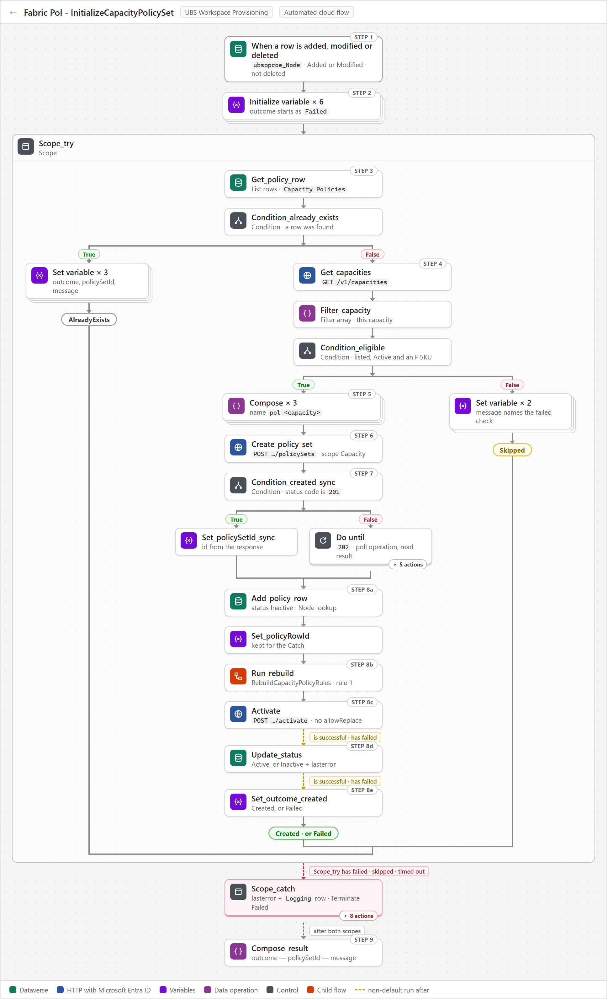

Three things to know when reading its run history:

- **Most runs end in `AlreadyExists` and do nothing.** Any edit to a Node row fires the trigger again, and that is expected.
- **`Skipped` is never retried.** If Fabric does not know the capacity yet when its row is created, and nobody touches the row afterwards, the capacity stays ungoverned and nothing reports it.
- **Activation happens with nobody deciding.** A new capacity locks to Power BI-only within minutes of its row appearing, so whoever provisions the capacity must tell its owner.

### 4.2 Fabric Pol - DeleteCapacityPolicySet

**Removes a capacity's governance when its inventory row is soft-deleted.** It runs when a `ubsppcoe_Node` row's `ubsppcoe_statecode` changes to `2` (Deleted). It looks up the matching `Capacity Policies` row and asks Fabric whether the capacity still exists. If Fabric no longer lists the capacity, the flow deletes the policy set and marks the row `Deleted`; if Fabric still has it, the flow only deactivates the policy set and marks the row `Suspended`, so the capacity ends up ungoverned with the item kept.

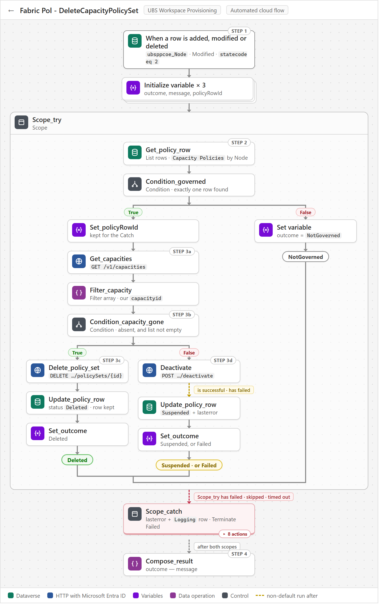

Three things to know when reading its run history:

- **Most runs end in `NotGoverned` and do nothing.** Every Node soft-delete in the tenant fires the flow, and most of those capacities were never governed, so there is no Fabric call.
- **`Suspended` is a green run that needs a human.** It means the inventory says the capacity is retired while Fabric says it is live, and nothing follows it up beyond the `ubsppcoe_lasterror` text.
- **`Failed` is the safe direction here.** It means deactivation failed, so the policy set is still enforcing on a retired capacity - and the run still ends green.

### 4.3 Fabric Pol - AddWorkspaceToPolicy

**Checks that a workspace really belongs on a governed capacity, then republishes that capacity's rules.** It runs when a `ubsppcoe_Workspace` row is OAP-enabled, assigned to a Node and Active. It finds the capacity through `Capacity Policies`, checks that the Node lookup leads back to the same Node, and if every check passes has `RebuildCapacityPolicyRules` rebuild that capacity's rules so the workspace is allowed on it. It reads Dataverse only, and writes nothing unless `Scope_catch` records an error in `ubsppcoe_lasterror` and `Logging`.

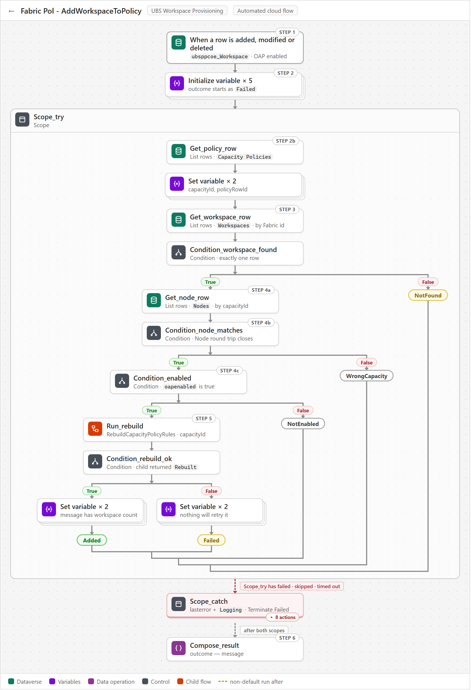

Three things to know when reading its run history:

- **`WrongCapacity` is the normal exit for an ungoverned capacity.** A capacity with no `Capacity Policies` row stops before the rebuild, and the run is green.
- **`Failed` is green, and nothing retries it.** The child flow has already written Fabric's error to `ubsppcoe_lasterror`, and the workspace stays out of Fabric's rules until the next successful rebuild.
- **Only `Caught` ends red, and its error text is only a pointer.** `ubsppcoe_lasterror` names the failed action and the run ID, so open that run to see the real error.

### 4.4 Fabric Pol - RemoveWorkspaceFromPolicy

**Republishes a capacity's rules when one of its workspaces stops qualifying for OAP.** It runs when a `ubsppcoe_Workspace` row has its OAP flag cleared or is soft-deleted. It finds the capacity from the row's Node in `Capacity Policies`, reads the workspace rows and `Policy Exceptions` to decide what to report, and whatever it finds has `RebuildCapacityPolicyRules` rebuild that capacity's rules, so Fabric ends up allowing only the workspaces that still qualify. It writes nothing to Dataverse unless an error is caught.

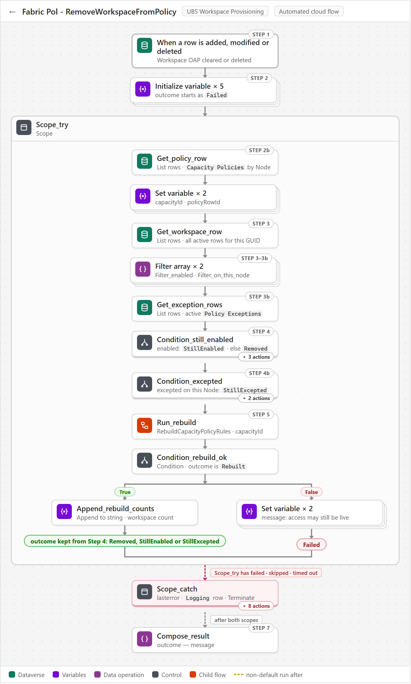

Three things to know when reading its run history:

- **A green run does not mean access was removed.** `StillEnabled` or `StillExcepted` in `Compose_result` means the workspace can still create items on this capacity, and nothing else reports it.
- **`Failed` also ends green.** The rebuild failed, access may still be live and nothing will retry it; only `Caught` ends the run red.
- **A workspace moving to another capacity never shows up here.** The OAP flag did not change, so the old capacity keeps the workspace until someone runs `MIG_RebuildAllCapacityPolicies`.

### 4.5 Fabric Pol - RebuildOnExceptionChange

**Puts an approved or revoked exception live in Fabric within minutes.** It runs when a `Policy Exceptions` row is added or its `ubsppcoe_active` flag changes. It finds the live workspace with that GUID, follows that workspace's Node to its row in `Capacity Policies`, and has `RebuildCapacityPolicyRules` rebuild that whole capacity, rule 3 included. It never writes to the exception table; the only things it writes are an error to `ubsppcoe_lasterror` and a `Logging` row, and only when an action fails.

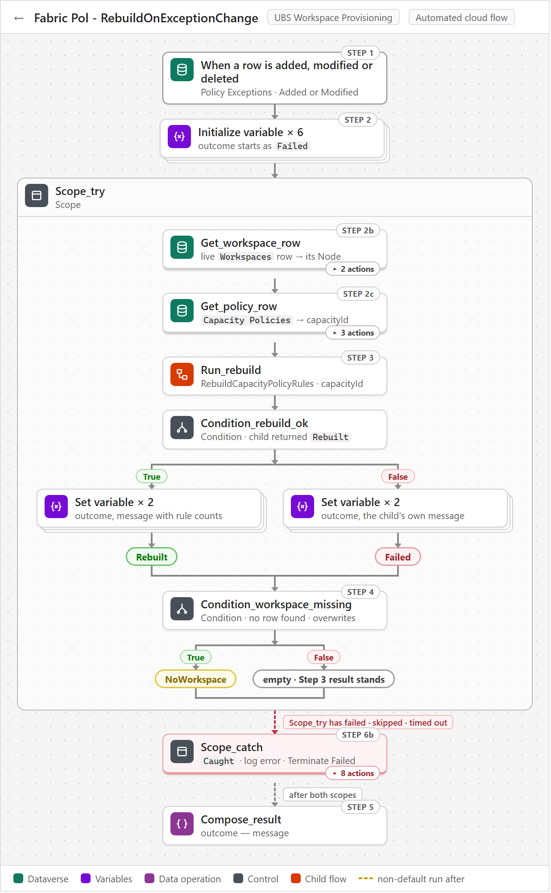

Three things to know when reading its run history:

- **`NoWorkspace` means a mistyped or deleted workspace, not a Fabric problem.** The exception looks approved but grants nothing, and the run still ends green, so check `ubsppcoe_workspaceid` on the row.
- **Two runs for one exception is normal.** A row created with Active = No and then switched on fires once for *Added* and once for *Modified*, and both runs rebuild.
- **Deleting an exception row does not fire the flow.** The workspace keeps its exception until somebody runs an estate-wide rebuild, so revoke by setting Active to No.

### 4.6 Fabric Pol - RebuildCapacityPolicyRules

**Rewrites every `ItemCreation` rule on one capacity's policy set from what Dataverse says today.** Every event flow calls it with a capacity id. It reads that capacity's `Capacity Policies` row, then three lists - the OAP-enabled workspaces under the capacity's Node, the active `Policy Item Types`, and the active `Policy Exceptions` workspaces on the same Node - and builds rule 1, rule 2 and rule 3 with up to 49 workspaces per rule. `Replace_rules` publishes them in one `replaceByPolicy` call, and the counts and any error are written back to the `Capacity Policies` row.

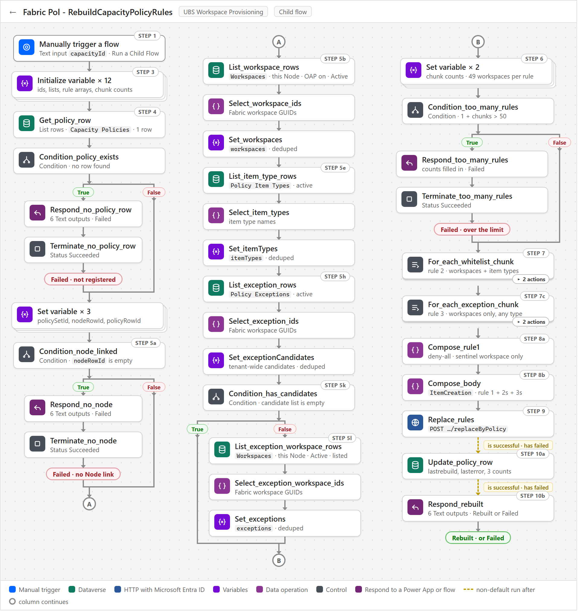

> The flow is one long straight line, so the diagram is drawn in three columns: **A** and **B** mark where each column continues.

Three things to know when reading its run history:

- **A run that says Succeeded can still be a failure.** The three guards - no registered policy set, no Node link, more than 50 rules - return `Outcome = Failed` and then stop with status Succeeded, so read `Outcome` and `Message` in the Respond action.
- **Rule 1 alone is a valid result.** A capacity with no OAP-enabled workspaces and no exceptions gets rule 1 only, but a blank Node link stops the run before anything is sent to Fabric.
- **A failed `Replace_rules` is recorded, not retried.** `Update_policy_row` and `Respond_rebuilt` run after success or failure, so the error lands in `ubsppcoe_lasterror`, and nothing tries again until another rebuild runs.

### 4.7 Fabric Pol - ListCapacityPolicySets

**Returns every governed capacity and the state of its policy set to the app, as one JSON string.** A Power App outside the solution calls it with no inputs whenever it needs the list. It reads `Capacity Policies` with one `List rows` sorted by capacity name, maps each row to ten text fields in `Select_rows`, and returns the array as a string in `PolicySetsJson`, together with `ErrorMessage`.

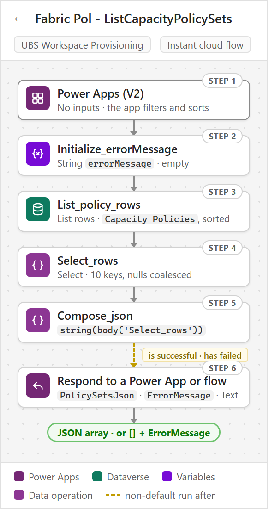

Three things to know when using it:

- **It never calls Fabric.** One Dataverse read and no joins keeps it inside the 120-second Power Apps limit at 200-300 capacities; an HTTP action, a child flow or a second `List rows` in its run history means something was added that should not be there.
- **The counts are as of the last rebuild, not live.** `workspaceCount`, `exceptionCount` and `ruleCount` are stamped on the row by `RebuildCapacityPolicyRules`, so the app must always show `lastRebuild` next to them.
- **An empty list is a real answer, so read `ErrorMessage`.** On failure `PolicySetsJson` is `[]` rather than blank, which looks the same as an empty table; only a populated `ErrorMessage` tells the two apart.

---

## 5. Migration flows - the one-off cutover

The existing estate was brought under the solution **once, by hand, in phases**, using four `MIG_` flows that are not part of business as usual: **register** every capacity (policy sets created, inactive, no rules), seed `Policy Exceptions`, **rebuild** every capacity's rules, review who is about to lose access, then **activate**. Everything before activation is inert - a policy set with rules but not activated changes nobody's access - so a wrong run is undone by deleting items and rows.

After cutover three of the four are deleted. `MIG_RebuildAllCapacityPolicies` is **kept, switched off**, as the only estate-wide repair tool.

### 5.1 Fabric Pol - MIG_RegisterAllCapacityPolicySets

**Registers every eligible Fabric capacity at cutover, leaving each policy set created but deactivated.** It is run by hand, once, in tranches, before anyone seeds `Policy Exceptions` or runs the rebuild. It reads `GET /v1/capacities`, keeps only Active F-SKU capacities, and calls `MIG_InitializeCapacityPolicySet` for each one, which creates the policy set and its `Capacity Policies` row. Every capacity ends up with an `Inactive` policy set and no rules, so nothing is enforced yet.

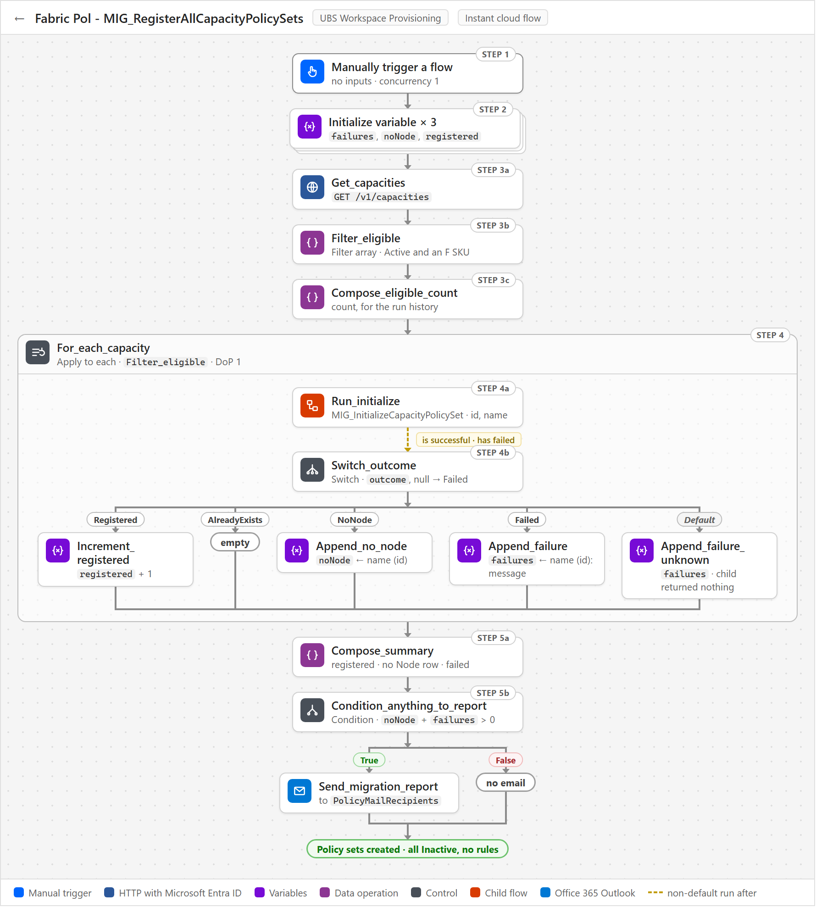

Three things to know when running it:

- **Check `Compose_eligible_count` before going further.** A count well below the estate means the `workspace provisioning` account is missing Capacity Admin, not that the data is wrong.
- **The `noNode` list goes to the platform team.** These capacities exist in Fabric but have no live `ubsppcoe_Node` row, so they get no policy set until someone adds a row.
- **Cancelling and re-running is safe.** Capacities already registered return `AlreadyExists` and are skipped, so each tranche picks up where the last one stopped.

### 5.2 Fabric Pol - MIG_InitializeCapacityPolicySet

**Creates one capacity's policy set in Fabric and registers it as `Inactive` - no rules, no activation.** `MIG_RegisterAllCapacityPolicySets` calls it once per Active F-SKU capacity, passing the capacity id and display name. It looks up the live `ubsppcoe_Node` row, creates the policy set in the holder workspace and adds a `Capacity Policies` row with status `Inactive`, leaving the capacity unenforced until the estate-wide rebuild and activation.

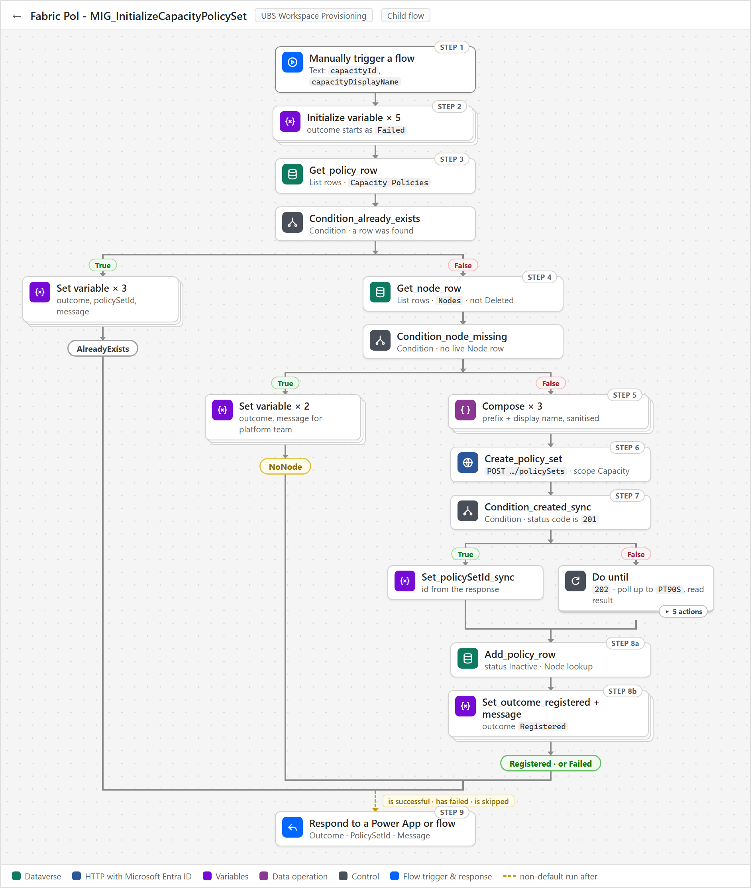

Three things to know when running it:

- **It is unsafe on its own.** It does not check whether the id is an Active F-SKU capacity, so only ever run it behind `MIG_RegisterAllCapacityPolicySets`, and delete it after cutover.
- **`AlreadyExists` makes the run restartable.** A capacity that is already registered is skipped, so a failed or partial run can simply be re-run, including in tranches.
- **`NoNode` and `Failed` are the deliverable.** `NoNode` is an inventory gap for the platform team, and `Failed` - usually a duplicate display name - carries the Fabric error in `Message`, because the Respond step also runs when earlier actions fail or are skipped.

### 5.3 Fabric Pol - MIG_RebuildAllCapacityPolicies

**Rebuilds the rules of every registered capacity from Dataverse in one run.** It was run once at cutover and is now kept switched off, for someone to run when the whole estate needs repairing. It reads every `Capacity Policies` row that has a policy set, oldest `ubsppcoe_lastrebuild` first, and has `RebuildCapacityPolicyRules` rebuild each capacity in turn. A capacity that rebuilds ends up with rules matching the tables; one that fails keeps the rules it had before the run.

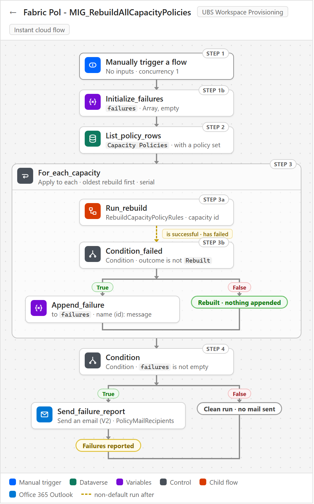

Three things to know when running it:

- **It is the only thing that applies out-of-band changes.** Hand-edited rules, a workspace moved between Nodes, or a hard-deleted `Policy Exceptions` row only reach Fabric when someone runs this flow.
- **A clean run sends nothing.** Mail goes to `PolicyMailRecipients` only when there are failures, so check `ubsppcoe_lastrebuild` on the table to confirm the run finished.
- **Success does not mean the set is in force.** If our policy set has been deactivated and another one is active, the rules are still rebuilt and reported as fine, and nothing flags it.

### 5.4 Fabric Pol - MIG_ActivateAllCapacityPolicySets

**Activates every registered but inactive policy set, putting rule 1 into force across the estate.** It was run by hand, once, at cutover, after the register and rebuild runs had finished. It reads the `Capacity Policies` rows that are `Inactive`, have a policy set and have at least one rule, calls Fabric `activate` for each, writes `ubsppcoe_status` and `ubsppcoe_lasterror`, and mails a summary to `PolicyMailRecipients`. Activated capacities end up `Active` - only OAP workspaces and exceptions can create Fabric items there - while failures stay `Inactive` with the reason in `ubsppcoe_lasterror`.

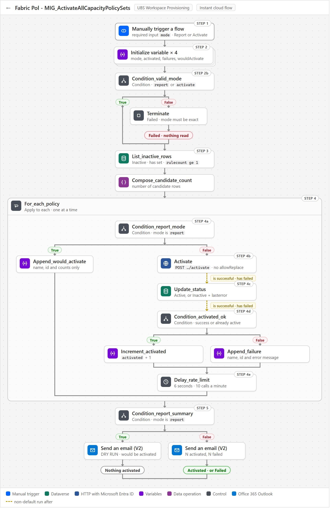

Three things to know when running it:

- **`Report` is the dry run, and you have to type `Activate` yourself.** The `mode` input is required, and any other value stops the run at `Condition_valid_mode` before a single row is read.
- **Re-runs are safe.** Only rows still `Inactive` are picked up, and a `400 PolicySetAlreadyActive` reply counts as activated, not failed.
- **It is slow on purpose.** `Delay_rate_limit` waits 6 seconds after each activation to stay under 10 calls a minute, so 200 capacities take about 20 minutes.

---

## 6. Identity and security

### 6.1 One identity runs everything - the `workspace provisioning` service account

**Every flow runs as one account, and every right it has was granted to it directly.** All three connections - Fabric, Dataverse and Outlook - are signed in as the `workspace provisioning` service account, so every Fabric and Dataverse call is made *as that account*, with the permissions it personally holds.

| | `workspace provisioning` service account |
|---|---|
| **Type** | A **user account** - email and password. Not a named person, so the solution does not stop when someone leaves |
| **Service principal, app registration, client secret** | **None.** There is nothing to rotate and no admin consent for API permissions to obtain |
| **How it authenticates** | It is **signed in on each connection**. The *HTTP with Microsoft Entra ID (preauthorized)* connector attaches the token itself, so no flow acquires a token and no flow holds a secret |
| **Connections signed in as it** | Fabric (*HTTP with Microsoft Entra ID (preauthorized)*), Microsoft Dataverse, Office 365 Outlook |


### 6.2 Fabric permissions

**The account needs exactly two Fabric roles, and nothing on the workspaces it governs.**

| # | Role | Scope | Why it is needed |
|---|---|---|---|
| F1 | **Contributor** (or Admin) | The **holder workspace** - one workspace | A policy set is a Fabric item, so it needs Workspace where policies will be created. Creating, changing and deleting it needs this role on the workspace that holds it |
| F2 | **Capacity Admin** | **Every governed capacity** | Needed to activate a policy set on the capacity, and to see the capacity in `GET /v1/capacities` at all |

What the account deliberately does **not** need:

- **No role on any governed workspace.** Approved workspaces are never touched as resources - they are GUIDs inside a rule's condition. Every write goes to `/v1/workspaces/{holder workspace}/policySets/...`.
- **Not Fabric Administrator.** That is only needed for the tenant-scope `/v1/admin/policySets` operations, which nothing here uses.
- **No Fabric tenant setting changes.** Every API-gating tenant setting is scoped to service principals.

> **F2 has to be granted on every new capacity as it is provisioned.** A capacity the account does not administer is simply absent from `GET /v1/capacities`. `InitializeCapacityPolicySet` then reports `Skipped` - indistinguishable from a capacity that does not exist - and the capacity stays ungoverned with nothing reporting it.

### 6.3 Dataverse permissions

**All privileges are at Organization depth**, because the rows belong to other people - User or Business Unit depth would hide them.

| Table | Read | Create | Write | Delete |
|---|---|---|---|---|
| `ubsppcoe_Node` | Yes | - | **Never** | **Never** |
| `ubsppcoe_Workspace` | Yes | - | **Never** | **Never** |
| `Logging` | - | Yes | **Never** | **Never** |
| `Capacity Policies` | Yes | Yes | Yes | - |
| `Policy Item Types` | Yes | - | - | - |
| `Policy Exceptions` | Yes | - | - | - |

**No flow deletes a Dataverse row anywhere.** A retired capacity's `Capacity Policies` row is updated to `Deleted`, never removed.

> **Every Dataverse trigger must run at `Organization` scope.** The default is `User`, at which a trigger fires only for changes the connection's own account made. Every change that matters here is made by the platform team, an import or an exception approver - so at `User` scope a flow never runs, with no error and an empty run history.

### 6.4 People and the access they need

The service account does the work, but four groups of people touch the solution.

| Who | What they do | Access they need |
|---|---|---|
| **Platform team** | Maintain `ubsppcoe_Node` and `ubsppcoe_Workspace` - add capacities, set the OAP flag, move and retire workspaces | Their own, unchanged. **Their edits are what trigger this solution** |
| **Policy administrators** | Maintain `Policy Exceptions` (with a reason and an approver) and `Policy Item Types` | Create and write on those two tables, in the maker portal or through an app |
| **Solution maintainers** | Edit the flows, run `MIG_RebuildAllCapacityPolicies`, re-sign connections | Maker rights on the environment and the solution; *System Customizer* or *System Administrator* to change tables |
| **Status app users** | Read capacity status through the app that calls `ListCapacityPolicySets` | Access to that app. The flow itself runs as the service account |

> **`Policy Exceptions` is the only thing that can widen access without the platform team.** An exception lets a workspace create any item type even if it is not OAP-enabled. It cannot reach a capacity the workspace does not sit on, because the capacity still comes from the platform team's data - which is why every exception carries `ubsppcoe_reason` and `ubsppcoe_approvedby`.

### 6.5 What the solution writes, and what it never logs

| Target | Access | Contents |
|---|---|---|
| `ubsppcoe_Node`, `ubsppcoe_Workspace` | **Read only** | - |
| `Logging` | **Insert only** - never read back, updated or deleted | `Error`, the flow's display name, a link to the run |
| `Capacity Policies` | Read and write | Policy set id, status, last rebuild, last error, cached counts |
| `Policy Item Types`, `Policy Exceptions` | Read only by flows | Maintained by people |
| Fabric policy sets | Create, replace rules, activate, deactivate, delete | Rule lists rebuilt wholesale from Dataverse |

**Nothing sensitive is logged.** `Logging` has no message column. The diagnosis goes to `ubsppcoe_lasterror`, and only the failed action's name, code and message are extracted - never the raw `result()` output, which carries every request body verbatim. The `MIG_` report mails do name capacities, workspaces and failure reasons, so `PolicyMailRecipients` should be a managed distribution group rather than individual addresses.

### 6.6 The largest operational risk - the account itself

**One password, one licence and one Conditional Access rule sit between the estate and a total failure.** A delegated connection breaks in ways an application identity does not, and every one of them looks the same: **`401` on every capacity at once**, with nothing in the run history naming the connection.

| Cause | What to do |
|---|---|
| Password rotated or expired | Re-authenticate the connections. A connection does not follow a password change |
| MFA enforced on the account | Exempt the account - a running flow cannot answer a prompt |
| Conditional Access applied to the account | Exclude it from location, device and compliance rules |
| Account disabled, or licence removed | Keep it enabled and licensed, and out of leaver reviews |
| Connection signed in by the wrong person | Re-create it signed in as the service account. Everything still runs, but as that person, and `GET /v1/capacities` quietly returns only what *they* administer |

Two tenant-level checks also apply once: if user consent to applications is disabled, a tenant administrator must consent to the *HTTP with Microsoft Entra ID (preauthorized)* connector; and the environment's **DLP policy** must place that connector, Dataverse and Office 365 Outlook in the same data group, or the flows will neither save nor run.

**Still open:** naming an owner for the account, exempting it from password expiry and interactive MFA, confirming that the Dataverse connection uses the same account, and confirming which security role carries the privileges in 6.3.

---

## 7. Data model and ownership

### 7.1 Six tables, two owners

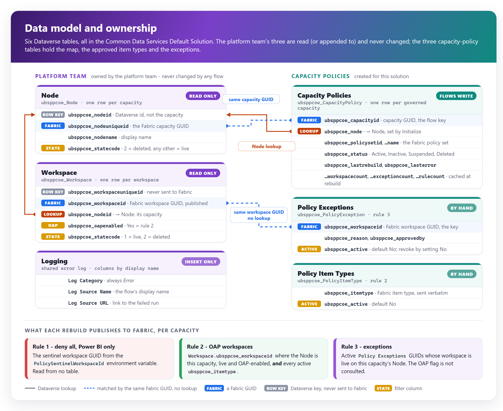

**All six tables live in the Common Data Services Default Solution, and all six carry the `ubsppcoe_` prefix - so the prefix does not tell you who owns a table.** The solution's own tables were deliberately created with the platform team's publisher prefix. Ownership is therefore always stated **by table name**, never by prefix.

| Table | Owner | Role in the design |
|---|---|---|
| `ubsppcoe_Node` | Platform team | **The capacity inventory.** A row added or soft-deleted here creates or retires a policy set |
| `ubsppcoe_Workspace` | Platform team | **The workspace inventory.** Which capacity each workspace sits on, whether it is OAP-enabled, and whether it is live |
| `Logging` | Platform team | Shared error log. Flows insert one row per caught failure |
| `Capacity Policies` | Capacity policies | **The capacity to policy set map.** One row per governed capacity, plus status, last rebuild, last error and cached counts |
| `Policy Item Types` | Capacity policies | The Fabric item types rule 2 allows |
| `Policy Exceptions` | Capacity policies | The workspaces rule 3 allows to create anything |

### 7.2 Who reads and who writes

**No flow writes the platform team's tables. Ever.** `ubsppcoe_oapenabled` means *this workspace has OAP enabled and gets the rest of the Fabric treatment*; capacity policy is one consumer of it. Writing to it would repurpose a field other systems already act on.

| Table | Read by | Written by |
|---|---|---|
| `ubsppcoe_Node` | Initialize, Delete (their trigger row), AddWorkspaceToPolicy | **No flow** |
| `ubsppcoe_Workspace` | Rebuild, Add, Remove, RebuildOnExceptionChange | **No flow** |
| `Logging` | **No flow** | The Catch blocks of the event flows - insert only |
| `Capacity Policies` | Every flow, directly or through the rebuild | Initialize and `MIG_Initialize` (insert), Rebuild (stamp), Delete and `MIG_ActivateAll` (status), Catch blocks (`ubsppcoe_lasterror`) |
| `Policy Item Types` | Rebuild | **No flow** - people, in the maker portal or an app |
| `Policy Exceptions` | Rebuild, Remove, RebuildOnExceptionChange | **No flow** - people, in the maker portal or an app |

### 7.3 Membership is derived, never stored

**Which workspace may create what, on which capacity, is not recorded anywhere the solution owns.** It is worked out again on every rebuild from the platform team's columns:

| A workspace is in... | ...for capacity *C* when |
|---|---|
| **Rule 2 - OAP workspaces** | Its `Node` lookup points at *C*, it is live (`ubsppcoe_statecode` = `1`), and `ubsppcoe_oapenabled` is `true` |
| **Rule 3 - exceptions** | Its `Node` lookup points at *C*, it is live, and an **active** `Policy Exceptions` row carries its Fabric GUID. The OAP flag is **not** consulted |
| **Neither** | Every other case - OAP flag `false` or empty, no Node, soft-deleted. Rule 1 leaves it Power BI-only |

**Both lists hang off the same `Node` lookup.** A workspace that moves capacity, or is soft-deleted, drops out of every rule on its old capacity at that capacity's next rebuild, exceptions included - nothing has to remember to clean it up. An exception has no capacity column of its own for the same reason.

### 7.4 The names that cause the most mistakes

Both platform tables keep the Fabric GUID in a different column from the Dataverse row key, and the names point the wrong way.

| Column | Table | What it really is |
|---|---|---|
| `ubsppcoe_nodeid` | `ubsppcoe_Node` | The **row key**. Not the capacity id |
| `ubsppcoe_nodeuniqueid` | `ubsppcoe_Node` | The **Fabric capacity GUID**, in an ordinary column. Find a capacity with a filtered *List rows*, never *Get a row by ID* |
| `ubsppcoe_nodeid` | `ubsppcoe_Workspace` | The **Node lookup** - the same name as Node's row key. Filter it as `_ubsppcoe_nodeid_value` |
| `ubsppcoe_node` | `Capacity Policies` | **Our** Node lookup, four characters away. Filter it as `_ubsppcoe_node_value` |
| `ubsppcoe_workspaceid` | `ubsppcoe_Workspace` | The **Fabric workspace GUID** - the only value ever published to Fabric |
| `ubsppcoe_workspaceuniqueid` | `ubsppcoe_Workspace` | The **row key**. Fabric accepts it if published by mistake, and it never matches anything |
| `ubsppcoe_statecode` | Both platform tables | A **custom Choice column**, not Dataverse's system `statecode`. Live is `eq 1` on workspaces but `ne 2` on Nodes, which have eleven states - do not make them the same |

### 7.5 What reading another team's tables costs

Reading the inventory removed a whole class of problem - there is no second copy of the approved list to seed or to drift. It introduced a coupling instead:

| Coupling | Consequence |
|---|---|
| **Changes originate elsewhere** | A bulk import or a hand edit changes what the rules should be. The solution only ever reacts |
| **Schema** | A renamed column makes a filter return nothing, the rebuild publishes rule 1 alone, and the capacity silently locks to Power BI-only. The platform team has undertaken not to rename columns - an undertaking, not a control |
| **Meaning** | `ubsppcoe_oapenabled` means *gets the Fabric treatment*, not *may create Fabric items*. They coincide today; if its meaning changes, capacity policy changes with it |
| **Moves** | Repointing a workspace's `Node` moves it between capacities, and **two** capacities need rebuilding. No trigger fires for a move - `MIG_RebuildAllCapacityPolicies` is the repair |
| **Data quality** | A wrong workspace GUID is accepted by Fabric and never matches. It can only be fixed where the row is created, by the platform team |

### 7.6 Fail closed - in the direction that cannot widen access

| Situation | Behaviour |
|---|---|
| The rebuild cannot find the `Capacity Policies` row, or its Node lookup is blank | **Refuse.** Nothing is published - a blank lookup looks exactly like a capacity whose workspaces were all disabled |
| `AddWorkspaceToPolicy` finds the data does not match the trigger | **Refuse** to rebuild, rather than report access nobody checked |
| `RemoveWorkspaceFromPolicy` finds an odd-looking row | **Rebuild anyway.** Republishing the current truth can only narrow or keep access |
| A new option appears on the workspace `ubsppcoe_statecode` | **Excluded** - filters use `eq 1`, so an unknown state stays out of rule 2 |
| A new option appears on the Node `ubsppcoe_statecode` | **Governed** - filters use `ne 2`, so an unknown state is still protected |
---

## 8. Fabric REST API integration

### 8.1 How every call is made

**There is one way to call Fabric in this solution: the *Invoke an HTTP request* action of the *HTTP with Microsoft Entra ID (preauthorized)* connector**, signed in as the `workspace provisioning` service account (section 6). The plain `HTTP` action is not used anywhere.

| Setting | Value |
|---|---|
| Base URL | `https://api.fabric.microsoft.com/v1` |
| Connection - Base Resource URL and Entra ID Resource URI | `https://api.fabric.microsoft.com` |
| Headers | `Content-Type: application/json` on a `POST` with a body - **and nothing else** |
| `Authorization` header | **Never.** The connector attaches the token; a hand-written header is ignored or breaks the call |
| Retry policy | Default. It already covers `408`, `429` and `5xx`. A failure that survives it is recorded and **not retried** |
| Asynchronous pattern | **Off** on *create policy set*, so the flow can read the `202` response and poll the operation itself |
| Holder workspace and sentinel GUID | Read from environment variables, never typed into a URL |

### 8.2 The calls the solution makes

Paths are relative to `https://api.fabric.microsoft.com/v1`, and `{holder}` is the holder workspace from `PolicyHolderWorkspaceId`.

| Call | Method and path | Used by | Behaviour to know |
|---|---|---|---|
| **List capacities** | `GET /capacities` | Initialize, Delete, `MIG_RegisterAll` | Returns **only the capacities the service account administers**. Not part of the policy API |
| **Create policy set** | `POST /workspaces/{holder}/policySets` | Initialize, `MIG_Initialize` | `201` with the new set, or `202` with an `x-ms-operation-id` header - a long-running operation |
| **Poll the operation** | `GET /operations/{id}`, then `GET /operations/{id}/result` | Initialize, `MIG_Initialize` | Only on a `202`. The created set is at `/result`, not on the operation |
| **Replace all rules** | `POST /workspaces/{holder}/policySets/{id}/policyRules/replaceByPolicy` | Rebuild | **Replaces every rule on the set, rule 1 included.** The only way rules are ever written |
| **Activate** | `POST /workspaces/{holder}/policySets/{id}/activate` | Initialize, `MIG_ActivateAll` | `400 PolicySetAlreadyActive` counts as success. `allowReplace` is never passed |
| **Deactivate** | `POST /workspaces/{holder}/policySets/{id}/deactivate` | Delete (capacity still in Fabric), emergency unlock | Returns `404 Capacity not found` once the capacity has gone |
| **Delete policy set** | `DELETE /workspaces/{holder}/policySets/{id}` | Delete (capacity gone from Fabric) | Works even after the capacity is gone |

**No call touches a governed workspace.** Every write goes to the holder workspace; approved workspaces only ever appear as GUIDs inside a rule. Nothing calls the tenant-scope `/admin/policySets` endpoints either.

### 8.3 Request bodies - what is actually required

**Create policy set** - one per capacity, scoped to it at creation. The scope cannot be changed afterwards.

```json
{
  "displayName": "pol_<capacity name>",
  "description": "Item creation policy for capacity <capacity name>",
  "creationPayload": { "scope": { "type": "Capacity", "id": "<capacity GUID>" } }
}
```

**Replace all rules** - the whole rule list, every time, in the order rule 1, rule 2, rule 3:

```json
{
  "policy": "ItemCreation",
  "policyRules": [
    {
      "displayName": "Deny all item creation (PBI items not tracked)",
      "conditions": [
        { "type": "Dynamic", "targetProperty": "workspace.id",
          "predicate": { "operator": "AnyOf", "values": [ "00000000-0000-0000-0000-000000000000" ] } }
      ],
      "effects": [ { "type": "Allow" } ]
    },
    {
      "displayName": "Approved item types for whitelisted workspaces (1/2)",
      "conditions": [
        { "type": "Dynamic", "targetProperty": "workspace.id",
          "predicate": { "operator": "AnyOf", "values": [ "<up to 49 OAP workspace GUIDs>" ] } },
        { "type": "Dynamic", "targetProperty": "item.type",
          "predicate": { "operator": "AnyOf", "values": [ "<active Policy Item Types>" ] } }
      ],
      "effects": [ { "type": "Allow" } ]
    },
    {
      "displayName": "Unrestricted item creation for exception workspaces",
      "conditions": [
        { "type": "Dynamic", "targetProperty": "workspace.id",
          "predicate": { "operator": "AnyOf", "values": [ "<up to 49 exception workspace GUIDs>" ] } }
      ],
      "effects": [ { "type": "Allow" } ]
    }
  ]
}
```

Rule 2 and rule 3 repeat, numbered `(1/n)`, once per 49 workspaces. **Rule 3 is rule 2 without the `item.type` condition** - removing it is what makes the rule match every item type.

**Activate:**

```json
{ "scopeType": "Capacity", "scopeId": "<capacity GUID>", "capacityId": "<capacity GUID>" }
```

**`capacityId` is required but not in the published reference.** Without it the service rejects the call with `PropertyCannotBeDefault`. The activation scope type must also match the set's own scope, or the call fails with `InvalidActivationScope`. `PolicySetActivationConflict` means another policy set already governs the capacity; it can only be overridden with `?allowReplace=True`, which no flow passes - taking over a capacity silently is a decision for a person.

### 8.4 Behaviours the design depends on

| Behaviour | What the design does about it |
|---|---|
| **There is no `Deny` effect** | Rule 1 is an `Allow` rule whose condition can never match (section 2.2) |
| **A policy set with no rules is not enforced** | Every rebuild emits rule 1 first, unconditionally. The single most important invariant |
| **`PATCH` on a rule replaces its whole conditions list, and there is no ETag** | Rules are never edited in place. Every publish is a full `replaceByPolicy` |
| **An empty `values` list is rejected** (`PropertyMinCount`) | Cannot arise - an empty chunk is never emitted |
| **Workspace GUIDs are never validated** | Any well-formed GUID is accepted and simply never matches. A wrong GUID can only be caught where the inventory row is created |
| **Item type values are validated** | A wrong `ubsppcoe_itemtype` fails the whole rebuild with `400 Failed to convert value...` |
| **List responses often omit a set's capacity scope** | Finding a set's capacity would need a `GET` per set - which is why the solution keeps its own map in `Capacity Policies` |
| **Rule IDs are regenerated on every replace** | Nothing stores or addresses a rule by ID |
| **Policy sets exist only on F SKU capacities** | Initialize skips any other SKU as `Skipped`, not `Failed` |

### 8.5 Limits

| Limit | Value | Where it bites |
|---|---|---|
| Workspaces per rule condition | **49** - as found by testing against the service; Microsoft's documentation says 50 | Rule 2 and rule 3 are split into chunks of 49 (`PolicyMaxWorkspacesPerRule`) |
| Rules per capacity-scope policy | **50** | `1 + ceil(OAP / 49) + ceil(exceptions / 49)`. The rebuild checks this before calling Fabric (`PolicyMaxRulesPerPolicy`) |
| Rule display name | **60 characters** | The rule names are kept short so `(10/12)` still fits |
| Policy sets active per capacity | **1** | Activating another set silently deactivates ours - undetectable from the solution |
| Activation calls | About **10 per minute** | `MIG_ActivateAll` waits 6 seconds between activations |

### 8.6 The release-stage switch - `PolicyApiBeta`

**The capacity-policy API is in preview, and its URL changes twice.** At **public preview** it is re-released as beta and every policy call needs `?beta=true`; at **general availability** the parameter goes away again. So that neither change needs a flow edit, the policy calls end their URL with an expression that reads the **`ubsppcoe_PolicyApiBeta`** environment variable:

```text
.../policySets/{id}/activate@{if(parameters('PolicyApiBeta (ubsppcoe_PolicyApiBeta)'), '?beta=true', '')}
```

| Stage | URL suffix | `PolicyApiBeta` |
|---|---|---|
| Private preview | none | **No** |
| Public preview (beta) | `?beta=true` | **Yes** |
| General availability | none | **No** |

**Six calls in four flows read it:** create policy set (Initialize, `MIG_Initialize`), activate (Initialize, `MIG_ActivateAll`), replace all rules (Rebuild) and delete policy set (Delete). **List capacities and operation polling are not policy calls and are unaffected.**

**A toggle pointing the wrong way fails every capacity at once**, at Fabric, with an error that names nothing. It is a Two options variable rather than text because an empty text value cannot be stored and a cleared one is silently ignored.

> **To confirm before public preview:**
> - **The flow edits.** The variable is built and proven, but the edits to the six actions in the built flows were recorded as *not done*. Confirm they have been made.
> - **`Deactivate` is not in the inventory.** The *deactivate* call in `DeleteCapacityPolicySet` (capacity still in Fabric) is a policy call but is not one of the six. It most likely needs the same suffix, or a suspend will fail at public preview.

Setting the variable in each environment is covered in the *Deployment guide*.

---

## Appendix A. Glossary

| Term | Meaning in this document |
|---|---|
| **Activate** | Putting a policy set into force on its capacity. Until then its rules change nobody's access |
| **Capacity** | A Fabric capacity (F SKU). Policy sets apply to exactly one capacity each |
| **Capacity Admin** | The Fabric role on a capacity that the service account needs in order to see and govern it |
| **Capacity Policies** | This solution's table mapping each governed capacity to its policy set, with status and last rebuild |
| **Child flow** | A flow called by other flows with *Run a Child Flow*. Here, `RebuildCapacityPolicyRules` |
| **Common Data Services Default Solution** | The Dataverse default solution, where all six tables live. Its components do not travel with an export of UBS Workspace Provisioning |
| **Cutover** | The one-off migration that brought the existing estate under the solution (section 5) |
| **Event flow** | A flow started by a Dataverse row being added or changed |
| **Exception** | An active `Policy Exceptions` row. Lets one workspace create any item type on whichever capacity it sits on (rule 3) |
| **Governed capacity** | A capacity with a `Capacity Policies` row and a policy set. The presence of the row is what makes it governed |
| **Holder workspace** | The single Fabric workspace that holds every policy set in the tenant |
| **`ItemCreation`** | The Fabric policy type that controls which item types may be created in which workspaces. Power BI items are outside it |
| **Live** | Not soft-deleted: `ubsppcoe_statecode` = `1` on a workspace, anything but `2` on a Node |
| **Node** | A row in the platform team's `ubsppcoe_Node` table - one per capacity |
| **OAP / OAP-enabled** | Outbound Access Protection. A workspace with `ubsppcoe_oapenabled` = `true` is allowed the approved Fabric item types (rule 2) |
| **Policy set** | A Fabric item holding a list of rules, activated against one capacity. Named `pol_<capacity name>` |
| **Policy Item Types** | This solution's table of Fabric item types that rule 2 allows |
| **`replaceByPolicy`** | The Fabric call that replaces every rule on a policy set at once. The only way rules are written |
| **Rebuild** | Reading the complete desired state for one capacity and replacing all its rules in Fabric |
| **Rule 1 / 2 / 3** | Deny all - Power BI only; OAP workspaces - approved item types; exceptions - allow all (section 2.2) |
| **Sentinel GUID** | `00000000-0000-0000-0000-000000000000` - the never-matching workspace that makes rule 1 a deny |
| **Service account** | The `workspace provisioning` user account every connection is signed in as (section 6) |
| **Soft delete** | Marking a row deleted with `ubsppcoe_statecode` = `2` instead of removing it |
| **Trigger scope** | The Dataverse trigger setting that decides whose changes fire a flow. Must be `Organization` |
| **UBS Workspace Provisioning** | The Power Platform solution holding the flows, environment variables and connection references |
