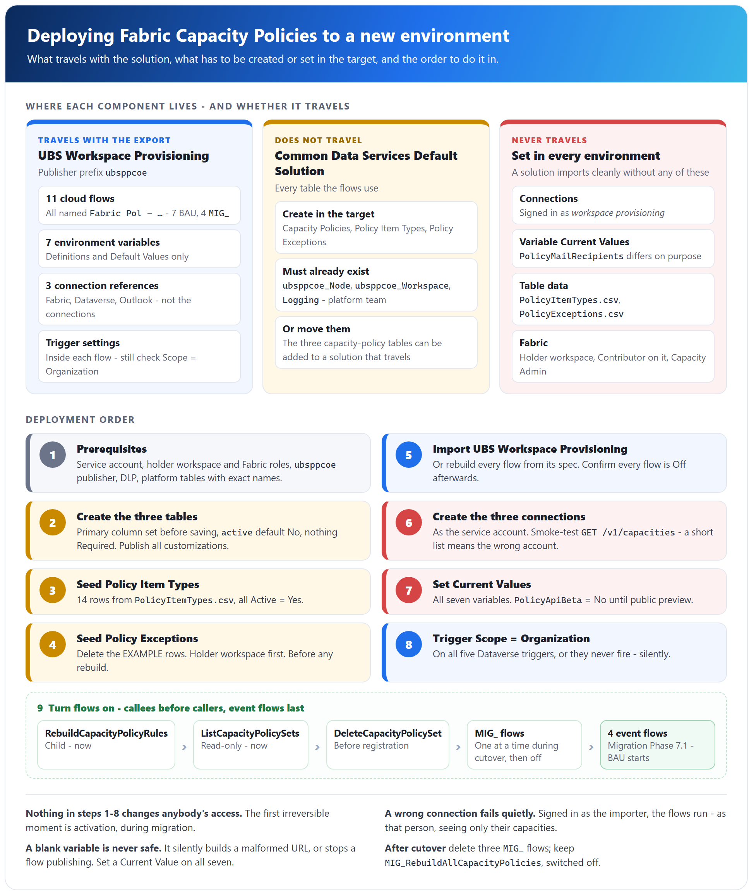

# Fabric Capacity Policies - Deployment guide

## Scope of this document

This guide is the single procedure for deploying the **Fabric Capacity Policies** solution to a new Power Platform environment: what has to exist first, what is created, imported, set and switched on, in which order, and how to prove it works before handing over. It brings together the deployment steps, the ALM notes, the identity requirements and the table build in one place.

It stops where the cutover starts. Bringing an existing estate under policy is covered by the *Migration guide*; day-to-day operation and failure handling by the *Error handling and monitoring* guide.

---

## Contents

1. What gets deployed
   - 1.1 Where each component lives
   - 1.2 What travels with the solution and what does not
2. Prerequisites
   - 2.1 Identity - the service account
   - 2.2 Fabric
   - 2.3 Entra ID and tenant settings
   - 2.4 Power Platform and Dataverse
   - 2.5 Licences
3. Deployment order, step by step
4. Verification after deployment
5. Per-environment values
6. Source control and ALM
7. Related documents

---

## 1. What gets deployed

### 1.1 Where each component lives

The solution is split across two Power Platform solutions in the same environment, plus objects outside Power Platform. **Where a component lives decides whether it travels with an export**, so this table is the starting point for every deployment.

| Component | Count | Lives in | Owner |
|---|---|---|---|
| Cloud flows, every display name starting `Fabric Pol - ` | 11 - 7 BAU, 4 `MIG_` | **UBS Workspace Provisioning** (publisher prefix `ubsppcoe`) | This project |
| Environment variables | 7 | UBS Workspace Provisioning | This project |
| Connection references - Fabric, Dataverse, Outlook | 3 | UBS Workspace Provisioning | This project |
| `Capacity Policies`, `Policy Item Types`, `Policy Exceptions` | 3 tables | **Common Data Services Default Solution** | This project |
| `ubsppcoe_Node`, `ubsppcoe_Workspace`, `Logging` | 3 tables | Common Data Services Default Solution | **Platform team** |
| Holder workspace - holds every policy set | 1 | Fabric | This project |
| Seed data - the seed list of item types and the exceptions list | 2 | Steps 3 and 4 of this guide | This project |

The flows are:

| Group | Flows | Trigger |
|---|---|---|
| BAU - event | `Fabric Pol - InitializeCapacityPolicySet`, `Fabric Pol - DeleteCapacityPolicySet`, `Fabric Pol - AddWorkspaceToPolicy`, `Fabric Pol - RemoveWorkspaceFromPolicy`, `Fabric Pol - RebuildOnExceptionChange` | Dataverse row change |
| BAU - child | `Fabric Pol - RebuildCapacityPolicyRules` | Manual, called by the flows above |
| BAU - helper | `Fabric Pol - ListCapacityPolicySets` | Power Apps (V2), called by an app outside the solution |
| Migration | `Fabric Pol - MIG_RegisterAllCapacityPolicySets`, `Fabric Pol - MIG_InitializeCapacityPolicySet`, `Fabric Pol - MIG_RebuildAllCapacityPolicies`, `Fabric Pol - MIG_ActivateAllCapacityPolicySets` | Manual |

**There is no custom connector.** Fabric is called through the built-in *HTTP with Microsoft Entra ID (preauthorized)* connector, so there is no connector definition, app registration or client secret to deploy.

### 1.2 What travels with the solution and what does not

**Exporting UBS Workspace Provisioning carries no table.** All six tables live in the Default Solution, so the three capacity-policy tables must be created in the target - or added to a solution that travels - before the flows are imported or run.

| Travels in UBS Workspace Provisioning | Does **not** travel - create, set or grant in every environment |
|---|---|
| Flow definitions, including trigger settings | **The three capacity-policy tables** - they are in the Default Solution |
| Environment variable *definitions* and *Default Values* | **Environment variable Current Values** |
| Connection *references* | **Connections** - created and signed in again as the service account |
| | **Table data** - both hand-maintained tables need seeding |
| | **The holder workspace**, and the Fabric roles on it and on every capacity |
| | The platform team's tables and their data |

**The two that catch people are environment variable values and connections.** A solution imports cleanly with neither, and the flows then fail at runtime - or, worse, run as the wrong person. See section 6.

---

## 2. Prerequisites

**Everything in this section must be true before step 1 of section 3.** None of it changes anybody's access, and every item is cheaper to find missing now than during the first rebuild. Why each identity and permission is needed is explained in the *Architecture* document, section 6.

### 2.1 Identity - the service account

**One identity is used everywhere: the `workspace provisioning` service account.** It is a user account with email and password, not a service principal, and every Fabric and Dataverse call is delegated as that account.

| # | Requirement | Why |
|---|---|---|
| I1 | A **user account** - the `workspace provisioning` service account | All three connections sign in as it |
| I2 | Licensed for Power Automate and Dataverse | A connection needs the account to stay licensed |
| I3 | **Exempt from password expiry and interactive MFA**, or a documented re-authentication process | A rotation silently breaks every Fabric call until the connection is re-authorised |
| I4 | Not blocked by a **Conditional Access** policy | Same failure - `401` on every capacity at once |
| I5 | Excluded from joiner-mover-leaver reviews | Service accounts do get disabled by lifecycle automation |

### 2.2 Fabric

| # | Requirement | Note |
|---|---|---|
| F1 | A **holder workspace** exists | One workspace holds every policy set in the tenant. **Put it on an ungoverned capacity if you can** - otherwise it needs an exception row (step 4) |
| F2 | Service account is **Contributor** (or Admin) on the holder workspace | Needed to create and update policy sets. On no other workspace |
| F3 | Service account is **Capacity Admin** on every capacity to be governed | Needed to activate, and to see the capacity in `GET /v1/capacities`. **Repeat for every new capacity, for ever** |
| F4 | Governed capacities are **F SKU** and `Active` | P, A, EM and PP SKUs cannot hold a policy set |

**The account deliberately needs nothing else** - no role on the governed workspaces and not Fabric Administrator. Workspaces appear only as values inside rules.

### 2.3 Entra ID and tenant settings

| # | Requirement |
|---|---|
| E1 | **No app registration, client secret or API permission** to configure - the identity is a user |
| E2 | **No Fabric tenant setting needs changing.** The API-gating settings apply to service principals only |
| E3 | **Admin consent for the *HTTP with Microsoft Entra ID (preauthorized)* connector**, if user consent to applications is disabled in the tenant. One-off, needs a tenant administrator |

### 2.4 Power Platform and Dataverse

| # | Requirement | Note |
|---|---|---|
| P1 | A target **environment with Dataverse** | |
| P2 | The **publisher with prefix `ubsppcoe`** exists | It owns `ubsppcoe_Workspace`, so it already exists. **Reuse it; never create one with another prefix** - every logical name the flows use would be wrong |
| P3 | **DLP policy** puts *HTTP with Microsoft Entra ID (preauthorized)*, *Microsoft Dataverse* and *Office 365 Outlook* in the **same data group** | Otherwise the flows will not save or run |
| P4 | The person deploying holds **System Customizer** or **System Administrator** | Needed to create tables and import |
| P5 | The **platform team's tables exist with the exact names below** | **Stop if they do not.** A renamed column does not error - the filter returns nothing and the capacity silently locks down |
| P6 | A Dataverse **security role** for the service account, at **Organization** depth | Privileges below |

The platform team's tables and the columns this solution depends on (the names that cause the most mistakes are explained in the *Architecture* document, section 7.4):

| Table | Columns that must exist |
|---|---|
| `ubsppcoe_Workspace` | `ubsppcoe_workspaceuniqueid` (row key), `ubsppcoe_workspaceid` (**Fabric workspace GUID**, Unique identifier), `ubsppcoe_oapenabled`, `ubsppcoe_statecode` (Choice, `1` = Active, `2` = Deleted), `ubsppcoe_nodeid` (lookup to Node) |
| `ubsppcoe_Node` | `ubsppcoe_nodeid` (row key), `ubsppcoe_nodeuniqueid` (**Fabric capacity GUID**), `ubsppcoe_statecode` (Choice, `2` = Deleted) |
| `Logging` | *Log Category*, *Log Source Name*, *Log Source URL* |

The security role for the service account (the *Architecture* document, section 6.3). These are Dataverse **row** privileges: *Create* means inserting a new row - for `Logging`, writing a log entry - not creating the table. The service account never creates or changes a table.

| Table | Read rows | Create rows | Write (update) rows | Delete rows |
|---|---|---|---|---|
| `ubsppcoe_Workspace`, `ubsppcoe_Node` | Yes | - | **Never** | **Never** |
| `Capacity Policies` | Yes | Yes | Yes | - |
| `Policy Item Types`, `Policy Exceptions` | Yes | - | - | - |
| `Logging` | - | Yes | **Never** | **Never** |

> **To confirm:** which security role carries these privileges in the source environment. If it is System Administrator, the table above is the actual need, and a custom role scoped to it is the correct long-term answer.

### 2.5 Licences

The only stated licence requirement is that the service account must be **licensed for Power Automate and Dataverse** (I2) and that licence removal breaks the connections.

> **To confirm:** the exact licence SKU for the service account, and whether the request quota of that tier was checked. The estate-wide rebuild is roughly 5,000-6,000 actions per run of `Fabric Pol - MIG_RebuildAllCapacityPolicies` at 250 capacities.

---

## 3. Deployment order, step by step

**Follow the steps in order.** Tables come before the flows that read them, data comes before anything that could publish it, and every flow stays off until the end. **Nothing in steps 1-8 changes anybody's access**; the first irreversible moment is activation, during migration.

| Step | What | Where |
|---|---|---|
| 1 | Prerequisites complete | Section 2 |
| 2 | Create the three tables | Dataverse - Default Solution |
| 3 | Seed `Policy Item Types` | Dataverse |
| 4 | Seed `Policy Exceptions` | Dataverse |
| 5 | Import UBS Workspace Provisioning | Power Platform |
| 6 | Create and bind the three connections | Power Automate |
| 7 | Set the environment variable Current Values | UBS Workspace Provisioning |
| 8 | Check every Dataverse trigger's Scope is `Organization` | Each event flow |
| 9 | Turn flows on, in order | UBS Workspace Provisioning |

> **If the solution cannot be exported**, step 5 becomes "rebuild every flow by hand", starting with `RebuildCapacityPolicyRules` and ending with `ListCapacityPolicySets`. **Create UBS Workspace Provisioning with the `ubsppcoe` publisher and do step 7 before step 5** - a flow cannot bind to a variable that does not exist yet, and the `MIG_` flows will not publish while `PolicyMailRecipients` is blank. See section 6.

### Step 1 - Prerequisites

1. Work through section 2 and tick every row.
2. Record the values in section 5 for this environment.

### Step 2 - Create the three tables

What each table holds, and who reads and writes it, is in the *Architecture* document, section 7.

| Table | Schema name | Primary column |
|---|---|---|
| Capacity Policies | `ubsppcoe_CapacityPolicy` | `ubsppcoe_capacityname` |
| Policy Item Types | `ubsppcoe_PolicyItemType` | `ubsppcoe_itemname` |
| Policy Exceptions | `ubsppcoe_PolicyException` | `ubsppcoe_workspacename` |

1. In make.powerapps.com, select the target environment and confirm the platform team's `Node` and `Workspace` tables are visible (view filter **All**).
2. Create each table **with the `ubsppcoe` publisher** - in the Default Solution, as in the source environment, or in a solution that travels.
3. **Set the primary column's schema name on the *New table* screen**, under Advanced options, before saving. It cannot be changed afterwards.
4. Add the remaining columns. **Leave every column Optional** - in particular, do not tick Required on the `ubsppcoe_node` lookup.
5. Set **Default value = No** on both `ubsppcoe_active` columns.
6. **Publish all customizations.**
7. Verify every logical name character by character against the names in this guide.

### Step 3 - Seed `Policy Item Types`

**Required.** An empty table makes Fabric reject rule 2.

The seed list:

| Item name (`ubsppcoe_itemname`) | Item type value (`ubsppcoe_itemtype`) | Active (`ubsppcoe_active`) |
|---|---|---|
| Lakehouse | `Lakehouse` | Yes |
| Warehouse | `Warehouse` | Yes |
| Eventhouse | `Eventhouse` | Yes |
| Notebook | `Notebook` | Yes |
| Spark Job Definition | `SparkJobDefinition` | Yes |
| Dataflow Gen2 (with and without CICD) | `Dataflow` | Yes |
| Pipeline | `DataPipeline` | Yes |
| Copy Job | `CopyJob` | Yes |
| Mirrored Database (all sources) | `MirroredDatabase` | Yes |
| Variable Library | `VariableLibrary` | Yes |
| Environment | `Environment` | Yes |
| Graph Queryset | `GraphQuerySet` | Yes |
| Graph Model | `GraphModel` | Yes |
| KQL Queryset | `KQLQueryset` | Yes |

1. Save the seed list as a CSV file with the logical names `ubsppcoe_itemname`, `ubsppcoe_itemtype` and `ubsppcoe_active` as headers, then **Tables** > `Policy Item Types` > **Import** > **Import data from Excel**, file type CSV.
2. The headers are logical names and map column for column. **Leave the row key unmapped.**
3. Check there are **14 rows** and `Active` reads **Yes** on all of them.
4. Review the list against the target tenant's Fabric item types - a type missing here cannot be created in any governed workspace.

### Step 4 - Seed `Policy Exceptions`

**Before any rebuild.** A missing exception is not an error - the workspace simply loses rule 3 at the first rebuild.

1. Prepare the exceptions list as a CSV file with these logical names as headers, one row per excepted workspace:

   | Column | What to fill in |
   |---|---|
   | `ubsppcoe_workspacename` | The workspace's display name |
   | `ubsppcoe_workspaceid` | The **Fabric workspace GUID** |
   | `ubsppcoe_reason` | Why the workspace needs item types outside the governed list |
   | `ubsppcoe_approvedby` | Who approved the exception, for example their email address |
   | `ubsppcoe_active` | **Yes** |

2. **Add the holder workspace first**, if it sits on a governed capacity - otherwise the solution locks itself out of its own store. It also needs a `ubsppcoe_Workspace` row under that capacity's Node (the *Migration guide*, Phase 2).
3. Add the estate's real exceptions: the Fabric workspace GUID in `ubsppcoe_workspaceid`, `ubsppcoe_active` = **Yes**, with `ubsppcoe_reason` and `ubsppcoe_approvedby`.
4. Import as in step 3, row key unmapped. Skip the import if the environment has no exceptions.

### Step 5 - Import UBS Workspace Provisioning

1. Import the solution into the target environment.
2. If the import wizard asks for connections and environment variable values, provide them as in steps 6 and 7 - and check them there afterwards anyway.
3. **Confirm every flow is Off** after import. Turn off any that are on.
4. Confirm all 7 environment variables and 3 connection references are present.
5. If the target estate still needs a cutover, confirm the four `MIG_` flows are present. Three of them are deleted after a cutover, so they may need rebuilding by hand.

### Step 6 - Connections

**All three connections are signed in as the `workspace provisioning` service account.** A connection created by whoever imported the solution authenticates as that person: the flows run, and `GET /v1/capacities` quietly returns only the capacities they administer.

| Reference | Connector | Setting |
|---|---|---|
| Fabric | HTTP with Microsoft Entra ID (preauthorized) | Base Resource URL and Entra ID Resource URI both `https://api.fabric.microsoft.com` |
| Dataverse | Microsoft Dataverse | - |
| Outlook | Office 365 Outlook | Used only by the `MIG_` report mails |

1. Sign in **as the service account** and create the three connections. Obtain tenant admin consent if prompted (section 2.3 E3).
2. Bind each connection reference in the solution to its connection.
3. Open each connection and **confirm the signed-in account**, not just that the connection exists.
4. **Smoke-test the Fabric connection**: a throwaway instant flow with one *Invoke an HTTP request*, `GET /v1/capacities`. Compare the count with the expected estate. **A short list means the wrong account or missing Capacity Admin.** Delete the flow afterwards.

> **Never add an `Authorization` header to a Fabric action.** The connector supplies the token itself.

### Step 7 - Environment variable Current Values

**Set a Current Value on all seven, not only a Default Value.** Values do not reliably travel, and a blank one fails silently in a URL or stops a flow publishing.

| Variable | Type | Value |
|---|---|---|
| `PolicyHolderWorkspaceId` | Text | The holder workspace GUID - **per environment** |
| `PolicySentinelWorkspaceId` | Text | `00000000-0000-0000-0000-000000000000` |
| `PolicyMaxWorkspacesPerRule` | Text | `49` |
| `PolicyMaxRulesPerPolicy` | Text | `50` |
| `PolicyNamePrefix` | Text | `pol_` |
| `PolicyApiBeta` | Two options | **No** - Default Value **and** Current Value. `Yes` only while the API is in public-preview beta |
| `PolicyMailRecipients` | Text | Semicolon-separated addresses, no spaces - **per environment** |

1. Open each variable from inside UBS Workspace Provisioning and set its **Current Value**.
2. **Point `PolicyMailRecipients` at a test mailbox outside production**, before anything runs. Prefer a distribution group; never leave it blank and never clear it.
3. Set `PolicyApiBeta` to match the API's release stage at the time of deployment: **No** at private preview and at general availability, **Yes** at public preview (beta). The *Architecture* document, section 8.6, explains the switch.

The two numeric variables are Text on purpose - the flows cast them with `int(...)`. **Do not add an eighth variable** for the policy type; `ItemCreation` is a literal in the rebuild body.

### Step 8 - Trigger Scope = `Organization`

**At the default `User` scope a Dataverse trigger fires only for the service account's own edits** - so it never fires, with no error and an empty run history. Open each event flow from inside the solution and check its trigger:

| Flow | Table | Change type | Scope |
|---|---|---|---|
| `Fabric Pol - InitializeCapacityPolicySet` | `ubsppcoe_Node` | Added or Modified | **Organization** |
| `Fabric Pol - DeleteCapacityPolicySet` | `ubsppcoe_Node` | Modified (`ubsppcoe_statecode eq 2`) | **Organization** |
| `Fabric Pol - AddWorkspaceToPolicy` | `ubsppcoe_Workspace` | Added or Modified | **Organization** |
| `Fabric Pol - RemoveWorkspaceFromPolicy` | `ubsppcoe_Workspace` | Modified | **Organization** |
| `Fabric Pol - RebuildOnExceptionChange` | `Policy Exceptions` | Added or Modified | **Organization** |

While each flow is open, confirm its connection references point at the connections from step 6.

### Step 9 - Turn flows on, in order

**A child flow that is off cannot be called**, so callees go on before callers. **The four event flows go on last**, because from that moment row changes publish themselves - and `InitializeCapacityPolicySet` activates deny-all on any capacity whose Node row is added or modified.

| Order | Flow | When | Why |
|---|---|---|---|
| 1 | `Fabric Pol - RebuildCapacityPolicyRules` | Now | Child flow. Inert until called; every rebuild needs it on |
| 2 | `Fabric Pol - ListCapacityPolicySets` | Now | Read-only, no Fabric calls |
| 3 | `Fabric Pol - DeleteCapacityPolicySet` | Before any registration run | It is the one flow that takes governance away: on a Node soft-delete it deletes the policy set if Fabric no longer lists the capacity, otherwise only deactivates it (the *Architecture* document, section 4.2). Activation relies on it to drop soft-deleted capacities |
| 4 | `Fabric Pol - MIG_InitializeCapacityPolicySet` | Only while `MIG_RegisterAllCapacityPolicySets` runs | Child of the registration loop. **Unsafe standalone** |
| 5 | `Fabric Pol - MIG_RegisterAllCapacityPolicySets`, `Fabric Pol - MIG_RebuildAllCapacityPolicies`, `Fabric Pol - MIG_ActivateAllCapacityPolicySets` | One at a time, in the phases of the *Migration guide* | On, run, off again |
| 6 | `Fabric Pol - InitializeCapacityPolicySet`, `Fabric Pol - AddWorkspaceToPolicy`, `Fabric Pol - RemoveWorkspaceFromPolicy`, `Fabric Pol - RebuildOnExceptionChange` | The *Migration guide*, Phase 7, step 1 | **This is the moment BAU starts** |

After cutover, delete `MIG_RegisterAllCapacityPolicySets`, `MIG_InitializeCapacityPolicySet` and `MIG_ActivateAllCapacityPolicySets`. **Keep `MIG_RebuildAllCapacityPolicies`, switched off** - it is the only estate-wide repair tool.

---

## 4. Verification after deployment

Run these before handing the environment over, and before the migration starts. **Use one throwaway, non-production capacity for every test that writes to Fabric** - `InitializeCapacityPolicySet` activates deny-all on it within minutes. If a check fails, use the *Error handling and monitoring* guide, section 6.

**Configuration checks**

| # | Check | Expected |
|---|---|---|
| V1 | `GET /v1/capacities` from a throwaway flow | The expected number of capacities |
| V2 | `Policy Item Types` | 14 rows, all `Active` = Yes |
| V3 | Environment variables | All seven have a **Current Value**; `PolicyApiBeta` matches the API's release stage |
| V4 | `PolicyMailRecipients` | A mailbox somebody reads - and outside production, **not** the production distribution group |
| V5 | Trigger Scope on the five event flows | `Organization` |
| V6 | Connections | All three signed in as the `workspace provisioning` account |

**Functional tests, on the test capacity**

| # | Test | Expected |
|---|---|---|
| T1 | Add or modify the test capacity's `ubsppcoe_Node` row with `InitializeCapacityPolicySet` on | Policy set `pol_<capacity>` created in the holder workspace, `Capacity Policies` row written, status `Active` |
| T2 | Run `RebuildCapacityPolicyRules` for the capacity with no OAP workspace and no exception | **Rule 1 alone** - the path that silently unlocks a capacity if it is wrong |
| T3 | Rebuild with OAP workspaces under its Node | Rule 1 plus the expected whitelist rules; `ubsppcoe_rulecount` matches |
| T4 | **Read the rules back in the Fabric portal** | They match T2-T3. A `200` that wrote nothing is otherwise invisible |
| T5 | Blank the `ubsppcoe_node` lookup on the `Capacity Policies` row and rebuild | The rebuild **fails** rather than emitting rule 1 |
| T6 | Force a Catch in `AddWorkspaceToPolicy`, `RemoveWorkspaceFromPolicy`, `InitializeCapacityPolicySet` or `DeleteCapacityPolicySet` | A `Logging` row with the run URL; `ubsppcoe_lasterror` written on a failed rebuild |
| T7 | Run `ListCapacityPolicySets` | The test row is returned, with counts and `lastRebuild` |
| T8 | Soft-delete the test Node row (`ubsppcoe_statecode` = 2) | `DeleteCapacityPolicySet` deletes the set if Fabric no longer has the capacity, or deactivates it and marks the row `Suspended` if it does |

**T1 needs `InitializeCapacityPolicySet` switched on, ahead of the order in step 9.** Turn it on for the test only and off again straight after: while it is on, any edit to any Node row in the environment initialises and activates that capacity.

**Clean up afterwards.** Delete any policy set and `Capacity Policies` row left by testing - a leftover set causes a name collision at registration, and a leftover row makes that capacity return `AlreadyExists` and be skipped (the *Migration guide*, section 2.3).

---

## 5. Per-environment values

Collect these before starting. **`PolicyMailRecipients` is the one value that must differ between environments on purpose**: dev and test point at a test mailbox, and only production points at the real distribution group.

**Environment variables**

| Variable | Same everywhere? | Dev | Test | Prod |
|---|---|---|---|---|
| `PolicyHolderWorkspaceId` | **No** - the holder workspace of that environment | | | |
| `PolicySentinelWorkspaceId` | Yes - `00000000-0000-0000-0000-000000000000` | | | |
| `PolicyMaxWorkspacesPerRule` | Yes - `49` | | | |
| `PolicyMaxRulesPerPolicy` | Yes - `50` | | | |
| `PolicyNamePrefix` | Yes - `pol_` | | | |
| `PolicyApiBeta` | Yes - **switch every environment on the same day** | | | |
| `PolicyMailRecipients` | **No - must differ** | | | |

**Keep named individuals out of the Default Values.** Defaults travel with an export and land in source control; put a generic mailbox in the default of `PolicyMailRecipients` and people, if any, in the Current Value.

**Other values**

| Value | Dev | Test | Prod |
|---|---|---|---|
| Tenant name / ID | | | |
| Power Platform environment | | | |
| Service account UPN | | | |
| Holder workspace name and GUID | | | |
| Dataverse security role for the service account | | | |
| Capacities to govern (count) | | | |
| Platform team contact | | | |

> **To confirm:** whether non-production environments in the same tenant use their own holder workspace and their own test capacities. A capacity can have only one active policy set, so two environments must never govern the same capacity.

---

## 6. Source control and ALM

**The solution as built in the environment is the system of record.** UBS Workspace Provisioning in the environment is what runs, and every flow is described in these documents. Changes must be made in the environment and reflected in these documents.

| Point | What it means |
|---|---|
| **The solution is recorded as not exportable from the customer environment** | No exported flow definition and no automated pipeline. A deployment either imports an export, if one becomes possible, or rebuilds every flow by hand |
| **Changes in the environment are not tracked anywhere else** | A flow edited without updating these documents leaves the two out of step, with nothing to detect it. Update the documents in the same change |
| **An export carries no table** | The tables are in the Default Solution. Create them per step 2, or move them into a solution that travels |
| **Default Values travel, Current Values do not** | Defaults are committed with an export; that is why `PolicyApiBeta` defaults to No and `PolicyMailRecipients` defaults to a generic mailbox |
| **If export becomes possible** | Reconcile each exported definition against the flow as documented before trusting action names and `runAfter` details; then the export can become authoritative |

> **To confirm:** whether UBS Workspace Provisioning can now be exported, and whether it is deployed managed or unmanaged. Export is currently recorded as impossible and the solution type as open.

---

## 7. Related documents

| Document | Use it for |
|---|---|
| The *Architecture* document | What the solution is, the components inventory, what each flow does, identity and security, the data model and the Fabric API integration, including the `PolicyApiBeta` switch |
| The *Migration guide* | The phased cutover that follows deployment: registering, rebuilding, reviewing and activating the existing estate, with rollback and sign-off |
| The *Error handling and monitoring* guide | Day-to-day operation after cutover: how failures are reported, where to look, routine monitoring, and common errors and fixes when a verification check fails |
