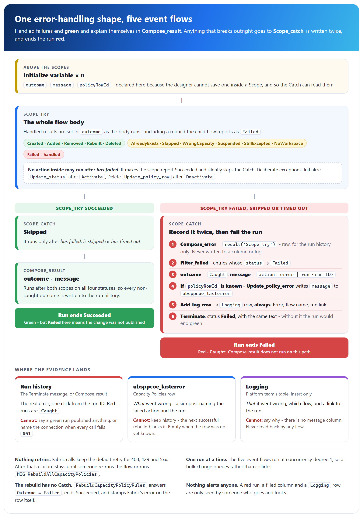

# Fabric Capacity Policies - Error handling and monitoring

## Scope of this document

This document describes how the **Fabric Capacity Policies** flows handle failure, what each outcome means, where the evidence lands, and what a person has to check because nothing else will. It brings together the failure-related material behind the solution and follows the current flow designs described in the *Architecture* document.

**Nothing in the solution alerts anyone today.** No flow runs on a schedule, no BAU failure sends a mail, and nothing retries a failed run. Every failure is visible only to someone who goes and looks - this document says where to look.

Flows are referred to by short name. Every display name in the **UBS Workspace Provisioning** solution starts `Fabric Pol - `, so `RebuildCapacityPolicyRules` appears in the maker portal and run history as `Fabric Pol - RebuildCapacityPolicyRules`. The tables live in the **Common Data Services Default Solution**.

---

## Contents

1. How failure is handled
   - 1.1 One shape, shared by the five event flows
   - 1.2 What the Catch writes, and where
   - 1.3 Green runs and red runs
   - 1.4 Deliberate exceptions to "no *has failed*"
   - 1.5 What the error text will actually say
   - 1.6 No retries, one run at a time
   - 1.7 Fail closed - and in which direction
2. Outcomes per flow
3. Where to look
4. What no trigger covers - silent drift
   - 4.1 The estate-wide repair
   - 4.2 The holder-workspace check
5. Routine monitoring checklist
6. Common errors and fixes
   - 6.1 Emergency - unlock a capacity
7. Related documents

---

## 1. How failure is handled

### 1.1 One shape, shared by the five event flows

**The five event flows - `InitializeCapacityPolicySet`, `DeleteCapacityPolicySet`, `AddWorkspaceToPolicy`, `RemoveWorkspaceFromPolicy` and `RebuildOnExceptionChange` - handle failure the same way.** None of its details is arbitrary: each was established by experiment against the platform.

| Part | What it does |
|---|---|
| `Initialize variable` actions | Sit **above** the scopes - the designer cannot save one inside a Scope. `outcome`, `message` and `policyRowId` live here, so the Catch can read them |
| `Scope_try` | Holds the whole body. Handled results - `Skipped`, `WrongCapacity`, `Failed` and the rest - are set in `outcome` and `message` as the body runs |
| `Scope_catch` | Runs after `Scope_try` **has failed**, **is skipped** or **has timed out** - never after success |
| `Compose_result` | Runs after **both** scopes on **all four** statuses and writes `outcome` and `message` into the run history. It is how a green run explains itself |

Inside `Scope_catch`, in order:

1. `Compose_error` holds `result('Scope_try')` - the raw array, kept for whoever opens the run. **It is never written to a column or a log**, because every entry carries the failed action's inputs and outputs verbatim.
2. `Filter_failed` keeps the entries whose `status` is `Failed`.
3. `outcome` is set to `Caught`, and `message` to *failed action name: error message | run &lt;run ID&gt;*.
4. `Condition_row_known` - if `policyRowId` is known, `Update_policy_error` writes `message` to `ubsppcoe_lasterror`. That column only; `ubsppcoe_lastrebuild` is not touched, because no rebuild happened.
5. `Add_log_row` inserts a `Logging` row - **outside** the condition, so it is written even when there is no policy row.
6. `Terminate`, status **Failed**, with the same text as its message.

Four rules keep the shape working:

- **A Catch without a `Terminate` is worse than no Catch.** It turns a loud failure into a green run, and nobody watches a table.
- **The only `Terminate` belongs at the end of the Catch.** One inside `Scope_try` ends the run before the Catch runs, and the scope shows *Aborted*, which nothing can catch.
- **No action inside `Scope_try` may run after *has failed*.** It makes the scope report Succeeded and silently skips the Catch for that path. Section 1.4 lists the three deliberate exceptions.
- **`Compose_result` does not run on the caught path.** The `Terminate` ends the run first, which is why its message repeats the same string.

**The other flows do not use this shape.** `RebuildCapacityPolicyRules` is request-response: its three guards answer `Outcome = Failed` and end the run Succeeded, and its final row update and response run whether `Replace_rules` succeeded or failed. `ListCapacityPolicySets` answers `[]` plus an `ErrorMessage`. `MIG_RebuildAllCapacityPolicies` carries on past a failed capacity and mails the failures. **None of them writes `Logging`** - the rebuild already stamps `ubsppcoe_lasterror`, and a `MIG_` run is supervised by the person who started it.

### 1.2 What the Catch writes, and where

| Destination | Holds | Written when | Limits |
|---|---|---|---|
| **Run history** - the `Terminate` message | `Caught` and the composed message | Every caught failure | The only place the real error lives, one click from the run ID. The run is **red** |
| **`ubsppcoe_lasterror`** on the `Capacity Policies` row | *What went wrong* - the signpost text | Only when `policyRowId` is known | 2000 characters. A snapshot, not a history: the next successful rebuild blanks it. Often empty for `InitializeCapacityPolicySet`, where five of six failure points come before the row exists, and for `RebuildOnExceptionChange` |
| **`Logging`** | *That it went wrong and where to look* - `Log Category` = `Error`, `Log Source Name` = the flow's display name, `Log Source URL` = a link to the run | Every caught failure in the five event flows | **No message column** - the run link is the whole value of the row. Insert only, never read back. The platform team owns it, and its retention may remove rows |

### 1.3 Green runs and red runs

**The run status tells you whether the flow broke, not whether the change was published.** Read `Compose_result` on every green run that matters.

| Kind | Outcomes | Run ends | Meaning |
|---|---|---|---|
| Done | `Created`, `Deleted`, `Added`, `Removed`, `Rebuilt` | Succeeded | The change is published |
| Nothing to do | `AlreadyExists`, `NotGoverned`, `WrongCapacity` | Succeeded | The event did not concern a governed capacity, or was already handled |
| Done, with a warning | `Skipped`, `Suspended`, `StillEnabled`, `StillExcepted`, `NoWorkspace`, `NotFound`, `NotEnabled` | Succeeded | The flow did all it could; several need a human (section 2) |
| **`Failed`** - handled | `Failed` | **Succeeded - green** | The flow understood the failure and recorded it. The change was **not** published |
| **`Caught`** - unhandled | `Caught` | **Failed - red** | An action failed outright and `Scope_catch` ran |

**"The rebuild failed" reaches a parent in two different ways.** When the child flow handles a Fabric error and answers `Outcome = Failed`, the parent reports `Failed` and stays green - the common case. When the child itself crashes, times out or is switched off, the parent's `Run_rebuild` action fails and the parent reports `Caught` - rare, and red.

`Failed` is green on purpose: the error is already on the `Capacity Policies` row, and a run history that is mostly red hides the real failures. Two choices remain open - **To confirm**: whether `Failed` should end red (a `Terminate` on the *No* branch of `Condition_rebuild_ok`), and whether `StillExcepted` and `NoWorkspace` should end red so a human sees them.

### 1.4 Deliberate exceptions to "no *has failed*"

Three actions run after *has failed* on purpose, because the failure is fully handled and recorded with Fabric's own message - better than a Catch could:

| Flow | Action | Runs after a failed... | Result |
|---|---|---|---|
| `InitializeCapacityPolicySet` | `Update_status`, `Set_outcome_created` | `Activate` | `Failed`, row `Inactive`, Fabric's error in `ubsppcoe_lasterror`, run green |
| `DeleteCapacityPolicySet` | `Update_policy_row` in the suspend branch | `Deactivate` | Disagreement or error recorded on the row |
| `RebuildCapacityPolicyRules` | `Update_policy_row`, `Respond_rebuilt` | `Replace_rules` | `Outcome = Failed`, Fabric's error in `ubsppcoe_lasterror` |

**Leave a note on these actions in the flow.** Someone applying the rule mechanically will "correct" them and turn the best error message in the solution into a generic caught error.

### 1.5 What the error text will actually say

**`result()` returns a scope's immediate children only, so the Catch names the outermost container that failed, not the action inside it.**

| Flow | `Scope_try` shape | What `ubsppcoe_lasterror` names |
|---|---|---|
| `RemoveWorkspaceFromPolicy`, `RebuildOnExceptionChange` | Flat - every action is an immediate child | The real action and its real error |
| `AddWorkspaceToPolicy`, `DeleteCapacityPolicySet`, `InitializeCapacityPolicySet` | Work nested inside Conditions | A container and boilerplate, for example `Condition: An action failed. No dependent actions succeeded. \| run 0858...` |

**That text is a signpost, not a diagnosis.** The run ID is the only route to the real error, so it must never be dropped from the expression. Flattening would improve the text; it was measured, considered and declined (2026-09-12) rather than restructure working flows. Two further assumptions hold the Catch together: `result()` is not in execution order, so `first()` is safe only while `Scope_try` stays sequential - **a parallel branch inside it would make the error column report an arbitrary failure**; and a flat flow that gains a `List rows` or child flow inside a Condition silently loses its good diagnosis.

### 1.6 No retries, one run at a time

- **Throttling is absorbed; failure is not retried.** Every Fabric HTTP action keeps Retry Policy at **Default** - `408`, `429` and `5xx`, four attempts with exponential backoff. Retries do not show as failures; open `Replace_rules` and check its attempt count. Setting the policy to *None* is the one mistake available.
- **Beyond that, nothing tries again.** Not the parent flow, not `Run a Child Flow`, not a schedule. A failure stays in place until somebody re-runs the flow, rebuilds the capacity, or runs `MIG_RebuildAllCapacityPolicies`.
- **The five event flows run with concurrency control at degree 1.** A bulk change queues instead of colliding - but 500 workspaces enabled in one import is still 500 runs. In `InitializeCapacityPolicySet` it also stops two runs creating two policy sets for one capacity.
- **`RebuildCapacityPolicyRules` cannot be serialised.** A request-response flow cannot have trigger concurrency, so two rebuilds of one capacity may overlap and the later write wins. Both read the same state, and the rebuild is idempotent, so the next rebuild converges any difference. `MIG_RebuildAllCapacityPolicies` runs at degree 1 on its trigger and its loop.

### 1.7 Fail closed - and in which direction

**Each flow fails in the direction that cannot widen access.** Refusing is not always the cautious choice:

| Situation | Behaviour | Why |
|---|---|---|
| Any rebuild | **Rule 1 is always emitted first** | A policy with no rules is unenforced - the capacity silently unlocks |
| Rebuild finds no policy row, a blank Node link, or more than 50 rules | **Refuse.** Nothing is published; `Outcome = Failed` | A blank link looks exactly like a capacity whose workspaces were all disabled. Publishing would strip a live whitelist and report success |
| `AddWorkspaceToPolicy` finds the data does not match the trigger | **Refuse** - `NotFound`, `WrongCapacity`, `NotEnabled` | Reporting `Added` would assert access nobody checked |
| `RemoveWorkspaceFromPolicy` finds an odd-looking row | **Rebuild anyway** | Republishing current truth can only narrow access |
| `DeleteCapacityPolicySet` - Fabric still lists the capacity, or the capacity list comes back empty | **Deactivate only** (`Suspended`), never delete | An empty list means lost permissions, not an estate decommissioned overnight |
| `DeleteCapacityPolicySet` - deactivation fails | `Failed`, green; the set **still enforces** | The safe direction: governance was not removed |
| `InitializeCapacityPolicySet` - activation conflict | **Never passes `allowReplace`**; activates only after the rebuild succeeded | Another policy set already governs the capacity - that needs a human |
| New value on workspace `ubsppcoe_statecode` / Node `ubsppcoe_statecode` | Workspace **excluded** (`eq 1`) / Node **governed** (`ne 2`) | Unknown states stay out of the whitelist, and capacities stay protected |

---

## 2. Outcomes per flow

| Flow | Outcomes | Green / red | What each needs from a human |
|---|---|---|---|
| `InitializeCapacityPolicySet` | `Created`, `AlreadyExists`, `Skipped`, `Failed`, `Caught` | Red: `Caught` only | `Created` - provisioning must tell the capacity owner it is now Power BI-only. `AlreadyExists` - nothing; most runs end here. `Skipped` - read the message: grant Capacity Admin, resume the capacity, or accept a non-F SKU, then have the Node row re-saved, because nothing retries. `Failed` - activation failed; the set is registered and `Inactive`: fix the cause and activate the existing set (re-running answers `AlreadyExists`; method **To confirm**). `Caught` - open the run from `Logging`; if `Create_policy_set` succeeded, look for an orphan in the holder workspace |
| `DeleteCapacityPolicySet` | `NotGoverned`, `Deleted`, `Suspended`, `Failed`, `Caught` | Red: `Caught` only | `NotGoverned`, `Deleted` - nothing. `Suspended` - the capacity is now ungoverned and the inventory disagrees with Fabric: reconcile with the platform team. `Failed` - the set still enforces on a retired capacity: finish the cleanup by hand - deactivate the set (only while the capacity is still in Fabric), delete the policy set item from the holder workspace, then set the row to `Deleted`. `Caught` - the flow may not have known what to delete: check the holder workspace and the row |
| `AddWorkspaceToPolicy` | `Added`, `NotFound`, `WrongCapacity`, `NotEnabled`, `Failed`, `Caught` | Red: `Caught` only | `Added`, `NotEnabled` - nothing. `WrongCapacity` - nothing for an ungoverned capacity; on a governed one, check `ubsppcoe_capacityid` against the Node. `NotFound` - blank or duplicate workspace GUID: an inventory defect for the platform team. `Failed` - approved in Dataverse but not in Fabric: re-run, or rebuild the capacity. `Caught` - open the run |
| `RemoveWorkspaceFromPolicy` | `Removed`, `StillEnabled`, `StillExcepted`, `Failed`, `Caught` | Red: `Caught` only | `Removed` - nothing. `StillEnabled` - another row still has the OAP flag: the platform team's. `StillExcepted` - the workspace can still create anything: deactivate its `Policy Exceptions` row if removal was meant. `Failed` and `Caught` - **access may still be live**: re-run or rebuild the same day |
| `RebuildOnExceptionChange` | `Rebuilt`, `NoWorkspace`, `Failed`, `Caught` | Red: `Caught` only | `NoWorkspace` - the exception grants nothing: check `ubsppcoe_workspaceid` on the row. `Failed` - rebuild the capacity by hand. `Caught` - open the run from `Logging`; `ubsppcoe_lasterror` is often empty here |
| `RebuildCapacityPolicyRules` | `Rebuilt`, `Failed` - in `Outcome` | Always ends Succeeded | Its caller reports the result. *No policy set is registered* - the capacity was never initialised. *No Node link* - repair the `Capacity Policies` row. *Exceeds the service limit* - a design decision. A Fabric error - read `ubsppcoe_lasterror` |
| `ListCapacityPolicySets` | `PolicySetsJson`, `ErrorMessage` | Green | A populated `ErrorMessage` with `[]` means the read failed, not that the estate is empty |
| `MIG_RebuildAllCapacityPolicies` | Per capacity `Rebuilt` or `Failed`; a failure mail | A failed capacity does not stop the loop | Act on every capacity in the mail. **A clean run sends nothing** - confirm with `ubsppcoe_lastrebuild` |

Each flow's "three things to know" in the *Architecture* document, sections 4 and 5.3, is the short version of this table.

---

## 3. Where to look

**Start with four questions**, in this order:

| Question | Where to look |
|---|---|
| Did the flow run at all? | Run history. **Empty** means it never triggered - usually trigger scope `User` instead of `Organization` |
| Did it fail? | `ubsppcoe_lasterror` on the `Capacity Policies` row, then the run history |
| One capacity or all of them? | **All at once is the connection** - not Fabric and not the data. One is data or permissions on that capacity |
| Was the change ever published? | `ubsppcoe_lastrebuild` on the row. Stale means nothing rebuilt it |

| Signal | Where | Tells you | Cannot tell you |
|---|---|---|---|
| **Run history** | Power Automate, **UBS Workspace Provisioning**, flows starting `Fabric Pol - ` | Red runs are `Caught`. `Compose_result` explains green runs; the `Terminate` message explains red ones | Whether a green run published anything, unless you open `Compose_result`. Anything about a flow that never triggered. **It never names the connection** - a lapsed credential shows as `401` everywhere |
| **`ubsppcoe_status`** | `Capacity Policies` | Last known activation state: `Active`, `Inactive`, `Suspended` or `Deleted` | Whether the set is in force in Fabric **now**. `Inactive` with a blank `ubsppcoe_lasterror` means activation was never attempted |
| **`ubsppcoe_lastrebuild`** | `Capacity Policies` | When a rebuild last reached Fabric for this capacity. Stale means nothing has rebuilt it | Success on its own - read it with `ubsppcoe_lasterror`. Guard refusals and Catch writes do not stamp it |
| **`ubsppcoe_lasterror`** | `Capacity Policies` | Blank is healthy. Otherwise: Fabric's error from a rebuild or activation, a Catch signpost, or the `Suspended` disagreement | History - each write overwrites, and a successful rebuild blanks it. Failures before the row exists. **Guard refusals** - the rebuild answers its caller without writing the row |
| **Counts** - `ubsppcoe_workspacecount`, `ubsppcoe_exceptioncount`, `ubsppcoe_rulecount` | `Capacity Policies` | What the last rebuild tried to publish - stamped on failure too | Live state, or what Fabric holds. `ubsppcoe_rulecount` = 1 is a locked capacity - correct with no OAP workspace, or a renamed column |
| **`Logging`** | Platform team's table, `Log Source Name` starting `Fabric Pol - ` | That an event flow's Catch ran, which flow, and the run link | Why - there is no message column. Nothing about handled `Failed` outcomes, the rebuild or the `MIG_` flows |
| **`ListCapacityPolicySets`** | The Power App | Every governed capacity's row in one read: status, counts, `lastRebuild`, `lastError` | Anything from Fabric - it never calls Fabric. Capacities with no row. A failed read unless `ErrorMessage` is shown (**To confirm**: the optional error Scope was built) |
| **Failure mail** from `MIG_RebuildAllCapacityPolicies` | `PolicyMailRecipients` | Capacities whose rebuild failed in that run | Anything on a clean run - **silence is not success**. A policy set that is not in force |

**Four states are invisible to every signal above**, and they are the ones to teach a new operator:

- **Our policy set is not in force.** Somebody deactivated it or activated a replacement; the rebuild writes to the dead set, returns `200`, stamps `ubsppcoe_lastrebuild` and leaves `ubsppcoe_lasterror` empty. Only the holder-workspace check (4.2) finds it.
- **A workspace GUID never matches.** Fabric accepts any well-formed GUID; a typo or a Dataverse row key published as a workspace id denies the owner with no error anywhere.
- **A column was renamed** on `ubsppcoe_Workspace` or `ubsppcoe_Node`. A filter returns nothing, the rebuild publishes rule 1 alone and reports success, and the capacity locks.
- **A capacity was never initialised.** With no `Capacity Policies` row it appears nowhere in the table or the app.

---

## 4. What no trigger covers - silent drift

**Every change is published by a row trigger, so a change that fires no trigger is never published.** These persist until a person acts:

| Change | Why nothing fires | What is left wrong | Repair |
|---|---|---|---|
| A workspace **moved** to another capacity | The OAP flag did not change, so neither Add nor Remove fires | The old capacity keeps granting it; the new one does not grant it; its exception follows it unapproved | `MIG_RebuildAllCapacityPolicies` |
| A `Policy Exceptions` row **hard-deleted** | A deleted row cannot be read, so no capacity can be derived | The workspace keeps unrestricted creation | `MIG_RebuildAllCapacityPolicies`. **Deactivate, never delete** |
| A `Policy Item Types` edit | The table has no trigger | Rule 2 is unchanged everywhere | `MIG_RebuildAllCapacityPolicies`, and announce an added type - it restricts |
| A rule **edited by hand** in Fabric | Fabric changes fire nothing | The hand edit stays in force | `MIG_RebuildAllCapacityPolicies` overwrites it |
| A `Failed` or `Caught` run nobody acted on | Nothing retries | Fabric and Dataverse disagree indefinitely | Re-run the flow, or `MIG_RebuildAllCapacityPolicies` |
| A capacity reported **`Skipped`** | A row trigger fires once per change | The capacity is **never governed**, and nothing reports it | Fix the cause, then have the platform team re-save the Node row |
| A Node **soft-delete reversed** | Initialize answers `AlreadyExists` | The capacity is ungoverned while looking registered (`Suspended`) | No tool; reactivate by hand - **To confirm** method |
| **Our policy set deactivated or replaced** in Fabric | Fabric changes fire nothing, and no flow reads activation state | Another set governs the capacity, or none does. **Undetectable** | Holder-workspace check (4.2) |
| A column **renamed** on the platform team's tables | Nothing reads the schema | Filters return nothing; capacities lock silently | The platform team - a rebuild cannot fix it |
| A policy set created with **no `Capacity Policies` row** (Initialize `Caught` after `Create_policy_set`) | The Catch does not clean up, and no flow scans for orphans | An orphan in the holder workspace | Holder-workspace check (4.2); the `Logging` row is the only trace |

### 4.1 The estate-wide repair

**`Fabric Pol - MIG_RebuildAllCapacityPolicies` is the only tool that applies out-of-band changes.** It is manual and kept switched off.

1. **Check the connection first.** A lapsed `workspace provisioning` credential fails every capacity with `401`.
2. Switch the flow on, run it manually, and switch it off again afterwards.
3. It rebuilds every `Capacity Policies` row that has a policy set, one at a time, oldest `ubsppcoe_lastrebuild` first - so an interrupted run resumes where it stopped.
4. **Read the failure mail.** It goes to `PolicyMailRecipients` only when something failed; a clean run sends nothing, so confirm completion from `ubsppcoe_lastrebuild` in the app.
5. Act on each failure: a `404` is a capacity gone from Fabric (finish the cleanup), *no Node link* is a registration defect, *exceeds the service limit* is a design decision, and `401` on everything is the connection.

**It cannot fix** a policy set that is deactivated or replaced (it reports success), a deleted policy set (`404`), a set created by hand, a blank Node link, a capacity with no row, or a wrong workspace GUID.

### 4.2 The holder-workspace check

**This is the only check that finds a policy set no longer in force.** Running the rebuild does not replace it.

1. Open the holder workspace named by `PolicyHolderWorkspaceId`.
2. For each governed capacity, confirm **exactly one** active policy set, and that it is ours - `pol_<capacity name>`, with the id in `ubsppcoe_policysetid`, and `ubsppcoe_status` = `Active`.
3. Note any policy set with no `Capacity Policies` row - an orphan from a caught initialisation.
4. If the holder workspace sits on a governed capacity, confirm its own `Policy Exceptions` row is active and labelled in `ubsppcoe_reason`. Without it, every new capacity fails at `Create_policy_set`.
5. Compare live `ubsppcoe_Node` rows against `Capacity Policies`: a Node with no row, or a row whose status is not `Active`, is an ungoverned capacity.

---

## 5. Routine monitoring checklist

**No owner or cadence has been agreed for most of these.** Frequencies are given only where the sources state one; every other cell is marked **To confirm**, and those are the gaps the receiving team must close.

| # | Check | How | How often | Owner |
|---|---|---|---|---|
| 1 | **Red runs** (`Caught`) on the five event flows | Run history, or new `Logging` rows from `Fabric Pol - ` flows | Per occurrence - **To confirm** how often someone looks | Unassigned - **To confirm** |
| 2 | **Green outcomes that need a human** - `Failed`, `Skipped`, `Suspended`, `StillExcepted`, `StillEnabled`, `NoWorkspace`, `NotFound` | `Compose_result` in run history | **To confirm** | Unassigned - **To confirm** |
| 3 | **Unhealthy rows** - non-blank `ubsppcoe_lasterror`, stale `ubsppcoe_lastrebuild`, status not `Active` | `ListCapacityPolicySets` app, or the table | **To confirm** | **To confirm** |
| 4 | **Ungoverned capacities** - live Node rows with no `Capacity Policies` row | Compare the two tables (4.2 step 5) | **To confirm**; also after any API release-stage change | **To confirm** |
| 5 | **Holder-workspace check** | Section 4.2 | No agreed cadence - **To confirm** | Unassigned - **To confirm** |
| 6 | **Estate-wide rebuild** | Section 4.1 | On demand - after any change in section 4 | Dataverse team - Panuganti, Saikirankumar-Reddy |
| 7 | **`Policy Item Types`** against new Fabric item types | Review the table | No agreed cadence - **To confirm** | Unassigned - **To confirm** |
| 8 | **`Policy Exceptions`** - reason and approver present, holder row active, no rows deleted | Review the table | **To confirm** | **To confirm** |
| 9 | **`PolicyApiBeta`** matches the API's release stage | Set its **Current Value** in every environment - the *Architecture* document, section 8.6 | The same day the service changes stage | **To confirm** |
| 10 | **`PolicyMailRecipients`** current, with no leavers | Environment variable, or the group behind it | On every joiner or leaver; before any `MIG_` run | **To confirm** |

**Service-account health.** Every Fabric, Dataverse and Outlook call runs as the `workspace provisioning` user account; there is no service principal and no second credential. **One password, one licence and one Conditional Access rule sit between the estate and a total `401`.**

| # | Check | Owner |
|---|---|---|
| S1 | A named owner exists for the account | Unassigned - **To confirm** |
| S2 | Exempt from **password expiry**, or the connection is re-authenticated on every rotation | Unassigned - **To confirm** |
| S3 | Exempt from **interactive MFA**, and not blocked by **Conditional Access** | Unassigned - **To confirm** |
| S4 | **Licensed and enabled**, and excluded from leaver reviews | Unassigned - **To confirm** |
| S5 | **Capacity Admin** on every governed capacity, granted as each is provisioned; **Contributor** on the holder workspace | Provisioning - platform team |
| S6 | All three connections signed in as the account, not as whoever imported the solution. **To confirm** that the Dataverse connection uses the same account | **To confirm** |

---

## 6. Common errors and fixes

| Symptom | Likely cause | Fix |
|---|---|---|
| **`401` on every capacity at once** | The service account: password rotated or expired, MFA, Conditional Access, licence removed, or disabled | Re-authenticate the *HTTP with Microsoft Entra ID (preauthorized)* connection as that account |
| Far fewer capacities than exist; a real capacity `Skipped` | Capacity Admin missing - **or the connection signed in as the wrong account**, which looks identical | Check whose sign-in the Fabric connection holds, grant Capacity Admin, then have the Node row re-saved |
| `Create_policy_set` fails for a new capacity while the estate is healthy | The holder workspace's own exception is missing or revoked, or Contributor is missing on the holder | Reinstate the row and rebuild; or grant Contributor |
| Activation fails after the set was created | Capacity Admin missing on that capacity | Grant it, then activate the registered set - re-running Initialize answers `AlreadyExists` |
| `400` or `404` on every capacity from one moment | `PolicyApiBeta` does not match the API's release stage | Set the **Current Value** in every environment the same day, turn flows off and on, then rebuild |
| `404 Capacity not found` on deactivate | The capacity is already deprovisioned | Expected. `DELETE` on the policy set still works |
| `404` on one capacity in an estate-wide rebuild | Orphan - the capacity is gone but the row still says `Active` | Delete the policy set item, then set the row to `Deleted` |
| `PropertyMinCount`, or `400 Failed to convert value` | An empty `values` list, or an enum value Fabric does not accept | Do not emit the rule; check spelling and casing |
| `401`/`403` with an `Authorization` header in the action | A hand-written header was added | Remove it - the connector supplies the token |
| **A flow never runs; history empty** | Trigger scope is `User`, not `Organization` | Set `Organization` |
| A whitelisted workspace is denied and its row looks right | The published GUID is wrong - `ubsppcoe_workspaceuniqueid` (row key) instead of `ubsppcoe_workspaceid` | Correct the source row - the platform team's. Nothing detects this |
| A workspace can create anything, unexpectedly | An active `Policy Exceptions` row | Set `ubsppcoe_active` to No |
| A new exception does nothing | `ubsppcoe_active` left at its default No, or `NoWorkspace` | Set it to Yes; check `ubsppcoe_workspaceid` |
| Revoking an exception changed nothing | The row was deleted, not deactivated | `MIG_RebuildAllCapacityPolicies` |
| A new item type cannot be created | `Policy Item Types` has no trigger | `MIG_RebuildAllCapacityPolicies` |
| **A whole capacity is locked** | No OAP workspace yet (correct), or a renamed column | Check `ubsppcoe_rulecount` and ask the platform team |
| The 50-rule ceiling is hit | More than about 2,400 OAP workspaces on one capacity | A design decision; the rebuild refuses readably |
| Run green, nothing happened | A handled outcome | Read `Compose_result` |
| `Scope_catch` never fires | An action inside `Scope_try` runs after *has failed* | Remove the tick - except the three in section 1.4 |
| A scope shows **Aborted** | A `Terminate` inside `Scope_try` | Move it to the end of the Catch |
| *"An action failed. No dependent actions succeeded."* | Boilerplate from a container | Open the run from the run ID; drill in with `result('<container name>')` |
| **Users denied while every signal is healthy** | Our policy set is not in force, or the GUID never matched | Holder-workspace check (4.2); then the workspace row |

### 6.1 Emergency - unlock a capacity

**Deactivating the capacity's policy set removes all enforcement from that capacity immediately**, and is the one sanctioned way to unlock it.

1. Deactivate the policy set with the Fabric REST call `POST /v1/workspaces/{holder}/policySets/{id}/deactivate`, made as the `workspace provisioning` service account - see the *Architecture* document, section 8.
2. Set that capacity's `ubsppcoe_status` to `Inactive` in `Capacity Policies`, so the table matches Fabric.
3. Record why, on which capacity, and who decided.
4. Find out why - `ubsppcoe_rulecount` = 1 means no OAP workspace; one workspace refused means it is not whitelisted or its Node points elsewhere; many capacities refused means a `Policy Item Types` change; everything failing from one moment means `PolicyApiBeta`.

**Do not delete the policy set** - recovery becomes a full re-initialisation. **Do not delete rules to unlock** - an activated set with no rules has no baseline, and the next rebuild silently re-locks it.

The rules stay published while deactivated and rebuilds keep running against them, so re-activating needs no rebuild. **But a deactivated set is exactly the state no signal detects**, so nothing will remind anyone to re-lock the capacity.

> **To confirm before it is needed:** no ready-made tool for this call is delivered with the solution, so an accessible method to deactivate - and later re-activate - a policy set must be agreed in advance, along with where the unlock is recorded.

---

## 7. Related documents

| Document | Use it for |
|---|---|
| The *Architecture* document | What the solution is; per-flow "three things to know" (sections 4 and 5); identity, data ownership and fail-closed rules (sections 6 and 7); the Fabric calls and the `PolicyApiBeta` switch (section 8) |
| The *Deployment guide* | Prerequisites, installation, connections, environment variables and verification after deployment |
| The *Migration guide* | The one-off cutover of the existing estate, its rollback and its emergency procedure |
