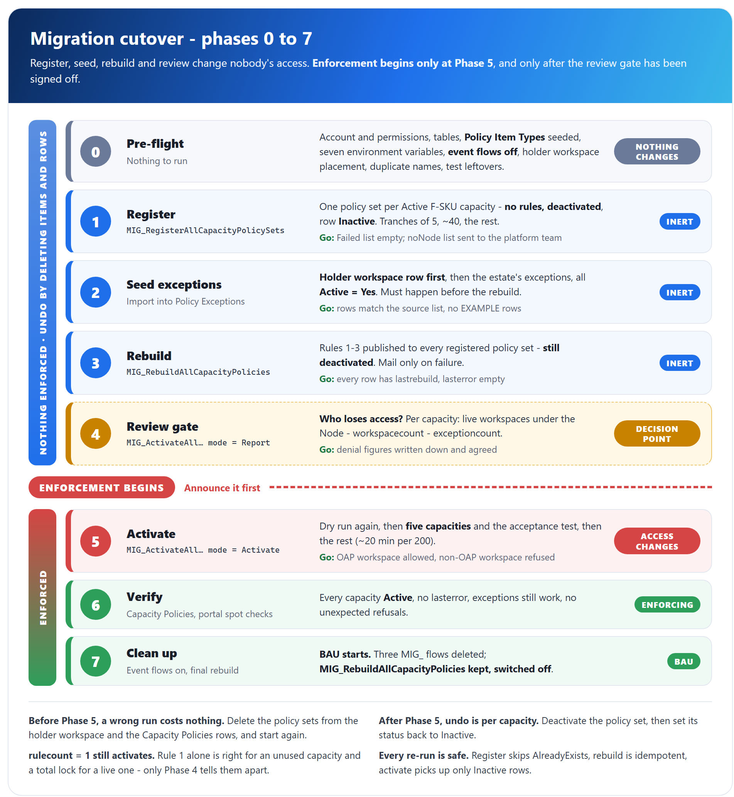

# Fabric Capacity Policies - Migration guide

## Scope of this document

This guide is the operational how-to for the **one-off cutover** that brings the existing Fabric estate under the **Fabric Capacity Policies** solution. It tells the person running the cutover which flow to run in each phase, with what input, what to check afterwards, when to stop and how to undo it.

It does not explain how the four `MIG_` flows work - that is in [ARCHITECTURE-v2.md](./ARCHITECTURE-v2.md) section 5 - and it does not repeat their build detail, which is in the flow specifications under [migration/](../../migration/). Day-to-day operation after cutover is in [CAPACITY-POLICY-OPERATIONS-RUNBOOK.md](../CAPACITY-POLICY-OPERATIONS-RUNBOOK.md).

---

## Contents

1. What the migration does, and why it is phased
2. Pre-flight checklist
3. Phase-by-phase procedure
   - Phase 0 - Pre-flight
   - Phase 1 - Register
   - Phase 2 - Seed exceptions
   - Phase 3 - Rebuild
   - Phase 4 - Review gate
   - Phase 5 - Activate
   - Phase 6 - Verify
   - Phase 7 - Clean up
4. Rollback and emergency
5. After cutover
6. Sign-off checklist
7. Related documents

---

## 1. What the migration does, and why it is phased

**The migration gives every eligible capacity a policy set, fills it with rules from Dataverse, and only then switches enforcement on.** It uses four manual flows in the **UBS Workspace Provisioning** solution, run by hand in a fixed order:

| Flow | Phase | What it does |
|---|---|---|
| `Fabric Pol - MIG_RegisterAllCapacityPolicySets` | 1 | Creates one policy set per Active F-SKU capacity - **no rules, deactivated** - and a `Capacity Policies` row with `Status = Inactive` |
| `Fabric Pol - MIG_InitializeCapacityPolicySet` | 1 | The child flow the register loop calls once per capacity. **Never run it on its own** |
| `Fabric Pol - MIG_RebuildAllCapacityPolicies` | 3 | Publishes rules 1-3 to every registered policy set. Still deactivated |
| `Fabric Pol - MIG_ActivateAllCapacityPolicySets` | 4, 5 | `Report` mode is the dry run; `Activate` mode puts the policy sets into force |

Every published policy set carries the same three rules:

| Rule | Who it is for | Effect |
|---|---|---|
| **Rule 1 - Deny all, Power BI only** | Every workspace on the capacity. Always present | Power BI items only |
| **Rule 2 - OAP workspaces, approved item types** | Workspaces marked `ubsppcoe_oapenabled` in the platform team's inventory | Power BI plus the item types in `Policy Item Types` |
| **Rule 3 - Exceptions, allow all** | Active rows in `Policy Exceptions` | Any item type |



> Source for the diagram: [`diagrams/migration-phases.html`](./diagrams/migration-phases.html). Re-render it with `render-diagram.ps1 migration-phases` after any edit.

**Everything before Phase 5 is inert.** A policy set with no rules, or with rules but deactivated, changes nobody's access. A wrong run in Phases 1-3 is undone by deleting the policy sets from the holder workspace and the rows from `Capacity Policies`, and nobody notices.

**Phase 5 ends that.** An activated policy set with rule 1 and nothing else stops all governed item creation on its capacity; only Power BI items are unaffected. That is why the phases are separate runs with a review gate in front of activation: the gaps between them are where mistakes are caught. **Do not compress the phases.**

All Fabric calls are made as the `workspace provisioning` service account through the *HTTP with Microsoft Entra ID (preauthorized)* connector. Report mails go to the `PolicyMailRecipients` environment variable.

---

## 2. Pre-flight checklist

**Nothing in this section changes anything.** Every item is cheaper to fix now than to discover in Phase 5. The flows, tables and environment variables are assumed to be deployed already, per [DEPLOYMENT-RUNBOOK.md](../DEPLOYMENT-RUNBOOK.md).

### 2.1 Flows

| # | Check | Why |
|---|---|---|
| F1 | **Turn off** `Fabric Pol - InitializeCapacityPolicySet`, `Fabric Pol - AddWorkspaceToPolicy`, `Fabric Pol - RemoveWorkspaceFromPolicy` and `Fabric Pol - RebuildOnExceptionChange` | They fire on Dataverse row changes with nobody pressing anything - including on the `Policy Exceptions` rows seeded in Phase 2 |
| F2 | **Leave `Fabric Pol - DeleteCapacityPolicySet` on** | A Node row soft-deleted between registration and activation moves its `Capacity Policies` row to `Deleted` or `Suspended`, which keeps it out of activation. If it cannot be on, see Phase 5.1 |
| F3 | **Leave `Fabric Pol - RebuildCapacityPolicyRules` on** | It is a child flow; a flow that is off cannot be called as one |
| F4 | **`Fabric Pol - MIG_RebuildAllCapacityPolicies` off** until Phase 3 | An enabled manual flow is one stray button press from publishing rules before exceptions are seeded |
| F5 | No `SyncCapacityPolicySets` flow exists | It was discarded on 2026-09-18 ([discarded/SyncCapacityPolicySets.md](../../discarded/SyncCapacityPolicySets.md)). If one exists, it is a leftover: turn it off and delete it |

### 2.2 Identity and permissions

| # | Check | Needed for |
|---|---|---|
| I1 | The Fabric connection in each `MIG_` flow is signed in as the **`workspace provisioning`** service account, not a personal account left over from a rehearsal | Every phase. A wrong account fails quietly, as a short capacity list |
| I2 | The account is **Contributor** on the holder workspace | Creating policy sets, Phase 1 |
| I3 | The account is **Capacity Admin** on every capacity to be governed | Seeing the capacity at all in Phase 1, and activating it in Phase 5 - the first time the permission is exercised at scale |

Both permissions are granted directly to the account; there is no service principal, app registration or client secret ([SECURITY-AND-IDENTITY.md](../SECURITY-AND-IDENTITY.md) section 2).

### 2.3 Tables and seed data

| # | Table | State required |
|---|---|---|
| T1 | `Capacity Policies` | Exists, empty or nearly so. **No rows left over from testing** - a leftover row makes that capacity answer `AlreadyExists` and be silently skipped |
| T2 | `Policy Item Types` | **Seeded and active**: 14 rows from [input/PolicyItemTypes.csv](../../input/PolicyItemTypes.csv), `Active = Yes` on all of them. An empty or inactive table makes rule 2 carry an empty `item.type` list, which Fabric rejects |
| T3 | `Policy Exceptions` | Exists. Seeding happens in Phase 2 |
| T4 | Holder workspace in Fabric | **No policy sets left over from testing** - a leftover set causes a name collision in Phase 1 |

`Policy Drift` is not part of the solution and must not exist.

### 2.4 Environment variables

All seven need a **Current Value**, not only a Default Value. A missing one fails at runtime with *The workflow parameter ... is not found*, once per capacity, all the way through a run.

| Variable | Value for the cutover |
|---|---|
| `PolicyHolderWorkspaceId` | The holder workspace GUID |
| `PolicySentinelWorkspaceId` | `00000000-0000-0000-0000-000000000000` |
| `PolicyMaxWorkspacesPerRule` | `49` |
| `PolicyMaxRulesPerPolicy` | `50` |
| `PolicyNamePrefix` | `pol_` |
| `PolicyApiBeta` | **No** while the API is in private preview; **Yes** once it is in public-preview beta ([API-BETA-SWITCH.md](../API-BETA-SWITCH.md)). Pointing the wrong way shows up as a `400`/`404` on every capacity with nothing naming the variable |
| `PolicyMailRecipients` | A semicolon-separated list, ideally one distribution group, **read during the migration window**. Read it off the variable - do not assume it is not still pointing at a rehearsal mailbox |

### 2.5 Estate checks

| # | Check | Why |
|---|---|---|
| E1 | **Duplicate capacity display names** | Policy set names are `pol_<capacity display name>`, and Fabric rejects a duplicate with `ItemDisplayNameAlreadyInUse`. If there are any, append the capacity-ID suffix unconditionally in `MIG_InitializeCapacityPolicySet` Step 5a ([spec](../../migration/MIG_InitializeCapacityPolicySet.md)) |
| E2 | **Where the holder workspace sits** | If it is on a capacity this solution will govern, rule 1 will stop the solution creating policy sets in it, and its `Policy Exceptions` row in Phase 2 is **mandatory**. If it sits on a capacity with no `ubsppcoe_Node` row, nothing governs it. Decide which case applies now |
| E3 | **Rollback tooling is reachable** | Undoing an activation uses `deactivate_policy_set.ps1` in `C:\GIT\ubs-policies` (section 4). **To confirm:** that repository is not part of this handover ([HANDOVER-REGISTER.md](../HANDOVER-REGISTER.md) item D4), so confirm someone on the cutover can run it before Phase 5 |

---

## 3. Phase-by-phase procedure

Each phase states what to run, what to check, the go/no-go criterion and how to roll back. Record the outcome of every phase in the sign-off checklist in section 6.

### Phase 0 - Pre-flight

**Run:** nothing.

Work through every row of section 2.

| | |
|---|---|
| **Go** | Every check in section 2 confirmed, and the holder-workspace decision (E2) recorded |
| **No-go** | Any check open. In particular, do not start Phase 1 with the wrong account on the Fabric connection |
| **Rollback** | None needed - nothing has changed |

### Phase 1 - Register

**Run:** `Fabric Pol - MIG_RegisterAllCapacityPolicySets`, manually. **No inputs.** Run it in tranches by cancelling from the run history.

1. **Start the run and check the candidate count.** Let it reach `Compose_eligible_count` and read the value. **If it is materially smaller than the estate, cancel.** `GET /v1/capacities` only returns capacities the `workspace provisioning` account administers, so a short list means the wrong account or missing Capacity Admin - an identity problem, not a data problem.
2. **First tranche - five capacities.** Cancel after about five iterations, then check by eye:

   | Check | Where | Expected |
   |---|---|---|
   | Policy sets exist | Holder workspace, Fabric portal | Five new items |
   | **No rules** | Open one | Empty rule list |
   | **Not activated** | Open one | Inactive |
   | Rows exist | `Capacity Policies` | Five rows |
   | **`Node` populated** | Open a row | A Node lookup, not blank |
   | `Status` | Same row | `Inactive` |
   | Counts | Same row | `ubsppcoe_lastrebuild`, `ubsppcoe_rulecount`, `ubsppcoe_workspacecount` blank |

   **An activated policy set here is deny-all in force on a capacity nobody approved** - the child still carries the BAU activation step. Stop and fix it. **A blank `Node`** means the lookup bind is wrong and the capacity can never be rebuilt: fix the bind, delete the rows and sets, start Phase 1 again.
3. **Second tranche - about 40 capacities.** Re-run; registered capacities answer `AlreadyExists` and are skipped, so each run resumes where the last stopped. Check the `noNode` list is plausible rather than "everything".
4. **The rest.** Re-run and let it complete (roughly 10 seconds per capacity, so 30-40 minutes for 200).
5. **Read the report mail.** It goes to `PolicyMailRecipients` and is sent only when there is something in the `noNode` or failed list; the subject carries all three numbers. A cancelled tranche sends nothing, so check the holder workspace and the table instead.

   | Bucket | Meaning | Action |
   |---|---|---|
   | Registered | Created this run | None |
   | **No Node row** | Active F-SKU in Fabric, but no live `ubsppcoe_Node` row - missing, or soft-deleted (`ubsppcoe_statecode` = 2) | **Hand the list to the platform team.** Nothing was created; these capacities are out of scope until a Node row exists |
   | Failed | Duplicate name, permission, timeout | Fix, then re-run |

| | |
|---|---|
| **Go** | `Failed` is empty after re-runs; every row has `Node` populated and `Status = Inactive`; no policy set is activated; the `noNode` list is with the platform team |
| **No-go** | Short candidate count, any activated policy set, any blank `Node`, or failures not understood |
| **Rollback** | Delete the policy sets from the holder workspace and the `Capacity Policies` rows. Nothing else has happened |

### Phase 2 - Seed exceptions

**Run:** nothing. This is a data import into `Policy Exceptions`, and it **must happen before Phase 3**. Rule 3 is derived from nothing else.

1. **Prepare the file** from [input/PolicyExceptions.csv](../../input/PolicyExceptions.csv). Its headers are the Dataverse logical names. **Delete its three `EXAMPLE` rows first.**
2. **Add the holder workspace row first** if section 2.5 E2 says the holder sits on a governed capacity:

   | Column | Value |
   |---|---|
   | `ubsppcoe_workspacename` | The holder workspace's name, labelled so the row is never revoked by mistake |
   | `ubsppcoe_workspaceid` | The GUID in `PolicyHolderWorkspaceId` |
   | `ubsppcoe_active` | **Yes** |
   | `ubsppcoe_reason` | *Holds the policy set items. Excepting it prevents the policy system locking itself out* |
   | `ubsppcoe_approvedby` | The owner of this solution |

   The row only works if the holder workspace has a **`ubsppcoe_Workspace` row under the Node of its capacity**. Without one there is no rule 3 entry and no error. Ask the platform team if it is missing.
3. **Add the estate's existing exceptions** - from `fabric_workspaces_exceptions.csv` if the migration has one. Take the `workspace_id` column into `ubsppcoe_workspaceid`, set `ubsppcoe_active` to **Yes**, and copy reason and approver. **Do not import `capacity_id`** - the capacity is derived from the workspace's Node at rebuild time - but check that the two agree first: a mismatch is an exception that is about to move capacity on the first rebuild.
4. **Import** through the maker portal: **Tables** > `Policy Exceptions` > **Import** > **Import data from Excel**, file type CSV. Leave the row key `ubsppcoe_policyexceptionid` unmapped.
5. **Check** that every imported row reads `Active = Yes`. `ubsppcoe_active` defaults to **No**, and an unset flag is the usual reason an exception appears to do nothing.

**If the estate has no exceptions and the holder needs none, skip this phase.** Skipping it when there *are* exceptions is invisible: Phase 3 publishes without rule 3, and those workspaces become restricted at Phase 5 with nothing reporting it.

| | |
|---|---|
| **Go** | Row count matches the source list (plus the holder row), all `Active = Yes`, no `EXAMPLE` rows, holder workspace has its `ubsppcoe_Workspace` row |
| **No-go** | Any exception whose workspace is not in `ubsppcoe_Workspace`, or whose Node disagrees with the source CSV and nobody has decided |
| **Rollback** | Correct or remove the imported rows. Nothing has read them yet |

### Phase 3 - Rebuild

**Run:** `Fabric Pol - MIG_RebuildAllCapacityPolicies`, manually. **Turn it on, use Run, then turn it off again.** No inputs.

It rebuilds every `Capacity Policies` row with a policy set, oldest `ubsppcoe_lastrebuild` first, and stamps `ubsppcoe_lastrebuild`, `ubsppcoe_lasterror`, `ubsppcoe_rulecount`, `ubsppcoe_workspacecount` and `ubsppcoe_exceptioncount`. **Still nothing is enforced** - every policy set is deactivated.

Check afterwards:

1. **The mail.** It is sent **only when a capacity failed**, with the failure count in the subject. A clean run sends nothing.
2. **The table.** Every row has a recent `ubsppcoe_lastrebuild` and an empty `ubsppcoe_lasterror`. This is the only proof that a clean run finished.
3. **The portal.** Open one capacity: rule 1 present, plus a rule 2 if it has OAP-enabled workspaces.
4. **An exception.** If Phase 2 seeded any, open a capacity that has one: rule 3 present, with **one** condition and no `item.type`.

| | |
|---|---|
| **Go** | Every row has `ubsppcoe_lastrebuild` set and `ubsppcoe_lasterror` empty, or every remaining failure is understood and accepted |
| **No-go** | Unexplained failures. Fix and re-run - failed capacities sort to the front of the next run |
| **Rollback** | None needed. Rules on a deactivated policy set do nothing, and a re-run overwrites them |

### Phase 4 - Review gate

**Run:** `Fabric Pol - MIG_ActivateAllCapacityPolicySets` with mode **`Report`** (optional, as a smell test). Nothing else.

**This is the decision point, and the reason the phases are separate.** Activation puts rule 1 into force, so every workspace **not** in rule 2 or rule 3 loses the ability to create governed items. The question to answer and sign off is:

> **How many workspaces will lose the ability to create items, on which capacities?**

Per capacity:

```text
live workspaces under the Node    ubsppcoe_Workspace, _ubsppcoe_nodeid_value = the Node, ubsppcoe_statecode eq 1
  - ubsppcoe_workspacecount       in rule 2, stamped in Phase 3
  - ubsppcoe_exceptioncount       in rule 3, stamped in Phase 3
= workspaces that will be denied
```

The first number is not stamped anywhere; it needs a query against `ubsppcoe_Workspace` per capacity, counting every live workspace whatever its OAP flag. A workspace that is both OAP-enabled and excepted is subtracted twice, so treat the result as a lower bound where exceptions exist.

**`ubsppcoe_rulecount` alone is not the answer.** `rulecount = 1` is right for an unused capacity and catastrophic for a live one where the OAP flag was never rolled out; `rulecount > 1` can still deny 498 of 500 workspaces.

| Signal | Action |
|---|---|
| `ubsppcoe_lastrebuild` empty, or `ubsppcoe_lasterror` populated | **Blocker.** Phase 3 did not complete for that capacity. Fix and re-run Phase 3 |
| Denied = 0 | Activate |
| Denied is small and nameable | Have the platform team OAP-enable those workspaces, or add `Policy Exceptions` rows. **Re-run Phase 3**, then activate |
| Denied is large, across many capacities | **Stop.** Whether `ubsppcoe_oapenabled` rollout is complete enough to enforce on is a decision above this project |

**The `Report` mail** lists each candidate capacity with its rule, whitelisted-workspace and exception counts. Look first for **many rules and few whitelisted workspaces**. It cannot show total workspaces per Node, so it is a smell test, not the sign-off.

| | |
|---|---|
| **Go** | Denial figures per capacity **written down and agreed** by the accountable owner (**To confirm:** who signs - the sources say only that a large denial needs a decision above this project), and the activation date announced |
| **No-go** | No written agreement, or any blocker row |
| **Rollback** | None needed - nothing has changed |

### Phase 5 - Activate

**This is the only step that changes access. Announce it before you run it.**

**Run:** `Fabric Pol - MIG_ActivateAllCapacityPolicySets`. The `mode` input is **required**: type `Report` or `Activate` (case does not matter). Anything else terminates the run before a row is read.

**5.1 Dry run - mode `Report`.**

1. Run it. It makes no Fabric call and no Dataverse write - check the run history shows the `Activate` action skipped.
2. Read the `DRY RUN` mail. **Is the count what Phase 4 led you to expect?** Candidates are rows with `Status = Inactive`, a policy set and `ubsppcoe_rulecount` of 1 or more. **Capacities with `rulecount = 1` are included** and will activate with rule 1 alone; Phase 4 is the only thing that stops a total lock on a live capacity. The specification's dry-run mail text still says "a rule count greater than 1" - the filter, not that sentence, decides (**To confirm** whether the built flow's wording was corrected).
3. If `DeleteCapacityPolicySet` was **not** on since Phase 1, check the candidate list by hand against Node rows soft-deleted since registration - this query cannot see `ubsppcoe_Node`.

**5.2 First tranche - mode `Activate`, about five capacities.** Cancel from the run history after about five, then on one of them:

- [ ] Policy set shows **Active** in the portal
- [ ] Its `Capacity Policies` row shows `Status = Active` and `ubsppcoe_lasterror` empty
- [ ] **A governed item created in a whitelisted (OAP) workspace - allowed**
- [ ] **A governed item created in a non-whitelisted workspace - refused**
- [ ] **If the holder workspace sits on this capacity, an item created in it - allowed** (the Phase 2 exception working)

The two creation tests are the acceptance test for the whole project. **Stop here if either is wrong** - five capacities is recoverable; two hundred is an incident.

**5.3 The rest - mode `Activate` to completion.** Expect about **20 minutes per 200 capacities**: the flow waits 6 seconds after each activation to stay under the tenant-wide limit of 10 activations a minute. Do not try to speed it up.

**5.4 Read the activation mail.** It is sent on every live run, clean or not, and is the record of when the estate went under enforcement. Failed capacities stay `Inactive` with the reason in `ubsppcoe_lasterror` and are **not enforced**. The likeliest cause is missing Capacity Admin. Fix and re-run: only rows still `Inactive` are picked up, and an already-active set (`400 PolicySetAlreadyActive`) counts as activated.

| | |
|---|---|
| **Go** | Acceptance tests passed on the first tranche; final run's failure list empty or every entry understood |
| **No-go** | Either creation test wrong on the first tranche |
| **Rollback** | Per capacity: deactivate the policy set and set `ubsppcoe_status` back to `Inactive` (section 4.2) |

### Phase 6 - Verify

**Run:** nothing new. Read `Capacity Policies` directly, or through `Fabric Pol - ListCapacityPolicySets`.

- [ ] Every migrated capacity present, `Status = Active`, `ubsppcoe_lastrebuild` recent, `ubsppcoe_lasterror` empty
- [ ] Three capacities spot-checked in the portal: rule 1 present, rule 2 copies consistent with `ubsppcoe_workspacecount`
- [ ] A workspace from the exceptions list can still create any item type on its capacity
- [ ] Nobody is reporting refusals they should not be getting

| | |
|---|---|
| **Go** | All four checks pass |
| **No-go** | Unexpected refusals - use the emergency procedure in section 4.3, then find the cause |
| **Rollback** | As Phase 5, per capacity |

### Phase 7 - Clean up

1. **Turn the four Dataverse-triggered BAU flows back on:** `Fabric Pol - InitializeCapacityPolicySet`, `Fabric Pol - AddWorkspaceToPolicy`, `Fabric Pol - RemoveWorkspaceFromPolicy` and `Fabric Pol - RebuildOnExceptionChange`. **This is the moment business as usual starts** - from here, row changes publish themselves.
2. **Run `Fabric Pol - MIG_RebuildAllCapacityPolicies` once more** (on, Run, off) and confirm every `ubsppcoe_lastrebuild` moved. It is the only estate-wide check there is, and it picks up any OAP flag, Node move or exception change made while the event flows were off.
3. **Check for capacities added during the window.** The rebuild only covers capacities already in `Capacity Policies`. **To confirm:** a `ubsppcoe_Node` row added while `InitializeCapacityPolicySet` was off is not expected to be replayed when the flow is turned on, so compare Node rows created since Phase 1 (and the `noNode` list) against `Capacity Policies`, and ask the platform team to re-save any missing row so the BAU flow fires.
4. **Delete the three disposable `MIG_` flows** - turn off, then delete `Fabric Pol - MIG_RegisterAllCapacityPolicySets`, `Fabric Pol - MIG_InitializeCapacityPolicySet` and `Fabric Pol - MIG_ActivateAllCapacityPolicySets`. Do this only after Phase 6 is signed off.
5. **Hand over what is outstanding:** the Phase 1 `noNode` list to the platform team; the Phase 4 denial figures and who signed them; every capacity activated at `rulecount = 1` and whether it is genuinely unused or awaiting OAP rollout.

| | |
|---|---|
| **Go** | Event flows on, final rebuild clean, three `MIG_` flows deleted, hand-over sent |
| **Rollback** | Turning an event flow off again is safe. A deleted `MIG_` flow can only be rebuilt from its specification |

---

## 4. Rollback and emergency

### 4.1 If you have to stop halfway

| Stopped after | State | What is enforced |
|---|---|---|
| Phase 1, 2, 3 or 4 | Policy sets exist, with or without rules, all deactivated | **Nothing** |
| **Phase 5, partway** | Some capacities `Active` | **Only the activated ones** |

**Stopping before Phase 5 is free** - leave it, or delete the policy sets and rows. **Stopping partway through Phase 5 is stable, not broken**: activated capacities are governed, the rest are as they were. Re-run mode `Activate` to finish, or roll back the activated ones.

**Do not leave Phase 5 part-done and walk away.** While the event flows are off, nothing keeps activated capacities current. If Phase 5 pauses for more than a day, run `MIG_RebuildAllCapacityPolicies` before stopping and again before resuming.

### 4.2 Undoing activation for one capacity

1. Deactivate the policy set: `.\deactivate_policy_set.ps1 -WorkspaceId <holderWorkspaceId> -PolicySetId <policySetId>`, from `C:\GIT\ubs-policies`.
2. Set that capacity's `ubsppcoe_status` back to `Inactive` in `Capacity Policies`, so a re-run of Phase 5 picks it up again.

Deactivated, the policy set enforces nothing and its rules stay published, so re-activating later needs no rebuild.

### 4.3 Emergency - people are blocked

Use 4.2 for each affected capacity, then find the cause ([CAPACITY-POLICY-OPERATIONS-RUNBOOK.md](../CAPACITY-POLICY-OPERATIONS-RUNBOOK.md) section 8). Two things not to do:

- **Do not delete the policy set.** It loses the registration and makes recovery a re-run of the whole migration for that capacity.
- **Do not delete rules to unlock.** A policy with zero rules is unenforced, and the next rebuild silently re-locks it.

| Symptom | Likely cause |
|---|---|
| Whole capacity locked, `rulecount = 1` | No workspace on it has `ubsppcoe_oapenabled = true` - a Phase 4 miss |
| One workspace refused, others fine | Not whitelisted or excepted, or its `Node` points elsewhere |
| Everything refused across many capacities | `Policy Item Types` mis-seeded |
| Every Fabric call failing `400`/`404` | `PolicyApiBeta` pointing the wrong way for the API's release stage |

---

## 5. After cutover

| Component | State after cutover |
|---|---|
| `Fabric Pol - MIG_RegisterAllCapacityPolicySets` | **Deleted.** No BAU role |
| `Fabric Pol - MIG_InitializeCapacityPolicySet` | **Deleted.** Unsafe standalone - it has no eligibility check |
| `Fabric Pol - MIG_ActivateAllCapacityPolicySets` | **Deleted.** New capacities are activated one at a time by `InitializeCapacityPolicySet` |
| `Fabric Pol - MIG_RebuildAllCapacityPolicies` | **Kept, switched off** - the only estate-wide repair tool. Turn on, Run, turn off |
| `Fabric Pol - InitializeCapacityPolicySet`, `AddWorkspaceToPolicy`, `RemoveWorkspaceFromPolicy`, `RebuildOnExceptionChange` | **Switched on** in Phase 7 |
| `Fabric Pol - DeleteCapacityPolicySet`, `RebuildCapacityPolicyRules`, `ListCapacityPolicySets` | On, unchanged |

**New capacities no longer need this guide.** A row added to `ubsppcoe_Node` triggers `InitializeCapacityPolicySet`, which creates, registers, rebuilds and activates that capacity on its own - including the capacities on the Phase 1 `noNode` list, once the platform team adds their rows.

**Nothing converges the estate on its own, and nothing observes it.** A failed event flow, a workspace moved between Nodes, a hard-deleted exception row or a hand-edited rule all persist until someone runs `MIG_RebuildAllCapacityPolicies` (**Q49**), and a policy set deactivated or deleted outside the flows is not detected at all (**Q11**). Both are in [ADR.md](../ADR.md).

---

## 6. Sign-off checklist

| # | Phase | Check | Evidence | Signed by / date |
|---|---|---|---|---|
| 1 | 0 | Section 2 complete: four event flows off, `DeleteCapacityPolicySet` and `RebuildCapacityPolicyRules` on, account, permissions, tables, seven variables, duplicate names, leftovers | Checklist | |
| 2 | 0 | Holder-workspace placement decided (governed or not) | Note | |
| 3 | 1 | `Compose_eligible_count` matches the expected estate | Run history | |
| 4 | 1 | First tranche: no rules, not activated, `Node` populated, `Status = Inactive` | Portal, table | |
| 5 | 1 | `Failed` empty; `noNode` list handed to the platform team | Report mail | |
| 6 | 2 | `Policy Exceptions` seeded, holder row first, all `Active = Yes`, no `EXAMPLE` rows | Table | |
| 7 | 3 | Every row has `ubsppcoe_lastrebuild`, `ubsppcoe_lasterror` empty; rule 3 seen where expected | Table, portal | |
| 8 | 4 | Per-capacity denial figures written down and **agreed** | Sign-off record | |
| 9 | 5 | `Report` dry-run count matches Phase 4 | Dry-run mail | |
| 10 | 5 | First tranche acceptance test: OAP workspace allowed, non-OAP workspace refused, holder workspace allowed | Test record | |
| 11 | 5 | Full activation run; failures resolved or accepted | Activation mail | |
| 12 | 6 | All migrated capacities `Active`, no errors; exceptions still work; no unexpected refusals | Table, portal | |
| 13 | 7 | Event flows on; final `MIG_RebuildAllCapacityPolicies` run clean; no capacity added during the window left unregistered | Table | |
| 14 | 7 | Three `MIG_` flows deleted; `MIG_RebuildAllCapacityPolicies` kept, off | Solution | |
| 15 | 7 | Hand-over sent: `noNode` list, Phase 4 figures, `rulecount = 1` activations | Mail | |

---

## 7. Related documents

| Document | What it covers |
|---|---|
| [ARCHITECTURE-v2.md](./ARCHITECTURE-v2.md) | The solution, the three rules, and section 5 - what each `MIG_` flow does |
| [migration/MIG_RegisterAllCapacityPolicySets.md](../../migration/MIG_RegisterAllCapacityPolicySets.md) | Build specification - Phase 1 loop |
| [migration/MIG_InitializeCapacityPolicySet.md](../../migration/MIG_InitializeCapacityPolicySet.md) | Build specification - Phase 1 child, including the duplicate-name suffix |
| [migration/MIG_RebuildAllCapacityPolicies.md](../../migration/MIG_RebuildAllCapacityPolicies.md) | Build specification - Phase 3 and estate-wide repair |
| [migration/MIG_ActivateAllCapacityPolicySets.md](../../migration/MIG_ActivateAllCapacityPolicySets.md) | Build specification - Phases 4 and 5 |
| [CAPACITY-POLICY-MIGRATION-RUNBOOK.md](../CAPACITY-POLICY-MIGRATION-RUNBOOK.md) | The detailed runbook this guide consolidates |
| [CAPACITY-POLICY-TABLES.md](../CAPACITY-POLICY-TABLES.md) | Table schemas, seeding `Policy Item Types` and `Policy Exceptions`, environment variables (section 8.11) |
| [DEPLOYMENT-RUNBOOK.md](../DEPLOYMENT-RUNBOOK.md) | Everything that must be deployed before Phase 0 |
| [CAPACITY-POLICY-OPERATIONS-RUNBOOK.md](../CAPACITY-POLICY-OPERATIONS-RUNBOOK.md) | Business as usual after cutover, and the emergency unlock |
| [TROUBLESHOOTING.md](../TROUBLESHOOTING.md) | Symptoms and causes |
| [SECURITY-AND-IDENTITY.md](../SECURITY-AND-IDENTITY.md) | The `workspace provisioning` account and its permissions |
| [API-BETA-SWITCH.md](../API-BETA-SWITCH.md) | The `PolicyApiBeta` toggle |
| [ADR.md](../ADR.md) | Open questions Q11 and Q49 |
| [HANDOVER-REGISTER.md](../HANDOVER-REGISTER.md) | Item D4 - the rollback scripts live outside this handover |
