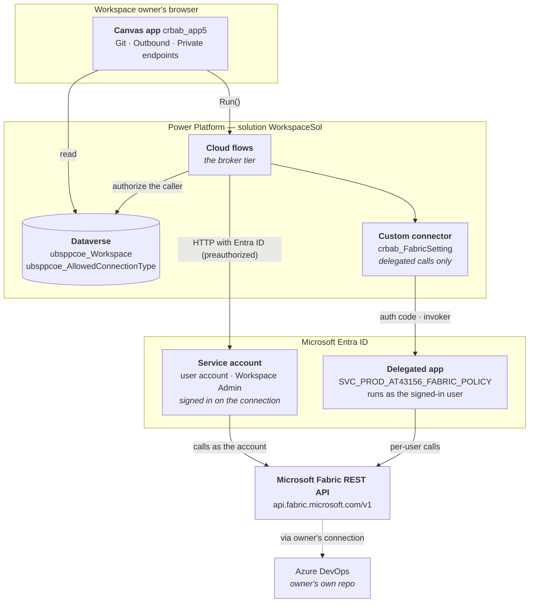
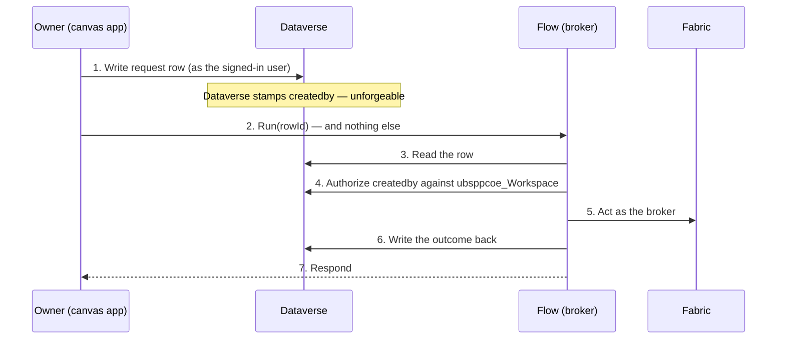
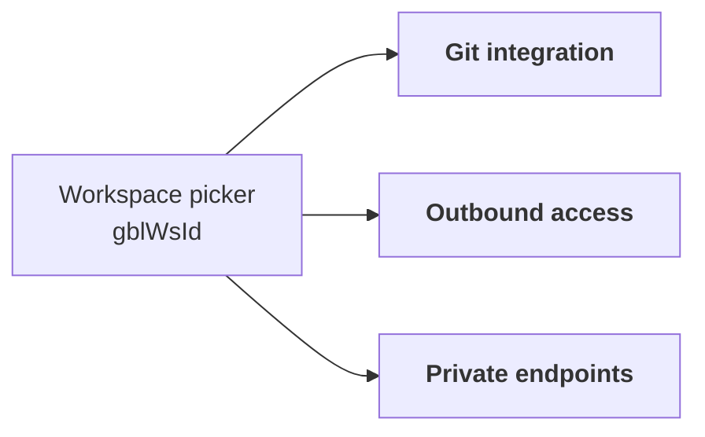
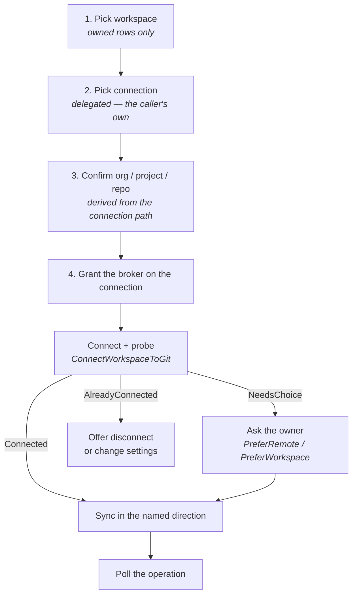
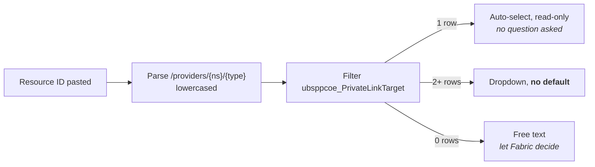

# Fabric Workspace Settings — Architecture

**Solution:** `WorkspaceSol` · **Version:** 1.0.0.12 · **Platform:** Microsoft Power Platform + Microsoft Fabric REST API
**Document version:** 1.0 · **Date:** 2026-09-25 · **Status:** For customer review

---

## Scope of this document

This document describes the architecture of the **Fabric Workspace Settings** solution — a Power Platform application that lets Fabric workspace owners configure **Git integration**, **outbound access**, and **managed private endpoints** for the workspaces they own, without holding the Fabric *Workspace Admin* role.

**Companion documents**

| Document | Answers |
|---|---|
| [PERMISSIONS.md](./PERMISSIONS.md) | Which rights every party must hold, and who grants them |
| [SECURITY.md](./SECURITY.md) | Security requirements, controls, trust boundaries and residual risk |
| [MIGRATION.md](./MIGRATION.md) | Everything that must be done to stand the solution up in a new tenant or environment |

Build-level detail — per-flow logic, connector definition, canvas app construction — lives in the engineering documentation under [`docs/`](../docs).

---

## Contents

1. [The problem](#1-the-problem)
2. [Solution overview](#2-solution-overview)
3. [Component inventory](#3-component-inventory)
4. [Identity model](#4-identity-model)
5. [Authorization boundary](#5-authorization-boundary)
6. [Functional architecture — the three tabs](#6-functional-architecture--the-three-tabs)
7. [Flow inventory](#7-flow-inventory)
8. [Data model](#8-data-model)
9. [Integration surface — Fabric REST API](#9-integration-surface--fabric-rest-api)
10. [Design decisions and their rationale](#10-design-decisions-and-their-rationale)
11. [Architectural constraints and known limitations](#11-architectural-constraints-and-known-limitations)

---

## 1. The problem

The estate contains roughly **4000 Fabric workspaces**. Their owners need to configure Git integration, outbound access rules and managed private endpoints for the workspaces they own.

Every one of those operations requires the Fabric **Workspace Admin** role. Workspace owners hold **Contributor** and will not be granted Admin — doing so would let each of them reconfigure any workspace they can reach, across the whole estate.

The requirement is therefore to deliver a *specific, bounded set of administrative capabilities* to a large population of non-administrators, without widening their standing privilege.

The answer is a **broker**: a Power Platform application that performs the privileged calls under a service principal, and uses **Dataverse as the authorization boundary** to decide whether the caller is entitled to act on the workspace they have named.

### The governing design principle

> **Broker only what genuinely requires Admin. Leave everything else in the Fabric UI, where the owner already has rights.**

This is not a stylistic preference — it directly reduces attack surface and maintenance cost. Applying it to Git integration removed four planned flows and two planned tables, because the Fabric permission model already lets a Contributor commit, update from Git, view connection details and read Git status unaided. Only **connect**, **disconnect** and **change connection settings** require Admin, so only those are brokered.

---

## 2. Solution overview

### Four tiers, one responsibility each

| Tier | Responsibility | Holds credentials? |
|---|---|---|
| **Canvas app** | Presentation, workspace selection, and every decision requiring the owner's judgement | **No** |
| **Cloud flows** | The broker. Authorize the caller against Dataverse, call Fabric through the preauthorized connector, flatten the result into a string response | **No** — the platform holds the connection |
| **Dataverse** | The authorization record and reference data. The only component that can answer *"does this user own this workspace?"* | No |
| **Custom connector** | Delegated Fabric calls, and only those. Every brokered call bypasses it entirely | Yes — the delegated app's secret |

The separation matters: the presentation tier holds nothing an attacker would want, and the tier that holds the privileged identity is never directly reachable by a user.

> **No flow acquires a token, and no flow holds a secret.** Brokered Fabric calls use the **HTTP with Microsoft Entra ID (preauthorized)** connector, which attaches the bearer token for the account its connection signed in as. There is no client-credentials block, no `Authorization` header and no `accessToken` variable anywhere in the solution.

---

## 3. Component inventory

### Solution manifest

| Property | Value |
|---|---|
| Unique name | `WorkspaceSol` |
| Version | `1.0.0.12` |
| Managed | No — exported **unmanaged** |
| Publisher | `Crf5954`, customization prefix `crbab` |
| Prefix — this solution's components | `crbab` — flows, canvas app, custom connector, environment variables, connection references |
| Prefix — tables | **`ubsppcoe`** — and the tables are **not in this solution** |

> ### Two prefixes, two solutions, and the tables are not ours
>
> **Every component this solution owns carries `crbab_`.** The flows, the canvas app, the `crbab_FabricSetting` connector, its environment variable and all six connection references.
>
> **The Dataverse tables carry `ubsppcoe_` and live in a separate, shared solution** owned by the platform team. This solution reads and writes them; it does not define them, and they do not travel with its export. A target environment without that shared solution cannot run any of this.

## 4. Identity model

Two identities, deliberately separated, because they answer two different questions.

| | **Broker** — the service account | **Delegated app** — `SVC_PROD_AT43156_FABRIC_POLICY` |
|---|---|---|
| Type | **A user account** — email and password | **A service principal** — Entra app registration with a client secret |
| Client ID | — none. There is no app registration | *Per-tenant — read from the app registration* |
| Object ID | *Per-tenant — the account's directory object ID* | — |
| OAuth flow | **Signed in on the connection.** The connector attaches the token | Authorization code, runs as the signed-in user |
| Effective rights | Workspace **Admin** on all managed workspaces | Whatever the calling user already holds |
| Used for | Every privileged write, and most reads | Calls whose *answer depends on who is asking* |
| Reached via | **HTTP with Microsoft Entra ID (preauthorized)** | The custom connector `FabricSetting`, `runtimeSource: invoker` |

> ### The one service principal in the solution, and what it is *not*
>
> **`SVC_PROD_AT43156_FABRIC_POLICY` backs the custom connector `FabricSetting`, and nothing else.** It is the registration whose client ID, client secret and scope list sit on the connector's Security tab.
>
> **It never acts on its own behalf.** The connector runs with `runtimeSource: invoker`, so every call made through it carries the **signed-in user's** rights, acquired by authorization code at connection time. The service principal is the *vehicle* for that delegation, not an identity with privileges of its own — which is why it holds **no application permissions and no Fabric role**.
>
> **Do not confuse it with the broker.** The broker is a user account reached through the preauthorized connector; this is a service principal reached through the custom connector. They are different identities, on different connectors, used for different reasons — and granting this one a Fabric role would quietly turn a delegated call into a privileged one.
>
> Its three delegated scopes and the consent behaviour are in [PERMISSIONS.md](./PERMISSIONS.md) §4.

### When delegation is used — and why it is unavoidable

Delegation is used in exactly two structural circumstances, never as a preference:

1. **The data is per-user.** `ListMyConnections` and `ListGateways` must return *the caller's* list. The service account's list is not the caller's list, and there is no API to ask "what would this user see?"
2. **The right is per-user.** `AddConnectionRoleAssignment` grants the service account access to a connection the owner created. Only the connection's Owner can grant that, so the call must run as the owner.

Everything else brokers through the service account. **Managed private endpoints are the clean illustration:** they are workspace-scoped objects with no per-user view, and their writes require Admin. A delegated create would therefore return `403` for every single user of the application. Brokering is not the preferred design there — it is the only design that works.

### Fabric access comes from a role on the account, and nothing else

A delegated connection has no `roles` claim to inspect and no application permissions to configure. The account's Fabric access requires exactly one thing: **a Fabric-side role on the target object** — workspace, gateway or connection — granted directly to the account.

There is no tenant setting to enable and no security group to join. Both of those belong to the service-principal path, which this solution does not use.

| Symptom | Meaning |
|---|---|
| `401 Unauthorized` on **every** call at once | **The connection, not Fabric.** The account's password rotated or expired, MFA or Conditional Access blocked it, or the account was disabled or unlicensed. Re-authenticate the connection |
| `403 Forbidden` on one object | The connection is healthy; the account lacks the **role on that object** |

> **The run history never says "the connection is the problem".** A lapsed credential presents as `401` across the board, so a wholesale failure means suspect the account before suspecting Fabric.

Full detail: [PERMISSIONS.md](./PERMISSIONS.md).

### Git credentials belong to the owner

The application **never holds Git credentials**. Owners create their own *Azure DevOps — Source Control* connection in Fabric; the broker is granted the `User` role on it at runtime and references it by ID, without ever seeing what is inside it. No API the application calls can even reveal the connection's contents.

A dedicated Git service principal was considered and dropped — it existed only to supply credentials for owners who could not reach Azure DevOps, which is not the case here.

**Consequence to communicate to owners:** Azure DevOps records the commit as pushed by *the connection's identity*, not by the requester. A connection built on a service principal outlives the person who created it; one built on a personal account does not. Which to use is the owner's decision; a service principal is the recommendation, and nothing in the system enforces it.

---

## 5. Authorization boundary

Fabric cannot answer the ownership question. Workspace owners hold no Fabric role that identifies them as owners, so querying `roleAssignments` on a workspace returns nothing useful about them.

**The ownership record therefore lives in Dataverse**, in `ubsppcoe_Workspace`. Every flow that acts on a workspace must confirm the caller appears there as primary or secondary owner, and **fail closed** if not.

### Why write flows cannot trust their own trigger

A Power Apps (V2) trigger receives the user identity as a **parameter**. Anyone who can reach the flow URL can forge it. That is acceptable for a read and unacceptable for a write.

Write operations therefore use the **audit-row pattern**:

Identity is trusted because of **where it was read from**, not because of who called. The flow keeps its Power Apps trigger, so the application still receives an immediate answer.

Two deliberate exceptions:

- **Read flows** may use a plain Power Apps trigger with no row at all.
- **`AddConnectionRoleAssignment` is self-authorizing.** The Fabric API only permits a caller to grant roles on a connection they already control, so the boundary is enforced by the API itself.

> ### ⚠️ Current implementation status
>
> **The ownership check is designed but not yet implemented.** No flow currently performs a `ubsppcoe_Workspace` lookup, and `ubsppcoe_GitAuditLog` does not exist. Each write flow acts on whatever `workspaceId` it is handed.
>
> This is acceptable only while the application's audience is the build team. **It must be implemented before the application is shared with workspace owners.** It is tracked as the top security item in [SECURITY.md](./SECURITY.md) and gates general availability.

---

## 6. Functional architecture — the three tabs

The canvas app presents a workspace picker followed by three independent tabs. `gblWsId` is set before anything else and gates every tab — no workspace, no tab. Each tab owns its load block, its error banner and its collections.

### 6.1 Git integration

Brokers exactly two operations — **connect** and **disconnect** — because those are the only Git actions a Contributor cannot already perform in the Fabric UI. There is no update API for a Git connection, so **changing a branch or directory is disconnect + reconnect**, which the same two flows cover.

The connect path is a wizard whose shape follows from one insight: *the owner cannot sensibly choose an initialization strategy before anyone knows whether both sides hold content.* The application therefore connects first, asks Fabric what it wants done, and raises the question only if Fabric declines to decide.

Three structural choices worth carrying:

- **The role grant happens on the final step**, immediately before the write, so an abandoned wizard leaves no stray role assignments behind.
- **Connect and sync are two flows, not one.** By the time content moves the workspace is already connected, so calling `connect` again would fail. The split also keeps each run inside the 120-second response budget a Power Apps call allows.
- **Organization, project and repository are derived**, never pasted — they come from `connectionDetails.path` on the connection the owner selected.

### 6.2 Outbound access

Reads and writes the workspace's outbound communication policy: allowed connections, allowed gateways, and whether Git integration is permitted outbound.

Everything on this tab lives under `networking/communicationPolicy/outbound/*` — these are Outbound Access Protection's own settings. **When OAP is off they are inert**, so the tab shows nothing but the OAP state and an explanation.

That is a correctness requirement, not tidiness. With OAP off there is no outbound restriction at all, so a greyed-out *Allow Git integration* toggle and an empty *Allowed gateways* list would each tell the owner the exact opposite of the truth about their workspace's posture. **Hide, do not disable.**

`GetOutboundRules` returns an **ETag** that `SetOutboundRules` must echo — optimistic concurrency, so two owners editing simultaneously cannot silently overwrite each other.

### 6.3 Private endpoints

Manages the workspace's **managed private endpoints** — the outbound private-link connections Fabric uses to reach data sources that are not publicly reachable. Three operations: list, create, delete.

Structurally the simplest tab: three HTTP calls against one resource, all brokered, all covered by a role the service account already holds. **No connector change, no new scope, no re-consent, no new Fabric permission, and no Azure RBAC at all** — the Azure-side rights sit entirely with the *approver* at the far end. That is what makes the feature deployable across 4000 workspaces with no Azure onboarding, and it is the property most worth protecting.

**Two independent status fields, and the tab must show both.** Conflating them is the likeliest design mistake here:

| Field | Owned by | Answers |
|---|---|---|
| `provisioningState` | **Fabric** | Did Fabric manage to create the endpoint? |
| `connectionState.status` | **The data source admin, in the Azure portal** | Has the far end accepted the request? |

`Succeeded` + `Pending` is the **normal steady state** for minutes to days after creation, and the endpoint is unusable until it reaches `Approved`. The tab must not present that as an error. `connectionState` is genuinely absent on a freshly created row, so every read of it must be null-safe.

#### Choosing the sub-resource

A private endpoint targets a resource *and a sub-resource* — Azure's private-link group ID. One storage account requires **separate endpoints for `blob` and `dfs`**, each approved separately.

The sub-resource is a property of the resource *type*, not the resource, so the application parses the type out of the resource ID and filters a Dataverse lookup table on it:

Around fifteen types resolve 1:1. Five are genuinely ambiguous — storage, Cosmos DB, Synapse, Purview and Databricks — where the resource ID cannot distinguish the options and only the owner knows which their workload needs.

**There is deliberately no default on that dropdown**, because of the sharper of the two failure modes:

| Failure | What happens |
|---|---|
| Sub-resource **invalid** for the type | Fabric accepts the `POST` with `201` — it does not validate — then provisioning fails. The row shows `Failed`; the owner deletes and recreates. Visible and self-correcting |
| Sub-resource **valid but not the one needed** | Provisions to `Succeeded`, gets approved, `connectionState` reads `Approved` — **and the workload still fails**, because its traffic goes to a hostname this endpoint does not cover. Every signal the application can see says success |

The second is why the picker constrains rather than guesses, and why the application always re-lists after a create: `outcome: Created` means the request was accepted, not that the endpoint works.

An endpoint showing `Failed` needs no diagnosis and no support ticket — it means the sub-resource was wrong. Delete it and create the right one.

---

## 7. Flow inventory

All flows live in [`Workflows/`](../Workflows) as unpacked solution JSON. They are edited in the maker portal and re-exported, and are **never hand-edited**.

**19 flows are built.** Every flow the application calls is added to the canvas app explicitly.

> **`GetFabricToken` is gone.** It existed only to run the client-credentials grant and hold the secret. With the preauthorized connector there is nothing left for it to do — see §4.

### Git integration — 7 flows

| Flow | Identity | Purpose |
|---|---|---|
| `GetWorkspaceGitState` | Service account | Read the current connection so the tab knows what to offer |
| `ListMyConnections` | **Delegated** | The caller's own Azure DevOps connections, filtered client-side |
| `AddConnectionRoleAssignment` | **Delegated** | Grant the service account the `User` role on the owner's connection |
| `ConnectWorkspaceToGit` | Service account | Stage 1 — connect, then probe for the required sync direction |
| `SyncWorkspaceWithGit` | Service account | Stage 2 — move the content |
| `DisconnectWorkspaceFromGit` | Service account | Disconnect. Also the only route to a branch or directory change |
| `GetGitOperationStatus` | Service account | Report the state of a long-running operation. Advances nothing |

### Networking — 8 flows

| Flow | Identity | Purpose |
|---|---|---|
| `GetOAPSetting` | Service account | Is Outbound Access Protection enabled? |
| `GetOutboundRules` / `SetOutboundRules` | Service account | Allowed outbound connections, with ETag concurrency |
| `GetGatewayRules` / `SetGatewayRules` | Service account | Allowed gateways |
| `GetGitPolicy` / `SetGitPolicy` | Service account | Outbound Git permission |
| `ListGateways` | **Delegated** | Gateways the caller can actually see |

### Supporting — 1 flow

| Flow | Identity | Purpose |
|---|---|---|
| `GetMyEmail` | Office 365 Users | Resolve the signed-in user's email for the ownership lookup |

### Private endpoints — 3 flows

| Flow | Identity | Purpose |
|---|---|---|
| `ListPrivateEndpoints` | Service account | Paged read of the workspace's endpoints |
| `CreatePrivateEndpoint` | Service account | Request a new endpoint. Returns `201` immediately, no polling |
| `DeletePrivateEndpoint` | Service account | Remove one |

**Built and tested 2026-09-02.** Build documentation is under [`docs/flows/nocustomcon/`](../docs/flows/nocustomcon).

> **Those three build documents still describe the token-flow model** — a `GetFabricToken` child call and an `Authorization` header. The Fabric routes, bodies and error handling they specify are accurate; only the auth mechanism has since changed to the preauthorized connector.

---

## 8. Data model

| Table | Role | Status |
|---|---|---|
| `ubsppcoe_Workspace` | **The authorization boundary.** Workspace ID plus primary and secondary owner. Populated externally | ✅ Exists — shared solution |
| `ubsppcoe_AllowedConnectionType` | Reference data for the outbound tab | ✅ Exists — shared solution |
| `ubsppcoe_PrivateLinkTarget` | Resource type → valid private-link sub-resources. One row per pair, seeded from [`data/PrivateLinkTargets.csv`](../data/PrivateLinkTargets.csv) | ✅ Exists — shared solution. **Seed rows are per environment** |
| `ubsppcoe_GitAuditLog` | Who did what, when and with what outcome — and the row that carries unforgeable identity into a write flow | ❌ Must be created |

**None of these tables is in `WorkspaceSol`.** They carry the `ubsppcoe_` prefix and belong to the platform team's shared solution, so none travels with this solution's export — see §3. `ubsppcoe_Workspace` is populated by external workspace-provisioning automation and is out of scope for this solution.

### Two rules that hold across all tables

- **Create tables in the maker portal, never by editing `customizations.xml`.**
- **Do not cache Fabric state in Dataverse.** Two tables — `ubsppcoe_GitConnection` and `ubsppcoe_WorkspaceGitMapping` — were designed and then dropped for exactly this reason: Fabric owns that state, the GET APIs return it live, and a local copy is only ever a second source of truth to reconcile.

### Why `ubsppcoe_PrivateLinkTarget` is flat

It is a flat type → sub-resource table rather than a parent/child model on purpose. The picker is a filter on one table, and supporting a newly added Azure source is **one row** — addable by anyone with Dataverse access, with no application republish. That matters because Fabric's supported-source list grows faster than a shipped list would realistically be maintained.

There is also no API that could replace it. Fabric publishes nothing. Azure's `privateLinkResources` call is authoritative but requires Reader RBAC on every target resource — which would mean onboarding the broker into every subscription any owner might target, and would destroy the single best property of the feature (§6.3).

---

## 9. Integration surface — Fabric REST API

Base: `https://api.fabric.microsoft.com/v1`

### Git endpoints

| Endpoint | Behaviour |
|---|---|
| `GET /workspaces/{id}/git/connection` | Returns `200` + `NotConnected` when disconnected — **not** `404` |
| `POST .../git/connect` | Synchronous |
| `PATCH .../git/myGitCredentials` | Per-identity; the broker must set `ConfiguredConnection` |
| `POST .../git/initializeConnection` | Returns `requiredAction`, `workspaceHead`, `remoteCommitHash` — **or `202` with an empty body** |
| `GET .../git/status` | May return `202` on a cold workspace |
| `POST .../git/commitToGit` | `202` + `x-ms-operation-id` |
| `POST .../git/updateFromGit` | `202` + `x-ms-operation-id` |
| `POST .../git/disconnect` | Synchronous |
| `GET /operations/{id}` and `/result` | Long-running-operation polling |

**State enumerations**

- `gitConnectionState`: `NotConnected` · `Connected` · `ConnectedAndInitialized`
- `requiredAction`: `CommitToGit` · `UpdateFromGit` · `None`

**Sync request bodies — what is actually required**

| API | Required | Optional |
|---|---|---|
| `commitToGit` | `mode` | `workspaceHead`, `comment`, `items` |
| `updateFromGit` | **`remoteCommitHash`** | `workspaceHead`, `conflictResolution`, `options` |

`workspaceHead` is optional in both and *"may be null only after Initialize Connection"*. Sending a stale value returns `WorkspaceHeadMismatch`.

### Networking and private-endpoint endpoints

| Endpoint | Purpose |
|---|---|
| `GET/PATCH /workspaces/{id}/networking/communicationPolicy/outbound/*` | Outbound access settings, ETag-guarded |
| `GET /gateways` · `GET /gateways/{id}/roleAssignments` | Gateway discovery. Role assignments need `ConnectionCreator` or higher |
| `GET /connections` · `POST /connections/{id}/roleAssignments` | Connection discovery and role grant, both delegated |
| `GET/POST/DELETE /workspaces/{id}/managedPrivateEndpoints` | Managed private endpoints |

---

## 10. Design decisions and their rationale

| Decision | Rationale |
|---|---|
| **Broker only connect and disconnect for Git** | Contributors already commit, update and read status in the Fabric UI. Brokering them would add four flows and two tables while widening the broker's exposure for no functional gain |
| **Dataverse, not Fabric, is the authorization boundary** | Fabric holds no record that identifies a workspace *owner*; the ownership fact exists only in Dataverse |
| **Writes authorize on `createdby`, not on a trigger parameter** | A Power Apps trigger parameter is forgeable by anyone who can reach the flow URL. A Dataverse `createdby` stamp is not |
| **A dedicated broker identity, not the existing tenant-wide one** | `sp_fabric_monit` holds `Tenant.Read.All` / `Tenant.ReadWrite.All` and was deliberately **not** reused. An application exposed to 4000 workspace owners must not run on a tenant-wide identity |
| **The broker is a service account reached through the preauthorized connector, not a service principal** | The connector attaches the token itself, so the solution holds no client secret, needs no app registration for the broker, and depends on no tenant setting. The cost is a user-account credential that must be kept permanently valid — see [SECURITY.md](./SECURITY.md) §4 |
| **Owners supply their own Git connection** | Keeps Git credentials entirely outside the solution, and makes credential durability the owner's explicit choice |
| **Connect and sync are separate flows** | Respects the 120-second Power Apps response budget, and avoids re-calling `connect` on an already-connected workspace |
| **Never branch on the initialization strategy** | The strategy tells Fabric *how to resolve initialization*; `requiredAction` tells the application *which way to sync*. They are not the same question |
| **No local cache of Fabric state** | Avoids a second source of truth that must be reconciled. The GET APIs are live and authoritative |
| **No Azure RBAC anywhere in the design** | Keeps managed private endpoints deployable across 4000 workspaces with zero Azure onboarding |
| **Treat "already exists" as success** | A duplicate role grant returns `409`; a re-initialized connection returns `409`. The end state is the one that was wanted — failing the run would show the user an error describing exactly the state they asked for |

---

## 11. Architectural constraints and known limitations

### Platform constraints

| Constraint | Consequence |
|---|---|
| **No update API for a Git connection** | Changing a branch or directory is disconnect + connect + initialize. There is no `PATCH` |
| **`directoryName` must already exist in the branch** | Connect returns `GitProviderResourceNotFound` otherwise. The Fabric portal offers to create the folder; the REST API has no equivalent. Folder names are **case-sensitive** |
| **Sync is all-or-nothing and validates item models** | An item holding a relative OneLake reference to a table absent from the target workspace fails the entire operation with `GitSyncFailed`. The real cause appears only in `error.moreDetails` from `GET /operations/{id}` |
| **`initializeConnection` may return `202` with no body** | None of the three response fields exist; the operation must be polled before the sync direction is known |
| **`ListGateways` pages are capped at five** | The pagination loop stops after five pages by design. A truncated list is returned that looks complete |
| **Fabric does not validate private-endpoint sub-resources** | An invalid sub-resource is accepted with `201` and fails later at provisioning (§6.3) |
| **Fabric Git restriction, December 1 2026** | Users without read-write permission on workspace items will not be able to use Git integration. Sensitivity labels and protection policies may block Git operations even for Contributors. Accepted risk; monitor |

### Power Platform conventions that the implementation depends on

These are not preferences — each was established after a real defect, and departing from them reintroduces it.

| Convention | Why |
|---|---|
| **Every Power Apps response field is a string** | A field declared `boolean` but emitted through `@{...}` interpolation returns the *string* `"true"`. Validation applies to the **whole response**, so the application then cannot read *any* field of that flow. Emit `string(...)` and coerce in Power Fx |
| **Power Apps trigger inputs are positional** | They are stored as `text`, `text_1`, `text_2`. The name shown is only a title. Inserting an input in the middle silently re-wires everything after it |
| **Make trigger inputs required** | A blank *optional* input is omitted from the trigger body entirely, and is indistinguishable in run history from one that was never wired. This is how an owner's initialization-strategy choice went missing with no error |
| **Re-add a flow to the application after any trigger change** | Power Apps caches the signature at bind time |
| **Respond on *Succeeded or Failed*** | A skipped action satisfies neither run-after condition, so a Fabric error ends the run with **no response at all** and the application shows a hard error instead of a readable message. This defect appeared independently in three separate flows |
| **Gate "empty" messages on a loaded flag** | A blank collection is falsy, so *"no results"* flashes on every workspace that does have some |
| **Guard optional trigger reads** | `triggerBody()?['text_2']` must be wrapped in `coalesce(…,'')`. The unguarded form throws |

### Naming inconsistency to be aware of

`GetGitOperationStatus` was renamed in place from `PollFabricOperation`, which preserved its GUID and connection references. **The canvas app must still call it as `PollFabricOperation.Run(...)`** — a rename changes the display name only, while the identifier Power Fx binds to is fixed when the flow is created. Using the new name yields *"'Run' is an unknown or unsupported function in namespace 'GetGitOperationStatus'"*. This is the solution's only such mismatch.

---

## Where to go next

| For | Read |
|---|---|
| Required permissions for every party | [PERMISSIONS.md](./PERMISSIONS.md) |
| Security requirements, controls and residual risk | [SECURITY.md](./SECURITY.md) |
| Deployment to a new tenant or environment | [MIGRATION.md](./MIGRATION.md) |
| Per-flow behaviour and verified test paths | [`docs/FLOWS.md`](../docs/FLOWS.md) |
| Custom connector configuration | [`docs/CUSTOM-CONNECTOR.md`](../docs/CUSTOM-CONNECTOR.md) |
| Canvas app build guides | [`docs/APP-GIT-TAB.md`](../docs/APP-GIT-TAB.md), [`docs/APP-OUTBOUND-TAB.md`](../docs/APP-OUTBOUND-TAB.md), [`docs/APP-PRIVATE-ENDPOINTS-TAB.md`](../docs/APP-PRIVATE-ENDPOINTS-TAB.md) |
| Open defects and undecided points | [`docs/OPEN-ISSUES.md`](../docs/OPEN-ISSUES.md) |
