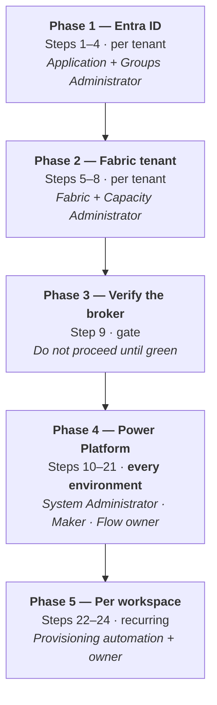

# Fabric Workspace Settings — Migration Actions

**Solution:** `WorkspaceSol` · **Version:** 1.0.0.12 · **Document version:** 1.0 · **Date:** 2026-09-25 · **Status:** For customer review

Companion to [ARCHITECTURE.md](./ARCHITECTURE.md), [PERMISSIONS.md](./PERMISSIONS.md) and [SECURITY.md](./SECURITY.md).

---

## Scope of this document

This document is the **runbook for standing the solution up in a new tenant or a new Power Platform environment**. It lists every action, in order, with who performs it, what it looks like when it is skipped, and how to verify it worked.

**The governing fact:**

> **The solution export carries almost nothing that makes the solution work.** It carries flows, two tables, a canvas app, a connector definition, connection *references* and environment variable *defaults*. Everything else — identities, tenant settings, secrets, bindings, roles, sharing, run-only users, two tables and the reference data — is configured by hand and must be redone.

**Out of scope.** The capacity-scoped `ItemCreation` policy solution migrates separately and shares no components with this one.

---

## Contents

1. [What the export does and does not carry](#1-what-the-export-does-and-does-not-carry)
2. [Migration at a glance](#2-migration-at-a-glance)
3. [Phase 1 — Entra ID (per tenant)](#phase-1--entra-id-per-tenant)
4. [Phase 2 — Fabric tenant (per tenant)](#phase-2--fabric-tenant-per-tenant)
5. [Phase 3 — Verify the broker before going further](#phase-3--verify-the-broker-before-going-further)
6. [Phase 4 — Power Platform (per environment)](#phase-4--power-platform-per-environment)
7. [Phase 5 — Per workspace (recurring)](#phase-5--per-workspace-recurring)
8. [The five that bite on every deployment](#the-five-that-bite-on-every-deployment)
9. [Post-migration verification](#post-migration-verification)
10. [Rollback](#rollback)
11. [Known migration defects](#known-migration-defects)

---

## 1. What the export does and does not carry

Verified against the solution export on 2026-09-25.

### ✅ Carried by the export

| Component | Count | Note |
|---|---|---|
| Cloud flows | 17 | Definitions only — connections, secrets and run-only settings do not travel |
| Dataverse tables | 2 | `crbab_Workspaces`, `crbab_AllowedConnectionType` — **schema only, no data** |
| Canvas app | 1 | `crbab_app5` |
| Custom connector | 1 | `ab_gateway-5flst-5fapp-5fcon` — **including a hardcoded tenant ID** |
| Connection references | 5 | 4 × custom connector, 1 × Office 365 Users — **arrive unbound** |
| Environment variables | 3 | `ab_TenantId`, `ab_BrokerClientId`, `ab_BrokerObjectId` — **values are defaults, not bindings** |

### ❌ Not carried — must be created or configured

| Item | Phase |
|---|---|
| Both Entra app registrations and their secrets | 1 |
| The `fabric_power_app_grp` security group | 1 |
| The Entra group backing the Dataverse group team | 1 |
| Fabric tenant settings | 2 |
| Workspace Admin grants and capacity assignment | 2 |
| Binding of the 5 connection references to real connections | 4 |
| Environment variable **values** for the target tenant | 4 |
| The broker client secret inside `GetFabricToken` | 4 |
| The connector's tenant ID and delegated app secret | 4 |
| The `crbab_PrivateLinkTarget` table and its 28 seed rows | 4 |
| The `crbab_GitAuditLog` table | 4 |
| The `Fabric Workspace Owner` security role | 4 |
| The Dataverse group team | 4 |
| Connector and canvas app sharing | 4 |
| **Run-only users on every app-facing flow** | 4 |
| All `crbab_Workspaces` data | 5 |

---

## 2. Migration at a glance



| Phase | Steps | Frequency | Approx. effort |
|---|---|---|---|
| 1 — Entra ID | 1–4 | Once per tenant | 1 hour |
| 2 — Fabric tenant | 5–8 | Once per tenant | 1 hour + provisioning automation |
| 3 — Verify | 9 | Gate | 15 minutes |
| 4 — Power Platform | 10–21 | **Every environment, every deployment** | 2–3 hours first time |
| 5 — Per workspace | 22–24 | Recurring | Automated + owner self-service |

> **The ordering is not cosmetic.** Several steps fail silently when taken out of sequence, and those are called out where they occur.

---

## Phase 1 — Entra ID (per tenant)

### Step 1 — Register the broker application

**Role:** Application Administrator

Register `sp_fabric_powerapp` as an app-only client-credentials application and create a client secret.

**Record both identifiers.** They are different values for the same principal, they are **not interchangeable**, and getting them the wrong way round fails at *runtime*, not at import:

| Identifier | Used as |
|---|---|
| Client (application) ID | `ab_BrokerClientId` — token acquisition |
| Service principal **object** ID | `ab_BrokerObjectId` — `principal.id` on connection role grants |

> **Add no Fabric application permissions.** Fabric does not grant REST access through them. A broker token legitimately shows `roles: (none)` and works correctly. See [SECURITY.md](./SECURITY.md).

### Step 2 — Register the delegated application

**Role:** Application Administrator

Register `gateway_lister_app` and add three delegated scopes from the **Power BI Service** API (`00000009-0000-0000-c000-000000000000`) — **not** from a Fabric API:

```
Gateway.Read.All
Connection.ReadWrite.All
offline_access
```

Create a client secret.

> ### ⚠️ Add every scope the connector will ever need now
>
> Consent is stored in Entra as an `oauth2PermissionGrant` keyed on (user, application, resource) and **outlives the connection**. Retrofitting a scope later means revoking consent for **every existing user** before any of them can re-consent — deleting and recreating a connection silently reuses the old grant and issues the same narrow token, with no prompt, no error, and a `403 InsufficientScopes` at the first call.
>
> Adding an *operation* later costs nothing. Adding a *scope* later is a tenant-wide exercise.

Do **not** add `Connection.Read.All` — `Connection.ReadWrite.All` already covers every connection operation.

### Step 3 — Create the broker security group

**Role:** Groups Administrator

Create `fabric_power_app_grp` and add the broker's **service principal object** to it — the service principal, not the app registration.

Paired with Step 5. Neither works alone.

### Step 4 — Create the user group

**Role:** Groups Administrator

Create (or identify) the Entra security group that will contain the workspace owners. It backs the Dataverse group team in Step 18.

---

## Phase 2 — Fabric tenant (per tenant)

### Step 5 — Enable service principal API access

**Role:** Fabric Administrator

Fabric admin portal → Tenant settings → Developer settings → **"Service principals can call Fabric public APIs"** → **Enabled**, scoped to `fabric_power_app_grp`.

**If skipped:** every app-only Fabric call returns a bare `401 Unauthorized` with nothing indicating a tenant setting is responsible. This is the hardest failure in the system to diagnose.

Scope it to the group — do not enable it tenant-wide.

### Step 6 — Enable the Git integration tenant switch

**Role:** Fabric Administrator

**If skipped:** no workspace can connect to Azure DevOps at all.

> Not explicitly verified in the source tenant. **Confirm it directly** when onboarding a new one rather than inferring it from a working test workspace.

### Step 7 — Grant the broker group Workspace Admin on every managed workspace

**Role:** Workspace provisioning automation

Connect, disconnect and sync all require Admin. **The application is inert without this.**

> This is done by the **workspace provisioning automation**, not by hand per workspace. A new tenant needs that automation in place before the solution is usable at scale. This is usually the longest-lead item in the whole migration — start it first.

### Step 8 — Assign a capacity to every managed workspace

**Role:** Capacity Administrator

**If skipped:** Git operations fail with `WorkspaceHasNoCapacityAssigned`.

---

## Phase 3 — Verify the broker before going further

### Step 9 — Prove the broker can reach Fabric

**This is a gate. Everything downstream assumes the broker can already call Fabric.**

Acquire a token and make one call, outside Power Automate:

```powershell
$tenantId = '<target tenant id>'
$clientId = '<broker client id>'
$secret   = '<broker client secret>'

$token = (Invoke-RestMethod -Method POST `
    -Uri "https://login.microsoftonline.com/$tenantId/oauth2/v2.0/token" `
    -Body @{
        grant_type    = 'client_credentials'
        client_id     = $clientId
        client_secret = $secret
        scope         = 'https://api.fabric.microsoft.com/.default'
    }).access_token

Invoke-RestMethod -Uri 'https://api.fabric.microsoft.com/v1/workspaces' `
    -Headers @{ Authorization = "Bearer $token" }
```

Interpret the result:

| Result | Meaning | Fix |
|---|---|---|
| A workspace list | ✅ Steps 1, 3, 5 are correct | Proceed |
| `401 Unauthorized` | The SPN cannot call Fabric **at all** | Step 3 or Step 5 is missing |
| `403 Forbidden` on a specific workspace | The SPN can call Fabric but holds no role on that object | Step 7 |
| Token request fails | Wrong client ID, wrong secret or wrong tenant | Step 1 |

> A token with an empty `roles` claim is **expected and correct**. Do not treat it as a fault.

**Do not proceed to Phase 4 until this returns a workspace list.**

---

## Phase 4 — Power Platform (per environment)

**Every step in this phase repeats on every environment and every deployment.**

### Step 10 — Import the solution

**Role:** System Administrator

Import `WorkspaceSol`.

> **Production should be imported as a *managed* solution.** The current export is **unmanaged** (`<Managed>0</Managed>`), which is appropriate for a build environment but leaves a production environment customizable out from under the solution. Produce a managed export for anything beyond development.

### Step 11 — Bind the connection references

**Role:** System Administrator

Five references arrive **unbound**. A reference is only a pointer; the connection holds the credentials and is environment-specific.

| Connection reference | Connector |
|---|---|
| `ab_sharedgateway5flst5fapp5fcon…_36424` | Custom connector |
| `ab_sharedgateway5flst5fapp5fcon…_502aa` | Custom connector |
| `ab_sharedgateway5flst5fapp5fcon…_78f84` | Custom connector |
| `ab_sharedgateway5flst5fapp5fcon…_e7dd2` | Custom connector |
| `ab_sharedoffice365users_a9929` | Office 365 Users |

**If skipped:** flows fail at their first connector action.

> Create the custom connector connections **after** Step 13, or they will be created against the source tenant.

### Step 12 — Supply the environment variable values

**Role:** System Administrator

Supply all three at import time:

| Variable | Source-tenant default | Set to |
|---|---|---|
| `ab_TenantId` | `9e929790-272d-4977-a2ab-301443c11ece` | The target tenant ID |
| `ab_BrokerClientId` | `a385fde9-1d6a-4e7f-8336-dc7feba5a4bc` | The target broker **client** ID |
| `ab_BrokerObjectId` | `6f70a764-908f-435b-a930-ffcb375577f3` | The target broker **object** ID |

> **The export carries this tenant's values as _defaults_, not as bindings.** An import that skips the prompt silently keeps pointing at the source tenant — the import succeeds and the flows fail later, against the wrong directory. **Set all three explicitly, even if the prompt appears pre-filled.**

Double-check that `ab_BrokerObjectId` holds the **object** ID and not the client ID. A wrong value here produces a connection role grant that grants nothing, and connect then fails as though the connection had never been shared.

### Step 13 — Correct the connector and recreate its connections

**Role:** Maker

In order:

1. Open the custom connector → **Security** tab.
2. Change **Tenant ID** to the target tenant.
3. Re-enter the `gateway_lister_app` **client secret** — editing the OAuth section blanks it and it will not save without it.
4. Confirm the scope string reads exactly `Gateway.Read.All Connection.ReadWrite.All offline_access`.
5. **Update connector.**
6. Copy the redirect URL the portal issues, and paste it into the `gateway_lister_app` registration.
7. **Delete and recreate** every connection created against the old settings.

> **Unlike Step 12, the connector's tenant ID is hardcoded in its connection parameters and _is_ carried by the export.** Imported into another tenant it still points at the source tenant, and every sign-in fails there.

**If skipped:** every connection attempt fails at sign-in against the wrong tenant.

### Step 14 — Re-enter the broker client secret

**Role:** Flow owner

Open `GetFabricToken` → the `Initialize_variable` action named `clientSecret` → enter the target tenant's broker secret.

**Exports scrub this value to a blank (`" "`). Nothing runs until it is replaced.**

This is the **only** flow holding a secret; every other flow calls it as a child. Keep it that way.

> Hardening item: this should become a Key Vault-backed secret environment variable. See [SECURITY.md](./SECURITY.md) §10.2.

### Step 15 — Create the `crbab_PrivateLinkTarget` table

**Role:** System Administrator

Create it **in the maker portal** — never by editing `customizations.xml` — and add it to the solution. Import the 28 seed rows from [`data/PrivateLinkTargets.csv`](../data/PrivateLinkTargets.csv).

> **Check the column mapping rather than trusting auto-match.** The CSV headers are *schema* names and the mapping screen shows *display* names. An unmapped sub-resource column imports 28 rows of blanks, which the create panel then sends to Fabric on every attempt — and Fabric does not validate sub-resources, so the endpoint provisions and fails later.

**If skipped:** the sub-resource dropdown is empty, with no error.

### Step 16 — Create the `crbab_GitAuditLog` table

**Role:** System Administrator

Create it in the maker portal and add it to the solution. It carries the unforgeable identity into write flows and serves as the audit record.

**Required before the application is shared with workspace owners.** See [SECURITY.md](./SECURITY.md) §10.1 and §10.3.

### Step 17 — Create the `Fabric Workspace Owner` security role

**Role:** System Administrator

Grant **Read** on:

- `Connector`
- `Connection Reference`
- `crbab_Workspaces`
- `crbab_AllowedConnectionType`
- `crbab_PrivateLinkTarget`

Add the role to the solution.

> A solution-aware connector is a **Dataverse row**, so access to it needs **table privileges**, not classic connector sharing. A missing privilege surfaces as `prvReadConnector`, which reads like a sharing problem and is not one.

### Step 18 — Create the Dataverse group team

**Role:** System Administrator

Create a group team from the Entra group in Step 4, and assign the `Fabric Workspace Owner` role to the team.

### Step 19 — Share the connector

**Role:** Maker

Share the custom connector with the group.

### Step 20 — Share the canvas app

**Role:** Maker

Share `crbab_app5` with the same group.

> Steps 19 and 20 are **separate**. One without the other leaves users an application they cannot use.

### Step 21 — Set run-only users on every app-facing flow

**Role:** Flow owner

For each of the 16 app-facing flows (all except `GetFabricToken`):

| Connection | Setting |
|---|---|
| The custom connector | **Provided by run-only user** |
| Office 365 Users | **Provided by run-only user** |
| HTTP actions using the broker | **Use this connection** |

> ### ⚠️ These settings do not survive solution import
>
> This step repeats on **every single deployment**, including an update to an environment where it was previously configured.
>
> **If skipped:** app users hit permission errors on a solution that imported perfectly cleanly — one of the most misleading failures in the whole migration.

---

## Phase 5 — Per workspace (recurring)

### Step 22 — Populate `crbab_Workspaces`

**Role:** Workspace provisioning automation

One row per workspace, naming the primary and secondary owner.

**This is the authorization boundary.** Without a row, the application shows that owner nothing. The table ships with schema only — **no data is carried by the export**.

### Step 23 — The owner creates their Azure DevOps connection

**Role:** Workspace owner — self-service

The owner creates their own *Azure DevOps — Source Control* connection in Fabric. The application grants the broker the `User` role on it at runtime, on the final wizard step.

Guidance to pass on: **a connection built on a service principal outlives the person who created it; one built on a personal account does not.** Azure DevOps records commits as pushed by the connection's identity, not the requester's. Nothing enforces this — no API the application calls can inspect a connection's contents.

### Step 24 — Confirm the repository, branch and folder exist

**Role:** Workspace owner

The target folder **must already exist in the branch**. Connect fails with `GitProviderResourceNotFound` otherwise:

- The Fabric portal offers a *Create and sync* prompt; the REST API has **no equivalent**.
- Folder names are **case-sensitive**.
- The folder must contain no subdirectories unless at least one is a Fabric item directory. A single plain file such as `README.md` is fine.

---

## The five that bite on every deployment

Everything above is a one-time cost except these. **All five fail quietly** — the solution imports cleanly and breaks later.

| # | Step | Symptom if missed | Why it is missed |
|---|---|---|---|
| 1 | **Run-only users** (21) | Permission errors for app users on a cleanly imported solution | The setting is invisible unless you open each flow |
| 2 | **Connector tenant ID** (13) | Every sign-in fails, against the *source* tenant | It *is* carried by the export, so it looks configured |
| 3 | **Environment variable values** (12) | Flows authenticate against the source tenant | The prompt is pre-filled with source values that look right |
| 4 | **Broker client secret** (14) | Every app-only flow fails at token acquisition | The scrubbed value `" "` is not visibly empty |
| 5 | **`crbab_PrivateLinkTarget` mapping** (15) | 28 rows of blanks; empty dropdown, no error | Auto-match appears to succeed |

**Check these five first** whenever a freshly deployed environment misbehaves.

---

## Post-migration verification

Work through in order. Each step isolates one layer.

### Broker path

- [ ] Step 9's token script returns a workspace list
- [ ] `GetFabricToken` runs successfully and returns an `access_token`
- [ ] `GetWorkspaceGitState` returns state for a known workspace
- [ ] `GetOAPSetting` returns the OAP state

### Delegated path

- [ ] A test user can create a connection on the custom connector **without an error at sign-in**
- [ ] The sign-in prompt names the **target** tenant
- [ ] `ListGateways` returns the user's gateways
- [ ] `ListMyConnections` returns the user's own connections

### Application

- [ ] A test user can open the canvas app
- [ ] The workspace picker shows only workspaces where that user is named in `crbab_Workspaces`
- [ ] The Git tab loads without a `prvReadConnector` error
- [ ] The outbound tab reflects the real OAP state
- [ ] The sub-resource dropdown is **populated** — an empty one means Step 15 or 17 failed

### End to end

- [ ] Connect a test workspace to Git and confirm the commit lands in Azure DevOps
- [ ] Disconnect it again
- [ ] Change an outbound rule and confirm it persists
- [ ] Confirm an audit row is written for each of the above *(once Step 16 is implemented)*

### Security gate

- [ ] Ownership authorization is enforced on every write flow
- [ ] A user **cannot** act on a workspace they do not own — test this explicitly
- [ ] Run the checklist in [SECURITY.md](./SECURITY.md) §12

---

## Rollback

| Scenario | Action |
|---|---|
| Import fails partway | Delete the solution in the target environment and re-import. Unmanaged imports layer rather than replace — confirm no orphaned components remain |
| Flows misbehave after an update | Re-check the five in [§The five that bite](#the-five-that-bite-on-every-deployment) before rolling back. Four of the five look identical to a broken import |
| Connector change breaks existing connections | Restore the previous tenant ID and scope string, update the connector, and have users recreate connections. **A scope change additionally requires revoking each user's `oauth2PermissionGrant`** |
| The broker must be stopped immediately | Disable the Fabric tenant setting from Step 5. This is a **single, immediate, tenant-wide kill switch** for every app-only operation and requires no solution change |

---

## Known migration defects

Carried forward from the engineering issue log, with their current state.

| # | Issue | Impact | Status |
|---|---|---|---|
| M1 | Connection references arrive unbound on import | Flows fail at the first connector action | 🟡 Open — Step 11 is the workaround |
| M2 | Run-only settings do not survive import | Permission errors for app users | 🟡 Open — inherent to the platform. Step 21 every time |
| M3 | Connector tenant ID is hardcoded and travels with the export | Every sign-in fails in the target tenant | 🟡 Open — Step 13 is the workaround |
| M4 | Broker secret is a flow variable, scrubbed on export | Token acquisition fails until re-entered | 🟡 Open — Step 14. Fix is Key Vault ([SECURITY.md](./SECURITY.md) §10.2) |
| M5 | Two empty path stubs in the connector's OpenAPI — `/connections/{connectionId}` and `/connections/{connectionId}/roleAssignments` | Harmless today; may confuse future imports or validation | 🟡 Open — delete at the next connector edit |
| M6 | `crbab_PrivateLinkTarget` and `crbab_GitAuditLog` are not in the solution | Manual creation per environment; drift between environments | 🟡 Open — Steps 15 and 16. Add both to the solution |
| M7 | The solution is exported unmanaged | Production environment remains customizable | 🟡 Open — produce a managed export for production |
| M8 | Private-endpoint flows are documented but not built | The private-endpoints tab is non-functional | 🔴 Open — three flows to build |

> **Resolved since the issue log was written:** the tenant ID and broker client ID are no longer hardcoded in `GetFabricToken`. Both are now read from the `ab_TenantId` and `ab_BrokerClientId` environment variables, verified in the current export. Earlier notes describing them as hardcoded are superseded by this document.

### The two structural improvements worth making

Both remove a recurring manual step rather than documenting it better:

1. **Add `crbab_PrivateLinkTarget` and `crbab_GitAuditLog` to the solution** (M6). This removes Steps 15 and 16 from every future deployment and eliminates schema drift between environments.
2. **Move the broker secret to a Key Vault-backed environment variable** (M4). This removes Step 14 and makes rotation a Key Vault operation rather than a flow edit in every environment.
