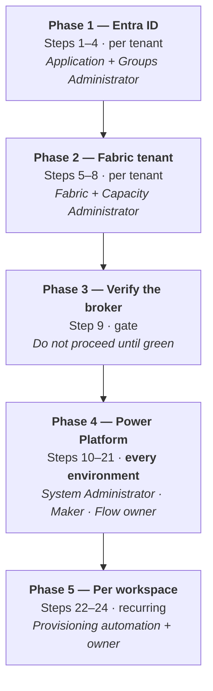

# Fabric Workspace Settings — Migration Actions

**Solution:** `WorkspaceSol` · **Version:** 1.0.0.12 · **Document version:** 1.0 · **Date:** 2026-09-25 · **Status:** For customer review

Companion to [ARCHITECTURE.md](./ARCHITECTURE.md), [PERMISSIONS.md](./PERMISSIONS.md) and [SECURITY.md](./SECURITY.md).

---

## Scope of this document

This document is the **runbook for standing the solution up in a new tenant or a new Power Platform environment**. It lists every action, in order, with who performs it, what it looks like when it is skipped, and how to verify it worked.

**The governing fact:**

> **The solution export carries almost nothing that makes the solution work.** It carries flows, two tables, a canvas app, a connector definition, connection *references* and environment variable *defaults*. Everything else — identities, tenant settings, secrets, bindings, roles, sharing, run-only users, two tables and the reference data — is configured by hand and must be redone.

**Out of scope.** The capacity-scoped `ItemCreation` policy solution migrates separately and shares no components with this one.

---

## Contents

1. [What the export does and does not carry](#1-what-the-export-does-and-does-not-carry)
2. [Migration at a glance](#2-migration-at-a-glance)
3. [Phase 1 — Entra ID (per tenant)](#phase-1--entra-id-per-tenant)
4. [Phase 2 — Fabric tenant (per tenant)](#phase-2--fabric-tenant-per-tenant)
5. [Phase 3 — Verify the broker before going further](#phase-3--verify-the-broker-before-going-further)
6. [Phase 4 — Power Platform (per environment)](#phase-4--power-platform-per-environment)
7. [Phase 5 — Per workspace (recurring)](#phase-5--per-workspace-recurring)
8. [The five that bite on every deployment](#the-five-that-bite-on-every-deployment)
9. [Post-migration verification](#post-migration-verification)
10. [Rollback](#rollback)
11. [Known migration defects](#known-migration-defects)

---

## 1. What the export does and does not carry

Verified against the solution export on 2026-09-25.

### ✅ Carried by the export

| Component | Count | Note |
|---|---|---|
| Cloud flows | 19 | Definitions only — connections and run-only settings do not travel |
| Dataverse tables | 0 | **None.** The `ubsppcoe_` tables belong to the platform team's shared solution and must already exist |
| Canvas app | 1 | `crbab_app5` |
| Custom connector | 1 | `crbab_FabricSetting` — **including a hardcoded tenant ID** |
| Connection references | 6 | 4 × custom connector, 1 × Office 365 Users, 1 × HTTP with Entra ID (preauthorized) — **arrive unbound** |
| Environment variables | 1 | `crbab_BrokerObjectId` — **values are defaults, not bindings** |

### ❌ Not carried — must be created or configured

| Item | Phase |
|---|---|
| The broker **service account** — created, licensed, MFA/expiry-exempt | 1 |
| The delegated app registration and its secret | 1 |
| The Entra group backing the Dataverse group team | 1 |
| Fabric tenant setting — Git integration | 2 |
| Workspace Admin grants and capacity assignment | 2 |
| Binding of the 6 connection references to real connections | 4 |
| The environment variable **value** for the target tenant | 4 |
| **Authorisation of all three connections as the service account** | 4 |
| The connector's tenant ID and delegated app secret | 4 |
| The 28 seed rows for `ubsppcoe_PrivateLinkTarget` | 4 |
| The `ubsppcoe_GitAuditLog` table | 4 |
| The `Fabric Workspace Owner` security role | 4 |
| The Dataverse group team | 4 |
| Connector and canvas app sharing | 4 |
| **Run-only users on every app-facing flow** | 4 |
| All `ubsppcoe_Workspace` data | 5 |

---

## 2. Migration at a glance



| Phase | Steps | Frequency | Approx. effort |
|---|---|---|---|
| 1 — Entra ID | 1–4 | Once per tenant | 1 hour |
| 2 — Fabric tenant | 5–8 | Once per tenant | 1 hour + provisioning automation |
| 3 — Verify | 9 | Gate | 15 minutes |
| 4 — Power Platform | 10–21 | **Every environment, every deployment** | 2–3 hours first time |
| 5 — Per workspace | 22–24 | Recurring | Automated + owner self-service |

> **The ordering is not cosmetic.** Several steps fail silently when taken out of sequence, and those are called out where they occur.

---

## Phase 1 — Entra ID (per tenant)

### Step 1 — Create the broker service account

**Role:** Identity administrator

The broker is a **user account**, not an application. **Do not register an app for it** — there is no client ID and no client secret.

Create (or identify) a service account, then make four things true of it:

| | Requirement | Why |
|---|---|---|
| 1 | **Licensed** for Power Automate and Dataverse | A connector connection needs the account to stay licensed |
| 2 | **Exempt from password expiry and interactive MFA** | The connection cannot answer a prompt, and does not follow a password change |
| 3 | Not blocked by **Conditional Access** | Location/device rules will stop the sign-in |
| 4 | **Excluded from joiner-mover-leaver automation** | Lifecycle reviews do disable service accounts |

**Record one identifier:**

| Identifier | Used as |
|---|---|
| The account's directory **object** ID | `crbab_BrokerObjectId` — `principal.id` on connection role grants, with `principal.type` = **`User`** |

> **It must be a service account, not a named person.** The app serves ~4000 workspaces; tying that to an individual makes it one leaver away from stopping.
>
> **Items 2–4 are a security decision, not just configuration.** Get them signed off by whoever owns the account — see [SECURITY.md](./SECURITY.md) §11 A5.

### Step 2 — Register the delegated application

**Role:** Application Administrator

Register `SVC_PROD_AT43156_FABRIC_POLICY` and add three delegated scopes from the **Power BI Service** API (`00000009-0000-0000-c000-000000000000`) — **not** from a Fabric API:

```
Gateway.Read.All
Connection.ReadWrite.All
offline_access
```

Create a client secret.

> ### ⚠️ Add every scope the connector will ever need now
>
> Consent is stored in Entra as an `oauth2PermissionGrant` keyed on (user, application, resource) and **outlives the connection**. Retrofitting a scope later means revoking consent for **every existing user** before any of them can re-consent — deleting and recreating a connection silently reuses the old grant and issues the same narrow token, with no prompt, no error, and a `403 InsufficientScopes` at the first call.
>
> Adding an *operation* later costs nothing. Adding a *scope* later is a tenant-wide exercise.

Do **not** add `Connection.Read.All` — `Connection.ReadWrite.All` already covers every connection operation.

### Step 3 — ~~Create the broker security group~~ — **not required**

`fabric_power_app_grp` existed to satisfy Step 5, and both were scoped to **service principals**. The broker is a user account, so neither applies.

**Skip this step.** Nothing replaces it: the account's Fabric access comes from a workspace role granted directly to it in Step 7.

### Step 4 — Create the user group

**Role:** Groups Administrator

Create (or identify) the Entra security group that will contain the workspace owners. It backs the Dataverse group team in Step 18.

---

## Phase 2 — Fabric tenant (per tenant)

### Step 5 — ~~Enable service principal API access~~ — **not required**

*"Service principals can call Fabric public APIs"* is scoped to service principals in an allowed security group. **The broker is a user account, so this setting does not govern it** — and neither does any Admin API setting beside it.

> **Do not enable it "to be safe".** It grants nothing this solution uses, and it widens the tenant for every service principal in whatever group it is scoped to.

**Skip this step.** If a `401` appears later, it means the connection has lapsed, not that a tenant setting is missing — see Step 9.

### Step 6 — Enable the Git integration tenant switch

**Role:** Fabric Administrator

**If skipped:** no workspace can connect to Azure DevOps at all.

> Not explicitly verified in the source tenant. **Confirm it directly** when onboarding a new one rather than inferring it from a working test workspace.

### Step 7 — Grant the broker group Workspace Admin on every managed workspace

**Role:** Workspace provisioning automation

Connect, disconnect and sync all require Admin. **The application is inert without this.**

> This is done by the **workspace provisioning automation**, not by hand per workspace. A new tenant needs that automation in place before the solution is usable at scale. This is usually the longest-lead item in the whole migration — start it first.

### Step 8 — Assign a capacity to every managed workspace

**Role:** Capacity Administrator

**If skipped:** Git operations fail with `WorkspaceHasNoCapacityAssigned`.

---

## Phase 3 — Verify the broker before going further

### Step 9 — Prove the broker account can reach Fabric

**This is a gate. Everything downstream assumes the broker can already call Fabric.**

There is no token to acquire — the connection holds the credential. So the check is made **through the connection**, not outside Power Automate:

1. In the target environment, create a throwaway flow with a manual trigger.
2. Add one **HTTP with Microsoft Entra ID (preauthorized)** -> *Invoke an HTTP request* action.
3. Sign the connection in **as the broker service account** (Step 1). Base Resource URL and Entra ID Resource URI are both `https://api.fabric.microsoft.com`.
4. Set Method `GET`, URL `https://api.fabric.microsoft.com/v1/workspaces`. **No `Authorization` header.**
5. Run it, read the count, then delete the flow.

Interpret the result:

| Result | Meaning | Fix |
|---|---|---|
| A workspace list of the expected size | OK — Steps 1 and 7 are correct | Proceed |
| **A short list, or an empty one** | **The connection was authorised as the wrong account.** It returns only what *that* identity administers | Recreate the connection, signing in as the service account (Step 1) |
| `401 Unauthorized` | The connection has lapsed — password, MFA, Conditional Access, licence, or a disabled account | Step 1, items 1-4. Re-authenticate the connection |
| `403 Forbidden` on a specific workspace | The account can call Fabric but holds no role on that object | Step 7 |

> ### The short-list case is the dangerous one
>
> A `401` is loud. **A short list is silent** — the flows run, and every workspace the connection's identity does not administer simply behaves as though it does not exist. **Compare the count against the size of the managed estate**, not merely against zero.

**Do not proceed to Phase 4 until this returns a workspace list of the expected size.**

---

## Phase 4 — Power Platform (per environment)

**Every step in this phase repeats on every environment and every deployment.**

### Step 10 — Import the solution

**Role:** System Administrator

Import `WorkspaceSol`.

> **Production should be imported as a *managed* solution.** The current export is **unmanaged** (`<Managed>0</Managed>`), which is appropriate for a build environment but leaves a production environment customizable out from under the solution. Produce a managed export for anything beyond development.

### Step 11 — Bind the connection references

**Role:** System Administrator

Five references arrive **unbound**. A reference is only a pointer; the connection holds the credentials and is environment-specific.

| Connection reference | Connector |
|---|---|
| `crbab_shared<connector id>…_36424` | `FabricSetting` |
| `crbab_shared<connector id>…_502aa` | `FabricSetting` |
| `crbab_shared<connector id>…_78f84` | `FabricSetting` |
| `crbab_shared<connector id>…_e7dd2` | `FabricSetting` |
| `crbab_sharedoffice365users_a9929` | Office 365 Users |

**If skipped:** flows fail at their first connector action.

> **`<connector id>` is generated when the connector is created and differs per environment.** Match the references by their trailing suffix and by connector, not by the full logical name — and re-read them from the imported solution rather than from this table.

> Create the custom connector connections **after** Step 13, or they will be created against the source tenant.

### Step 12 — Supply the environment variable value

**Role:** System Administrator

One variable, supplied at import time:

| Variable | Set to |
|---|---|
| `crbab_BrokerObjectId` | The broker service account's directory **object** ID, in the target tenant |

> **The export carries the source tenant's value as a _default_, not as a binding.** An import that skips the prompt silently keeps pointing at the source directory — the import succeeds and the grant fails later. **Set it explicitly, even if the prompt appears pre-filled.**

**"Broker" in the name is a leftover from the service-principal design** — the value is a *user account's* object ID. It is sent as `principal.id` with `principal.type` = **`User`**, and the same flow filters existing assignments on it, so a wrong value both fails to grant and re-POSTs a duplicate.

> **`crbab_TenantId` and `crbab_BrokerClientId` no longer exist.** Both existed solely to build the client-credentials token request. If an older export still carries them, they have no consumer.

### Step 13 — Correct the connector and recreate its connections

**Role:** Maker

In order:

1. Open the custom connector → **Security** tab.
2. Change **Tenant ID** to the target tenant.
3. Re-enter the `SVC_PROD_AT43156_FABRIC_POLICY` **client secret** — editing the OAuth section blanks it and it will not save without it.
4. Confirm the scope string reads exactly `Gateway.Read.All Connection.ReadWrite.All offline_access`.
5. **Update connector.**
6. Copy the redirect URL the portal issues, and paste it into the `SVC_PROD_AT43156_FABRIC_POLICY` registration.
7. **Delete and recreate** every connection created against the old settings.

> **Unlike Step 12, the connector's tenant ID is hardcoded in its connection parameters and _is_ carried by the export.** Imported into another tenant it still points at the source tenant, and every sign-in fails there.

**If skipped:** every connection attempt fails at sign-in against the wrong tenant.

### Step 14 — Authorise the three connections as the service account

**Role:** Flow owner

**There is no secret to re-enter.** No flow contains a credential, so nothing is scrubbed from the export.

Instead, create each connection by **signing in as the broker service account** (Step 1):

| Connection | Connector |
|---|---|
| Fabric | **HTTP with Microsoft Entra ID (preauthorized)** — Base Resource URL and Entra ID Resource URI both `https://api.fabric.microsoft.com` |
| Dataverse | Microsoft Dataverse |
| Mail / profile | Office 365 Users |

> **This fails quietly if done as the wrong person.** A connection created by whoever happened to import the solution authenticates as *them* — the flows run, and every workspace they do not administer silently behaves as though it does not exist. Step 9 is what catches it; re-run it after this step if you did not create the connection yourself.

> **If user consent to applications is disabled in the tenant**, a tenant administrator must consent to the *HTTP with Microsoft Entra ID (preauthorized)* connector once before the connection can be created.

> The solution's one remaining secret is the delegated app's, on the custom connector's Security tab (Step 13). Hardening item: it should become a Key Vault-backed secret environment variable. See [SECURITY.md](./SECURITY.md) §10.2.

### Step 15 — Create the `ubsppcoe_PrivateLinkTarget` table

**Role:** System Administrator

Create it **in the maker portal** — never by editing `customizations.xml` — and add it to the solution. Import the 28 seed rows from [`data/PrivateLinkTargets.csv`](../data/PrivateLinkTargets.csv).

> **Check the column mapping rather than trusting auto-match.** The CSV headers are *schema* names and the mapping screen shows *display* names. An unmapped sub-resource column imports 28 rows of blanks, which the create panel then sends to Fabric on every attempt — and Fabric does not validate sub-resources, so the endpoint provisions and fails later.

**If skipped:** the sub-resource dropdown is empty, with no error.

### Step 16 — Create the `ubsppcoe_GitAuditLog` table

**Role:** System Administrator

Create it in the maker portal and add it to the solution. It carries the unforgeable identity into write flows and serves as the audit record.

**Required before the application is shared with workspace owners.** See [SECURITY.md](./SECURITY.md) §10.1 and §10.3.

### Step 17 — Create the `Fabric Workspace Owner` security role

**Role:** System Administrator

Grant **Read** on:

- `Connector`
- `Connection Reference`
- `ubsppcoe_Workspace`
- `ubsppcoe_AllowedConnectionType`
- `ubsppcoe_PrivateLinkTarget`

Add the role to the solution.

> A solution-aware connector is a **Dataverse row**, so access to it needs **table privileges**, not classic connector sharing. A missing privilege surfaces as `prvReadConnector`, which reads like a sharing problem and is not one.

### Step 18 — Create the Dataverse group team

**Role:** System Administrator

Create a group team from the Entra group in Step 4, and assign the `Fabric Workspace Owner` role to the team.

### Step 19 — Share the connector

**Role:** Maker

Share the custom connector with the group.

### Step 20 — Share the canvas app

**Role:** Maker

Share `crbab_app5` with the same group.

> Steps 19 and 20 are **separate**. One without the other leaves users an application they cannot use.

### Step 21 — Set run-only users on every app-facing flow

**Role:** Flow owner

For each of the 19 app-facing flows:

| Connection | Setting |
|---|---|
| The custom connector | **Provided by run-only user** |
| Office 365 Users | **Provided by run-only user** |
| HTTP actions using the broker | **Use this connection** |

> ### ⚠️ These settings do not survive solution import
>
> This step repeats on **every single deployment**, including an update to an environment where it was previously configured.
>
> **If skipped:** app users hit permission errors on a solution that imported perfectly cleanly — one of the most misleading failures in the whole migration.

---

## Phase 5 — Per workspace (recurring)

### Step 22 — Populate `ubsppcoe_Workspace`

**Role:** Workspace provisioning automation

One row per workspace, naming the primary and secondary owner.

**This is the authorization boundary.** Without a row, the application shows that owner nothing. The table ships with schema only — **no data is carried by the export**.

### Step 23 — The owner creates their Azure DevOps connection

**Role:** Workspace owner — self-service

The owner creates their own *Azure DevOps — Source Control* connection in Fabric. The application grants the broker the `User` role on it at runtime, on the final wizard step.

Guidance to pass on: **a connection built on a service principal outlives the person who created it; one built on a personal account does not.** Azure DevOps records commits as pushed by the connection's identity, not the requester's. Nothing enforces this — no API the application calls can inspect a connection's contents.

### Step 24 — Confirm the repository, branch and folder exist

**Role:** Workspace owner

The target folder **must already exist in the branch**. Connect fails with `GitProviderResourceNotFound` otherwise:

- The Fabric portal offers a *Create and sync* prompt; the REST API has **no equivalent**.
- Folder names are **case-sensitive**.
- The folder must contain no subdirectories unless at least one is a Fabric item directory. A single plain file such as `README.md` is fine.

---

## The five that bite on every deployment

Everything above is a one-time cost except these. **All five fail quietly** — the solution imports cleanly and breaks later.

| # | Step | Symptom if missed | Why it is missed |
|---|---|---|---|
| 1 | **Run-only users** (21) | Permission errors for app users on a cleanly imported solution | The setting is invisible unless you open each flow |
| 2 | **Connector tenant ID** (13) | Every sign-in fails, against the *source* tenant | It *is* carried by the export, so it looks configured |
| 3 | **Environment variable value** (12) | Flows authenticate against the source tenant | The prompt is pre-filled with source values that look right |
| 4 | **Connections authorised as the wrong identity** (14) | Flows run, but Fabric returns only what that person administers — no error anywhere | A connection that works for the person who made it looks correct, and the short list is not visibly empty |
| 5 | **`ubsppcoe_PrivateLinkTarget` mapping** (15) | 28 rows of blanks; empty dropdown, no error | Auto-match appears to succeed |

**Check these five first** whenever a freshly deployed environment misbehaves.

---

## Post-migration verification

Work through in order. Each step isolates one layer.

### Broker path

- [ ] Step 9's throwaway flow returns a workspace list **of the expected size**
- [ ] The Fabric connection's owner is the broker service account, not a person
- [ ] `GetWorkspaceGitState` returns state for a known workspace
- [ ] `GetOAPSetting` returns the OAP state

### Delegated path

- [ ] A test user can create a connection on the custom connector **without an error at sign-in**
- [ ] The sign-in prompt names the **target** tenant
- [ ] `ListGateways` returns the user's gateways
- [ ] `ListMyConnections` returns the user's own connections

### Application

- [ ] A test user can open the canvas app
- [ ] The workspace picker shows only workspaces where that user is named in `ubsppcoe_Workspace`
- [ ] The Git tab loads without a `prvReadConnector` error
- [ ] The outbound tab reflects the real OAP state
- [ ] The sub-resource dropdown is **populated** — an empty one means Step 15 or 17 failed

### End to end

- [ ] Connect a test workspace to Git and confirm the commit lands in Azure DevOps
- [ ] Disconnect it again
- [ ] Change an outbound rule and confirm it persists
- [ ] Confirm an audit row is written for each of the above *(once Step 16 is implemented)*

### Security gate

- [ ] Ownership authorization is enforced on every write flow
- [ ] A user **cannot** act on a workspace they do not own — test this explicitly
- [ ] Run the checklist in [SECURITY.md](./SECURITY.md) §12

---

## Rollback

| Scenario | Action |
|---|---|
| Import fails partway | Delete the solution in the target environment and re-import. Unmanaged imports layer rather than replace — confirm no orphaned components remain |
| Flows misbehave after an update | Re-check the five in [§The five that bite](#the-five-that-bite-on-every-deployment) before rolling back. Four of the five look identical to a broken import |
| Connector change breaks existing connections | Restore the previous tenant ID and scope string, update the connector, and have users recreate connections. **A scope change additionally requires revoking each user's `oauth2PermissionGrant`** |
| The broker must be stopped immediately | **Disable the service account, or delete the Fabric connection.** The Step 5 tenant setting is no longer the kill switch — it does not govern a user account. This is still a **single, immediate, tenant-wide kill switch** for every app-only operation and requires no solution change |

---

## Known migration defects

Carried forward from the engineering issue log, with their current state.

| # | Issue | Impact | Status |
|---|---|---|---|
| M1 | Connection references arrive unbound on import | Flows fail at the first connector action | 🟡 Open — Step 11 is the workaround |
| M2 | Run-only settings do not survive import | Permission errors for app users | 🟡 Open — inherent to the platform. Step 21 every time |
| M3 | Connector tenant ID is hardcoded and travels with the export | Every sign-in fails in the target tenant | 🟡 Open — Step 13 is the workaround |
| M4 | Broker secret is a flow variable, scrubbed on export | Token acquisition fails until re-entered | 🟡 Open — Step 14. Fix is Key Vault ([SECURITY.md](./SECURITY.md) §10.2) |
| M5 | Two empty path stubs in the connector's OpenAPI — `/connections/{connectionId}` and `/connections/{connectionId}/roleAssignments` | Harmless today; may confuse future imports or validation | 🟡 Open — delete at the next connector edit |
| M6 | `ubsppcoe_GitAuditLog` is not in the shared solution | Manual creation per environment; drift between environments | 🟡 Open — Step 16 |
| M7 | The solution is exported unmanaged | Production environment remains customizable | 🟡 Open — produce a managed export for production |

> **Resolved since the issue log was written:** the tenant ID and broker client ID are gone entirely, along with `GetFabricToken` and the client-credentials grant they served. Earlier notes describing them as hardcoded, or as environment variables, are superseded by this document.

### The two structural improvements worth making

Both remove a recurring manual step rather than documenting it better:

1. **Add `ubsppcoe_PrivateLinkTarget` and `ubsppcoe_GitAuditLog` to the solution** (M6). This removes Steps 15 and 16 from every future deployment and eliminates schema drift between environments.
2. **Move the broker secret to a Key Vault-backed environment variable** (M4). This removes Step 14 and makes rotation a Key Vault operation rather than a flow edit in every environment.