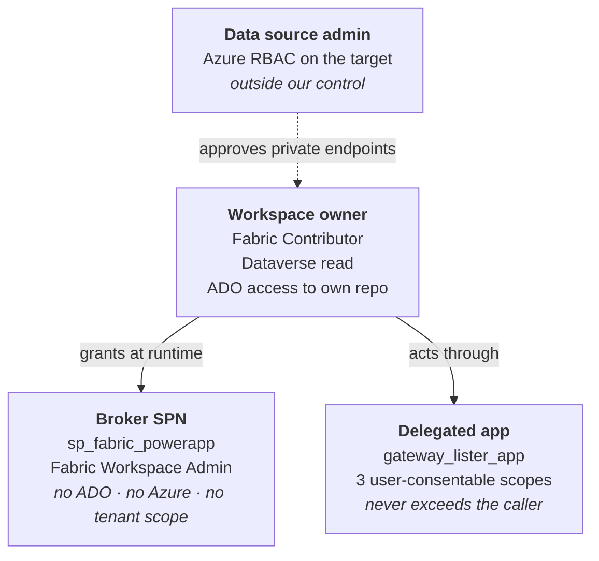

# Fabric Workspace Settings — Required Permissions

**Solution:** `WorkspaceSol` · **Document version:** 1.0 · **Date:** 2026-09-25 · **Status:** For customer review

Companion to [ARCHITECTURE.md](./ARCHITECTURE.md), [SECURITY.md](./SECURITY.md) and [MIGRATION.md](./MIGRATION.md).

---

## Scope of this document

This document states **every permission the solution requires**, who must hold it, who is able to grant it, and what fails if it is missing. It is the reference for the access request that accompanies deployment.

It covers the workspace-settings solution only. The capacity-scoped `ItemCreation` policy solution is a separate system with its own identities and its own permission set; nothing here applies to it.

> **None of the permissions in this document are carried by the solution export.** All of them must be granted again in every tenant, and the Power Platform ones in every environment.

---

## Contents

1. [Summary — the four parties](#1-summary--the-four-parties)
2. [The workspace owner — the end user](#2-the-workspace-owner--the-end-user)
3. [The broker service principal](#3-the-broker-service-principal)
4. [The delegated application](#4-the-delegated-application)
5. [Azure — nobody on our side](#5-azure--nobody-on-our-side)
6. [Administrative roles required to perform the setup](#6-administrative-roles-required-to-perform-the-setup)
7. [Fabric tenant settings](#7-fabric-tenant-settings)
8. [Fabric workspace and capacity requirements](#8-fabric-workspace-and-capacity-requirements)
9. [Azure DevOps requirements](#9-azure-devops-requirements)
10. [Permission failure reference](#10-permission-failure-reference)

---

## 1. Summary — the four parties

Four parties hold rights in this system, and keeping them separate is the whole security argument. The owner holds almost nothing. The broker holds a great deal, but only inside Fabric. The Azure-side rights belong to neither.



| Party | Holds | Does **not** hold |
|---|---|---|
| **Workspace owner** | Fabric Contributor, Dataverse read, own ADO access | Fabric Workspace Admin, any Entra role, any Azure RBAC, any broker credential |
| **Broker SPN** | Fabric Workspace Admin on managed workspaces | Any Azure DevOps right, any Azure RBAC, any Entra application permission, any tenant-scoped Fabric permission |
| **Delegated app** | Three delegated Power BI Service scopes | Any application permission; it can never exceed what the calling user already holds |
| **Data source admin** | Azure RBAC on the private-link target | Any role in this solution |

---

## 2. The workspace owner — the end user

This is the permission set to request for the user population.

| # | Needs | Where | Granted by | Why |
|---|---|---|---|---|
| **U1** | Dataverse security role **`Fabric Workspace Owner`** | Power Platform | System Administrator | Read on `Connector`, `Connection Reference`, `crbab_Workspaces`, `crbab_AllowedConnectionType`, `crbab_PrivateLinkTarget` |
| **U2** | Membership of the Entra group behind the Dataverse **group team** | Entra → Dataverse | Groups Administrator | The mechanism by which U1 is assigned |
| **U3** | Share on the **canvas app** | Power Platform | Maker | Access to the application itself |
| **U4** | Share on the **custom connector** | Power Platform | Maker | Separate from U3 — one without the other leaves the user an application they cannot use |
| **U5** | **Run-only** access to each flow the application calls | Power Automate | Flow owner | Per flow, per environment |
| **U6** | A row in `crbab_Workspaces` naming them primary or secondary owner | Dataverse | Provisioning automation | The authorization boundary. Without a row the application shows them nothing |
| **U7** | **Contributor** on the Fabric workspace | Fabric | Workspace Admin / provisioning | Not for the application — for everything the application deliberately does *not* broker |
| **U8** | Azure DevOps access to their own repository | Azure DevOps | ADO project administrator | They create their own connection; the application never holds Git credentials |
| **U9** | Consent to the delegated scopes, on first connection | Entra | **The user themselves** | `Gateway.Read.All` and `Connection.ReadWrite.All` are user-consentable — no administrator required |

### What the owner conspicuously does **not** need

**Fabric Workspace Admin. Any Entra directory role. Any Azure RBAC. Any credential belonging to the broker.**

That is the point of the entire design — the application exists so these capabilities can be delivered *without* granting Admin to 4000 people.

### Two failure modes here are quiet rather than loud

| Missing | Symptom | Why it misleads |
|---|---|---|
| U1 — role on `Connector` | `prvReadConnector` error | Reads like a connector sharing problem. It is not; a solution-aware connector is a Dataverse row and needs **table privileges** |
| U1 — read on `crbab_PrivateLinkTarget` | **An empty dropdown, with no error at all** | Looks like a formula bug. Check the security role before the formula |

---

## 3. The broker service principal

`sp_fabric_powerapp` — client ID `a385fde9-1d6a-4e7f-8336-dc7feba5a4bc`, object ID `6f70a764-908f-435b-a930-ffcb375577f3`.

### What it must hold

| # | Needs | Where | Granted by | Notes |
|---|---|---|---|---|
| **B1** | Membership of the Entra security group `fabric_power_app_grp` | Entra | Groups Administrator | The **service principal object**, not the app registration |
| **B2** | Fabric tenant setting **"Service principals can call Fabric public APIs"**, scoped to that group | Fabric admin portal | Fabric Administrator | Paired with B1 |
| **B3** | **Workspace Admin** on every managed workspace | Fabric | Workspace provisioning automation, via the group | Not granted by hand, per workspace |
| **B4** | The `User` role on the owner's Azure DevOps connection | Fabric | Granted **at runtime** by `AddConnectionRoleAssignment` | Self-service, per connection, on the final wizard step |
| **B5** | A client secret | Entra | Application Administrator | Re-entered per environment; see [SECURITY.md](./SECURITY.md) |

**B1 and B2 are a pair and neither works alone.** Together they are the hardest prerequisite in the system to diagnose, because their absence produces a bare `401` on every call with nothing pointing at a tenant setting.

### What it must **not** be given

This list is as important as the one above, and should be treated as a standing constraint rather than a note.

| Must not hold | Why |
|---|---|
| **Entra application permissions for Fabric** | Fabric does not grant REST access through them. A broker token legitimately shows `roles: (none)` and works correctly. Adding permissions achieves nothing and widens the identity for no benefit |
| **Any Azure DevOps right** | Git credentials live exclusively in the owner's own connection. The broker references that connection by ID and never sees its contents |
| **Any Azure RBAC** | Managed private endpoints require none — see §5 |
| **Any tenant-scoped Fabric permission** | A separate identity holding `Tenant.ReadWrite.All` exists in this tenant and was deliberately **not** used as the broker. An application exposed to 4000 workspace owners must not run on a tenant-wide identity |

### Client ID versus object ID

They are different identifiers for the same principal and are **not interchangeable**.

| Identifier | Value | Used for |
|---|---|---|
| Client (application) ID | `a385fde9-1d6a-4e7f-8336-dc7feba5a4bc` | Token acquisition — `ab_BrokerClientId` |
| Service principal object ID | `6f70a764-908f-435b-a930-ffcb375577f3` | `principal.id` on a connection role grant — `ab_BrokerObjectId` |

Supplying the client ID where the object ID is required produces a role assignment that grants nothing, and the subsequent connect then fails as though the connection had never been shared. Both are published as environment variables so neither is retyped from memory.

---

## 4. The delegated application

`gateway_lister_app` — backs the custom connector `FabricSetting` and runs as the signed-in user. **Its client ID is a per-tenant value and is not recorded here** — read it from the app registration; [MIGRATION.md](./MIGRATION.md) collects it per deployment.

### Required delegated scopes

These are published by the **Power BI Service** Entra application (`00000009-0000-0000-c000-000000000000`), **not** by a Fabric application. Add them under *API permissions → Add a permission → Power BI Service → Delegated permissions*.

| Scope | Required by | Admin consent required? |
|---|---|---|
| `Gateway.Read.All` | `ListGateways` | **No** — user-consentable |
| `Connection.ReadWrite.All` | `ListMyConnections`, `AddConnectionRoleAssignment` | **No** — user-consentable |
| `offline_access` | Token refresh | No |

Because all three are user-consentable, each user consents at connection creation and **no administrator is required for the user population**. Granting admin consent tenant-wide is optional and merely suppresses the per-user prompt.

**One scope covers every connection operation.** `GET /connections` accepts `Connection.Read.All` *or* `Connection.ReadWrite.All`; `POST /connections/{id}/roleAssignments` requires `Connection.ReadWrite.All`. Do not add both — `Connection.Read.All` is redundant.

### ⚠️ Grant every scope this connector will ever need in one pass

Adding a scope later is expensive in a way that is easy to underestimate.

Consent is stored in Entra as an `oauth2PermissionGrant` keyed on (user, application, resource), and it **outlives the connection**. Deleting and recreating the connection silently reuses the old grant and issues the same narrow token — **no prompt, no error**, and a `403 InsufficientScopes` at the first call. The grant must be revoked first, for **every existing user**, before any of them can re-consent.

Adding an *operation* later costs nothing. Adding a *scope* later is a tenant-wide re-consent exercise.

### The connector carries its own copy of the scope list

The scope on the connector's *Security* tab is a single space-delimited string and must match the app registration exactly:

```
Gateway.Read.All Connection.ReadWrite.All offline_access
```

The two are edited separately and **neither validates the other**. If the connector requests a scope the app registration does not publish, the connector saves without complaint and the failure appears later, at **connection creation**, as `AADSTS65001` or an invalid-scope error — which reads like a connector bug and is not one.

> **Always change the app registration first, then the connector.**

Two further traps:

- Editing the OAuth section of the connector's Security tab **blanks the client secret** and will not save without it. Have the `gateway_lister_app` secret to hand.
- The single space-delimited scope key is the connector UI's own encoding, not a malformed value. Under the *Azure Active Directory* security type the connector prepends the Resource URL, so short scope names are correct. Under *Generic OAuth 2* they must be fully qualified or consent closes silently with no error.

---

## 5. Azure — nobody on our side

**Managed private endpoints require no Azure permissions for the application, the broker, or the owner.**

The Azure-side rights sit entirely with the **approver** — the data source administrator who accepts or rejects the connection request in the Azure portal. That person is outside this solution's control and needs no role within it.

This is the single best property of the private-endpoints feature and it is worth protecting deliberately. The obvious enhancement — calling Azure's `privateLinkResources` API for authoritative sub-resource lists instead of maintaining the `crbab_PrivateLinkTarget` table — would require the broker to hold **Reader in every subscription any owner might ever target**. That means Azure onboarding across the entire estate, traded away to avoid maintaining a 28-row reference table. It was rejected for that reason and should stay rejected.

---

## 6. Administrative roles required to perform the setup

One-time per tenant unless noted. None of this is carried by the solution export.

| Task | Role required | Frequency |
|---|---|---|
| Both app registrations, and their client secrets | **Application Administrator** | Per tenant |
| The `fabric_power_app_grp` security group | **Groups Administrator** | Per tenant |
| The Entra group backing the Dataverse group team | **Groups Administrator** | Per tenant |
| Fabric tenant settings — SPN API access, Git integration | **Fabric Administrator** | Per tenant |
| Capacity assignment on managed workspaces | **Capacity Administrator** | Per workspace |
| Workspace Admin grant to the broker's group | **Fabric Workspace Admin** / provisioning automation | Per workspace |
| Solution import, environment variables, security role, group team | **Power Platform System Administrator** | Per environment |
| Connector and canvas app sharing, connector tenant ID | **Maker** | Per environment |
| Run-only users, client secret re-entry | **Flow owner** | Per environment |
| Azure-side approval of private endpoints | **Data source administrator** (Azure RBAC) | Per endpoint |

---

## 7. Fabric tenant settings

Fabric Admin portal → **Tenant settings**. **Fabric Administrator** role required.

### T1 — Service principals can call Fabric public APIs

*Developer settings → "Service principals can call Fabric public APIs" → Enabled, scoped to `fabric_power_app_grp`.*

**This is the single hardest prerequisite in the system to diagnose.** Without it every app-only Fabric call returns a bare `401 Unauthorized` — *"The caller is not authenticated to access this resource"* — with nothing indicating that a tenant setting is the cause.

Paired with B1 (§3). Neither works without the other.

### T2 — Git integration enabled

Git integration must be permitted at tenant level for workspaces to connect to Azure DevOps at all.

> **Not explicitly verified in the current tenant.** Connect works for the test workspace, which implies it is enabled, but it has not been confirmed directly and **should be checked before any new tenant is onboarded**.

---

## 8. Fabric workspace and capacity requirements

| # | Requirement | Consequence if missing |
|---|---|---|
| **W1** | The broker's security group holds **Workspace Admin** on every managed workspace | Every brokered operation returns `403`. The application is inert |
| **W2** | A **capacity is assigned** to every managed workspace | Git operations fail with `WorkspaceHasNoCapacityAssigned` |
| **W3** | The owner holds **Contributor** on the workspace | The owner cannot perform the operations the application deliberately does not broker — commit, update from Git, read status |

W1 is granted through the security group by the **workspace provisioning automation**, not by hand per workspace. A new tenant needs that automation in place, or the application cannot function at all.

---

## 9. Azure DevOps requirements

Per workspace, and the **owner's own responsibility**.

| # | Requirement | Consequence if missing |
|---|---|---|
| **D1** | The owner can reach the target repository in Azure DevOps | They cannot create the connection the whole Git flow depends on |
| **D2** | The repository, branch and target folder **already exist** | Connect fails with `GitProviderResourceNotFound` |

On D2 specifically:

- The folder **must already exist** in the selected branch. The Fabric portal offers a *Create and sync* prompt; the REST API has **no equivalent**, so the application cannot create it.
- Folder names are **case-sensitive** against what is in the branch.
- The folder must not contain subdirectories unless at least one is a Fabric item directory. A single plain file such as `README.md` is fine.

These rules are stated on the folder field of the connect wizard.

### The connection identity is the owner's choice

Whichever credential the owner puts in the connection determines its durability, and that is the owner's call, not the application's. A connection built on a **service principal** outlives the person who created it; one built on a personal account does not.

A service principal is the recommendation to pass on as guidance. **Nothing enforces it**, and no API the application calls can even determine what is inside a connection. Azure DevOps will record commits as pushed by the connection's identity, not by the requester.

---

## 10. Permission failure reference

The fastest route from a symptom to the missing permission.

| Symptom | Missing permission | Reference |
|---|---|---|
| Bare `401` on **every** Fabric call | Broker group membership (B1) **or** the Fabric tenant setting (T1) | §3, §7 |
| `403` on a specific workspace | Broker has no Workspace Admin on that workspace (B3 / W1) | §3, §8 |
| `403` on a specific connection | The runtime role grant (B4) did not happen, or used the **client ID** instead of the object ID | §3 |
| `403 InsufficientScopes` on a delegated call | A stale `oauth2PermissionGrant` — the scope changed and consent was not revoked | §4 |
| `AADSTS65001` at connection creation | Connector scope string does not match the app registration | §4 |
| `prvReadConnector` | User lacks Read on the `Connector` table (U1) | §2 |
| **Empty sub-resource dropdown, no error** | User lacks Read on `crbab_PrivateLinkTarget` (U1) | §2 |
| Permission errors for app users on a cleanly imported solution | Run-only users not reconfigured after import (U5) | §2, [MIGRATION.md](./MIGRATION.md) |
| Every sign-in fails against the wrong tenant | Connector tenant ID still points at the source tenant | [MIGRATION.md](./MIGRATION.md) |
| `WorkspaceHasNoCapacityAssigned` | No capacity on the workspace (W2) | §8 |
| `GitProviderResourceNotFound` | The target folder does not exist in the branch (D2) | §9 |

### The two-symptom rule worth memorising

> **`401` means the broker cannot call Fabric at all** — a tenant setting or group membership problem.
> **`403` means the broker can call Fabric but holds no role on that object** — a workspace or connection role problem.

Telling these apart first saves the majority of diagnostic time on this solution.
