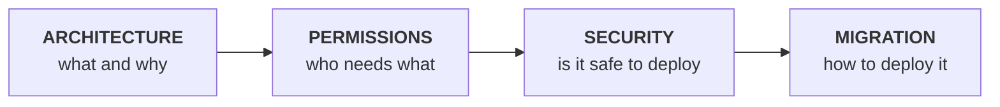

# Fabric Workspace Settings

**Solution documentation set** · Version 1.0 · 2026-09-25

A Power Platform application that lets Microsoft Fabric **workspace owners** configure **Git integration**, **outbound access** and **managed private endpoints** for the workspaces they own — without being granted the Fabric *Workspace Admin* role.

---

## Scope

This documentation set covers the **Fabric Workspace Settings** solution (`WorkspaceSol`) only.

> The capacity-scoped `ItemCreation` **policy** solution is a **separate system**. It governs capacities rather than workspace settings, shares no components, identities or data with this solution, and is documented independently under [`capacity-policies/`](../capacity-policies). Nothing in this folder applies to it, and nothing in it applies here.

---

## The documents

| Document | Read it for | Primary audience |
|---|---|---|
| **[ARCHITECTURE.md](./ARCHITECTURE.md)** | What the solution is, how it is built, and why each design decision was taken | Architects, reviewers, anyone new to the solution |
| **[PERMISSIONS.md](./PERMISSIONS.md)** | Every permission required, who must hold it, who grants it, and what fails without it | Identity and access teams, the access request |
| **[SECURITY.md](./SECURITY.md)** | Security requirements, controls, trust boundaries, threat model and residual risk | Security review, before production access is granted |
| **[MIGRATION.md](./MIGRATION.md)** | Step-by-step actions to stand the solution up in a new tenant or environment | Deployment team |

### Suggested reading order

**If you are onboarding a new tenant, [MIGRATION.md](./MIGRATION.md) is the whole job.** The other three explain why each step is there.

---

## The solution in one paragraph

Roughly 4000 Fabric workspaces need owner-driven configuration of Git integration, outbound access rules and private endpoints. Every one of those operations requires Fabric **Workspace Admin**, which owners do not have and will not be granted — they are Contributors. The solution is a **broker**: a canvas app calls Power Automate flows, which perform the privileged calls under a service principal and use **Dataverse as the authorization boundary** to decide whether the caller is entitled to the workspace they named. The governing principle is to **broker only what genuinely requires Admin** and leave everything else in the Fabric UI, where the owner already has rights.

---

## At a glance

| | |
|---|---|
| Solution unique name | `WorkspaceSol` |
| Version | `1.0.0.12` (exported **unmanaged**) |
| Cloud flows | 17 built · 3 designed, not built |
| Dataverse tables | 2 shipped · 2 to be created |
| Canvas app | `crbab_app5` — three tabs |
| Custom connector | `crbab_FabricSetting` — delegated calls only |
| Identities | 1 broker service principal · 1 delegated application |
| Azure RBAC required | **None** |

---

## Current status — read before deploying

The solution is **functional for the build team and not yet ready for general availability.** Three items gate release to workspace owners:

| # | Gap | Impact |
|---|---|---|
| 1 | **Ownership authorization is not implemented** | Any caller who can reach a flow URL can act on any managed workspace, not only their own |
| 2 | **No audit record of brokered actions** | Fabric attributes every action to the broker service principal; the requesting user is not recorded anywhere durable |
| 3 | **Private-endpoint flows are not built** | The private-endpoints tab is non-functional |

Items 1 and 2 are detailed in [SECURITY.md](./SECURITY.md) §10 and should be built together — the same Dataverse table serves both.

---

## Engineering documentation

Build-level detail lives in [`docs/`](../docs) and is referenced from these documents where relevant:

| Topic | Location |
|---|---|
| Per-flow behaviour and verified test paths | [`docs/FLOWS.md`](../docs/FLOWS.md) |
| Individual flow specifications | [`docs/flows/`](../docs/flows) |
| Custom connector build instructions | [`docs/CUSTOM-CONNECTOR.md`](../docs/CUSTOM-CONNECTOR.md) |
| Canvas app build guides | [`docs/APP-GIT-TAB.md`](../docs/APP-GIT-TAB.md) · [`docs/APP-OUTBOUND-TAB.md`](../docs/APP-OUTBOUND-TAB.md) · [`docs/APP-PRIVATE-ENDPOINTS-TAB.md`](../docs/APP-PRIVATE-ENDPOINTS-TAB.md) |
| Private-endpoint design rationale | [`docs/APP-PRIVATE-ENDPOINTS.md`](../docs/APP-PRIVATE-ENDPOINTS.md) |
| Open defects and undecided points | [`docs/OPEN-ISSUES.md`](../docs/OPEN-ISSUES.md) |

> Where the engineering notes and these documents disagree, **these documents are the more recent** — they were verified against the solution export on 2026-09-25. Differences found during that verification are recorded in [MIGRATION.md](./MIGRATION.md) §Known migration defects.

---

## Solution artefacts in this repository

| Path | Contents |
|---|---|
| [`Workflows/`](../Workflows) | The 17 cloud flows, as unpacked solution JSON. **Never hand-edited** |
| [`CanvasApps/`](../CanvasApps) | The canvas app package |
| [`Connector/`](../Connector) | The custom connector definition and OpenAPI |
| [`environmentvariabledefinitions/`](../environmentvariabledefinitions) | The three environment variables |
| [`data/`](../data) | Reference data, including the private-link target seed file |
| [`scripts/`](../scripts) | Diagnostic helpers |
