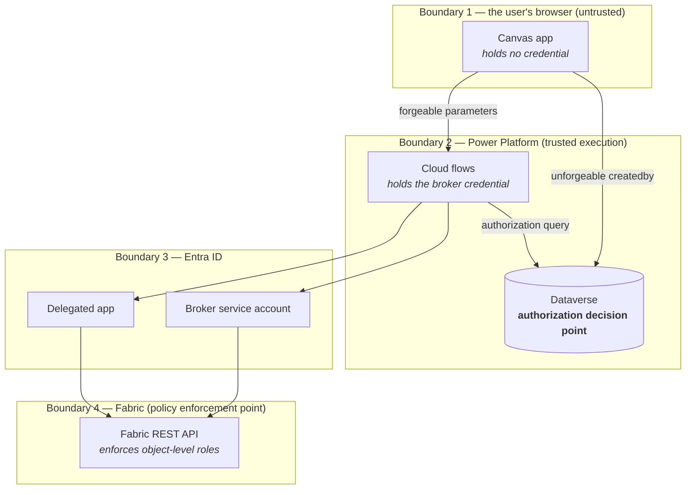

# Fabric Workspace Settings — Security Requirements

**Solution:** `WorkspaceSol` · **Document version:** 1.0 · **Date:** 2026-09-25 · **Status:** For customer review

Companion to [ARCHITECTURE.md](./ARCHITECTURE.md), [PERMISSIONS.md](./PERMISSIONS.md) and [MIGRATION.md](./MIGRATION.md).

---

## Scope of this document

This document states the **security requirements** the solution must satisfy, the **controls** that satisfy them, the **trust boundaries** it relies on, and the **residual risk** the customer is accepting at the current build state.

It is the document to review before granting the solution access to a production tenant.

> Permission *inventories* — who must hold which right — are in [PERMISSIONS.md](./PERMISSIONS.md). This document covers why those permissions are shaped the way they are, and what must be true for them to remain safe.

**Out of scope.** The capacity-scoped `ItemCreation` policy solution is a separate system with its own security posture and is documented independently.

---

## Contents

1. [Security objective](#1-security-objective)
2. [Security requirements](#2-security-requirements)
3. [Trust boundaries](#3-trust-boundaries)
4. [Identity and credential handling](#4-identity-and-credential-handling)
5. [Authorization controls](#5-authorization-controls)
6. [Secrets management](#6-secrets-management)
7. [Auditability](#7-auditability)
8. [Data handling](#8-data-handling)
9. [Threat model](#9-threat-model)
10. [Open security items — must close before general availability](#10-open-security-items--must-close-before-general-availability)
11. [Accepted risks](#11-accepted-risks)
12. [Security review checklist](#12-security-review-checklist)

---

## 1. Security objective

> **Deliver a bounded set of Fabric administrative capabilities to roughly 4000 non-administrators, without increasing any individual's standing privilege, and without the solution ever holding a credential that belongs to a user.**

Every control in this document exists to serve that sentence. The two failure modes it guards against are:

- **Privilege escalation** — a workspace owner using the application to act on a workspace they do not own, or to obtain rights beyond the ones the application brokers.
- **Credential exposure** — the broker's privileged credential, or a user's Git credential, becoming recoverable by someone who should not have it.

---

## 2. Security requirements

The requirements the solution is designed to meet. Each is traced to its control and its current status.

| # | Requirement | Control | Status |
|---|---|---|---|
| **S1** | No end user is granted Fabric Workspace Admin | Brokered architecture; owners remain Contributors | ✅ Met |
| **S2** | The privileged identity is never reachable directly by a user | The broker token is acquired inside a child flow and never returned to the canvas app | ✅ Met |
| **S3** | The privileged identity is scoped as narrowly as the function allows | Workspace-scoped roles only; no tenant-scoped permission; no Azure RBAC; no Azure DevOps rights | ✅ Met |
| **S4** | A user may only act on workspaces they own | Dataverse ownership check against `ubsppcoe_Workspace`, fail closed | ❌ **Not implemented** — §10.1 |
| **S5** | Write operations authorize on an identity the caller cannot forge | Audit-row pattern using the Dataverse `createdby` stamp | ❌ **Not implemented** — §10.1 |
| **S6** | The solution never holds a user's Git credentials | Owners create their own connections; the broker is granted a role on them and references them by ID | ✅ Met |
| **S7** | Per-user data is returned per user, never through the privileged identity | Delegated calls through the custom connector, `runtimeSource: invoker` | ✅ Met |
| **S8** | The solution cannot grant itself rights a user does not already have | `AddConnectionRoleAssignment` is delegated; the Fabric API only permits grants on connections the caller controls | ✅ Met |
| **S9** | Secrets are not committed to source control | Repository verified clean; exports scrub the secret to a blank | ✅ Met |
| **S10** | Secrets are held in a managed secret store | Key Vault-backed environment variable | ❌ **Not implemented** — §10.2 |
| **S11** | Privileged actions are attributable to a named user | `ubsppcoe_GitAuditLog` row recording actor, action, target and outcome | ❌ **Not implemented** — §10.3 |
| **S12** | Concurrent edits cannot silently overwrite one another | ETag optimistic concurrency on outbound rules | ✅ Met |
| **S13** | Fabric state is not duplicated into a second store | No caching of Fabric state in Dataverse; live GETs only | ✅ Met |

**Three requirements — S4, S5 and S11 — are not yet met.** They are the subject of §10 and they gate general availability.

---

## 3. Trust boundaries

### What each boundary assumes

| Boundary | Assumption | If the assumption fails |
|---|---|---|
| **1 → 2** | **Nothing arriving from the canvas app can be trusted.** Anyone who can reach a flow URL can call it with arbitrary parameters | This is precisely why S4/S5 exist. Without them, this boundary is currently *unenforced* for writes |
| **2 (Dataverse)** | Dataverse's `createdby` stamp cannot be forged by the caller | Platform guarantee. Sound |
| **2 (flows)** | Only the flow runtime can read the broker credential; the canvas app never receives a token | Verified — `GetGitOperationStatus` deliberately does **not** accept a token as a trigger input, precisely so an SPN credential with broad Fabric rights never enters the canvas app where it would be recoverable by anyone who can open it |
| **3 (delegated)** | A delegated token can never exceed what the signed-in user already holds | Entra guarantee. Sound |
| **4 (Fabric)** | Fabric enforces object-level roles on every call | Platform guarantee. This is the backstop that limits blast radius when S4 is absent — the broker can only reach *managed* workspaces |

### The important consequence

With S4 not yet implemented, the only thing constraining a write is **Boundary 4** — the set of workspaces on which the broker holds Admin. That set is the entire managed estate. A user who can reach a flow URL can therefore act on any managed workspace, not only their own.

**This is why the application's audience must remain the build team until S4 lands.**

---

## 4. Identity and credential handling

### Two identities, deliberately separated

| | Broker — the service account | Delegated — `SVC_PROD_AT43156_FABRIC_POLICY` |
|---|---|---|
| Type | **A user account**, signed in on the preauthorized connection | Entra app registration |
| Flow | **No token request.** The connector attaches the token | Authorization code, runs as the user |
| Privilege | Fabric Workspace Admin on managed workspaces | Never exceeds the caller |
| Exposure | The Power Platform connection | User's own session |

### Deliberate exclusions from the broker identity

These are standing constraints, not incidental facts. Each one materially limits blast radius.

| Excluded | Security rationale |
|---|---|
| **Tenant-scoped Fabric permissions** | An identity holding `Tenant.Read.All` / `Tenant.ReadWrite.All` already exists in this tenant (`sp_fabric_monit`) and was **deliberately not reused**. An application exposed to 4000 workspace owners must not run on a tenant-wide identity. That identity appears nowhere in this solution |
| **Any Entra directory role or application permission** | The account needs a Fabric workspace role and nothing else. A directory role would widen it far beyond anything a flow calls |
| **Azure DevOps rights** | Keeps all Git credentials outside the solution boundary entirely |
| **Azure RBAC** | Keeps the private-endpoints feature free of any Azure onboarding, and prevents the broker from becoming a path into the subscription estate |

### Access is granted by two independent gates

The account's Fabric access requires **both** of: a live, authorised connection, and an object-level Fabric role. No single misconfiguration grants access.

> **This is one gate fewer than the service-principal design had, and the kill switch moved.** There is no longer a tenant setting that stops every brokered call in one action. The equivalent control is now **the connection and the account itself** — disabling the account, revoking its licence, or deleting the connection stops all brokered operations immediately, without touching the solution.
>
> The trade is deliberate and worth stating plainly: a tenant setting is revoked by a Fabric Administrator in the admin portal, whereas disabling an account is an identity-team action. **Incident runbooks that named the tenant setting as the kill switch must be updated**, or an incident will be met with a control that no longer does anything.

### The credential is a user password, and that changes its handling

There is no client secret to leak from a flow definition, which removes an entire class of exposure. In its place is an account credential with a different profile:

| Property | Consequence |
|---|---|
| It is a **password**, not an application secret | It is phishable and sprayable in a way a client secret is not. It must be strong, unique, and vaulted in the customer's privileged-credential store |
| The connection **does not follow a password change** | Rotation breaks every brokered call until the connection is re-authorised by hand |
| It must be **exempt from MFA and password expiry** to stay usable | That exemption is itself a security decision and should be a deliberate, documented one — not a side effect of making the app work |
| Anyone who can **edit a flow** can use the connection | They cannot read the credential, but they can invoke it. Maker access to the environment is therefore equivalent to use of the broker identity |

### Git credentials never enter the solution

The application never holds, transports, or reads Git credentials. The owner creates the Azure DevOps connection; the service account is granted the `User` role on it and references it by ID. **No API the application calls can reveal a connection's contents.**

Residual consideration to communicate to owners: Azure DevOps records commits as pushed by the *connection's* identity, not the requester's. Attribution of a Git commit to a human therefore depends on the audit trail in S11, not on the Git history.

---

## 5. Authorization controls

### The authorization decision point is Dataverse

Fabric cannot answer *"does this user own this workspace?"* — owners hold no Fabric role that says so. The ownership record exists only in `ubsppcoe_Workspace`, and every flow acting on a workspace must confirm the caller appears there as primary or secondary owner.

**The check must fail closed.** Absence of a row is a denial, not a pass-through.

### Reads and writes are treated differently, on purpose

| Operation class | Trigger | Identity source | Rationale |
|---|---|---|---|
| **Read** | Power Apps (V2) | Trigger parameter | A forged parameter yields data the caller is already entitled to see, or data that is not sensitive. Acceptable |
| **Write** | Power Apps (V2), carrying only a row ID | Dataverse `createdby` on the referenced row | A forged parameter would yield an unauthorized change. **Not acceptable** |

### The audit-row pattern

1. The canvas app writes a request row **as the signed-in user** — Dataverse stamps `createdby`.
2. The app calls the flow passing **only that row's ID**.
3. The flow reads the row. `_createdby_value` cannot be forged, and neither can the parameters sitting beside it in the same row.
4. The flow authorizes `createdby` against `ubsppcoe_Workspace`.
5. The flow acts as the broker.
6. The flow writes the outcome back to the row and returns it.

Identity is trusted because of **where it was read from**, not because of who called. The flow keeps its Power Apps trigger, so the application still receives a synchronous answer.

### The one self-authorizing exception

`AddConnectionRoleAssignment` needs no Dataverse check. The Fabric API only permits a caller to grant roles on a connection they already control, so **the boundary is enforced by the API itself**. A user can only ever grant the broker access to their own connection — which is exactly the intended operation.

This is a genuine structural exception, not a shortcut, and it should not be used to justify skipping the check elsewhere.

### Blast radius of the write operations

Worth stating plainly, because it is what makes S4 urgent rather than merely desirable:

| Operation | Effect if performed against a workspace the caller does not own |
|---|---|
| `DisconnectWorkspaceFromGit` | Breaks that workspace's source control link |
| `SyncWorkspaceWithGit` | Moves content in one direction, all-or-nothing, across the whole workspace |
| `SetOutboundRules` / `SetGatewayRules` / `SetGitPolicy` | Changes the workspace's outbound security posture |
| `CreatePrivateEndpoint` | **Sends a connection request that leaves Fabric entirely**, to a third-party data source |
| `DeletePrivateEndpoint` | **Breaks a live data path**, with a cooldown before it can be reinstated |

The last two are the sharpest. A private-endpoint create is externally visible outside the tenant, and a delete is not immediately reversible.

---

## 6. Secrets management

### Current state

| Credential | Where it lives | Carried by the export? |
|---|---|---|
| **Service account password** | The customer's privileged-credential store. **Not in the solution** — the Power Platform connection holds the resulting authorisation, not the password | **No** |
| Delegated app client secret | The custom connector's Security tab | **No** — must be re-entered |

**Neither credential is present in this repository**, which has been verified clean of tracked secrets.

> **There is no secret inside any flow.** The preauthorized connector removes the client-credentials block entirely, so no flow definition contains a credential, and there is nothing for the export scrubber to have to catch. **One secret remains in the solution — the delegated app's, on the connector** — and it is the only one.

### Required improvement — S10

> **The delegated app's client secret should be held in a Key Vault-backed secret environment variable, not typed into the connector's Security tab.**

The current arrangement has three drawbacks:

1. The secret must be re-entered by hand in every environment.
2. Rotation requires a connector edit per environment, rather than a Key Vault update.
3. There is no access log for reads of the secret.

The solution's one environment variable (`crbab_BrokerObjectId`) is a plain string with `secretstore` disabled — the pattern for a secret variable is not yet established here.

**Status: deferred, not resolved.** See §10.2.

> **The broker half of S10 is closed by the identity change**, not by a mitigation: there is no broker secret left to vault.

### Credential rotation

Rotation is the **customer's responsibility**. The two credentials rotate very differently:

| Credential | Rotation steps |
|---|---|
| **Service account password** | Rotate in Entra → **re-authorise the Fabric connection in every environment** → verify a brokered call succeeds. **Until the connection is re-authorised, every brokered call returns `401`.** There is no partial failure and no warning beforehand |
| Delegated app secret | Create a new secret in Entra → update the connector's Security tab → **update connector** → verify existing connections still authenticate |

> **The account rotation is the dangerous one**, because nothing fails at rotation time — it fails at the next flow run, across the whole application at once, and the run history blames Fabric rather than the connection. Schedule re-authorisation **with** the rotation, not after someone reports an outage.

> Editing the OAuth section of the connector's Security tab **blanks the client secret** and will not save without it. Have the secret available before starting.

---

## 7. Auditability

### Current state: insufficient

**There is currently no record of who performed a brokered action.** Every Fabric write is executed by the broker service account, so:

- Fabric's own audit log attributes every action to the service account, not to the requesting user.
- Azure DevOps attributes every commit to the connection's identity, not to the requester.
- Power Automate run history retains the flow run, but is not a durable, queryable audit store, and its retention is subject to platform defaults.

**The user who requested a privileged action is not recorded anywhere durable.** For a solution whose entire purpose is to let non-administrators trigger administrative actions, that is a material gap.

### Required control — S11

`ubsppcoe_GitAuditLog` must record, for every brokered write:

| Field | Purpose |
|---|---|
| `createdby` | The actor — **unforgeable**, stamped by Dataverse |
| Workspace ID | The target |
| Action | Which operation was requested |
| Parameters | What was requested, as submitted |
| Outcome and error detail | What actually happened |
| Timestamps | When |

This table does double duty: it is the audit record **and** the carrier of unforgeable identity for the authorization pattern in §5. Implementing S5 therefore delivers S11 as a by-product, and the two should be built together.

**Status: not built.** See §10.3.

### Retention

Retention policy for the audit table has not been set and should be agreed with the customer's compliance function before go-live. No personal data beyond the actor's Dataverse user reference is recorded.

---

## 8. Data handling

| Data | Classification | Where it rests | Notes |
|---|---|---|---|
| Workspace ID, name | Low | Dataverse `ubsppcoe_Workspace` | Populated externally |
| Owner identity (name, email) | **Personal data** | Dataverse `ubsppcoe_Workspace` | Used solely for the authorization decision |
| Connection IDs and display names | Low | Transient — never persisted | Read live from Fabric, per user |
| **Git credentials** | **High** | **Never in the solution** | Held in the owner's Fabric connection only |
| Azure resource IDs for private endpoints | Low–Medium | Transient | May reveal internal resource naming |
| Reference data — connection types, private-link targets | Public | Dataverse | Derived from Microsoft documentation |

### Two data-handling rules

- **No Fabric state is cached in Dataverse.** Two tables designed for that purpose were dropped. A local copy is a second source of truth to reconcile, and a second place for stale authorization-relevant data to sit.
- **No tokens are persisted.** Tokens are acquired per run and live only within the flow run.

---

## 9. Threat model

| # | Threat | Vector | Current mitigation | Residual |
|---|---|---|---|---|
| **T1** | A user acts on a workspace they do not own | Forged `workspaceId` on a flow call | **None at the application layer.** Limited only by the broker's workspace scope | 🔴 **High until S4 lands** |
| **T2** | A user forges another user's identity to a flow | Forged identity parameter on a Power Apps trigger | Audit-row pattern designed; not implemented | 🔴 **High until S5 lands** |
| **T3** | The broker credential is extracted from the canvas app | Inspecting the published app | **Mitigated by design** — no token is ever returned to the app | 🟢 Low |
| **T4** | The broker credential is extracted from the flow definition | Maker-portal access to the environment | **Mitigated by design** — no flow contains a credential. The preauthorized connector holds the authorisation, and a maker can *use* the connection but cannot read anything from it | 🟢 Low |
| **T4a** | The broker account's password is phished, sprayed or reused | It is a user password, exempt from MFA and expiry so the connection stays alive | Strong unique password, vaulted in the customer's privileged-credential store; Conditional Access scoped to permit the service account only where it must run | 🟡 **Medium — the MFA exemption is the trade that creates this** |
| **T4b** | A maker invokes the broker connection for an unintended purpose | Edit rights on any flow in the environment | Environment maker access is equivalent to use of the broker identity. Controlled by Power Platform environment roles only | 🟡 Medium |
| **T5** | A user's Git credential is exposed | Application handling of the connection | **Mitigated by design** — the application never holds or reads it | 🟢 Low |
| **T6** | The broker is used as a path into Azure | Azure RBAC on the broker | **Mitigated by design** — the broker holds no Azure RBAC | 🟢 Low |
| **T7** | The broker is used to reach the whole tenant | Tenant-scoped Fabric permissions | **Mitigated by design** — deliberately not granted; the tenant-wide identity was rejected for this role | 🟢 Low |
| **T8** | A stale OAuth consent grants more than intended | `oauth2PermissionGrant` outliving a connection | Scope list frozen at three; all three are minimum-necessary | 🟡 Medium — a scope change requires tenant-wide re-consent |
| **T9** | A privileged action cannot be attributed | No audit store | **None** | 🔴 **High until S11 lands** |
| **T10** | Concurrent edits silently overwrite | Two owners editing outbound rules | ETag optimistic concurrency | 🟢 Low |
| **T11** | A private-endpoint request leaks internal resource identifiers externally | Create sends a request outside Fabric | Requires a valid Azure resource ID the user already knows. Approval is required at the far end | 🟡 Medium — amplified by T1 until S4 lands |

> **T4 dropped from Medium to Low with the identity change, and T4a/T4b are what replaced it.** The risk did not disappear — it moved from *a secret sitting in a flow* to *an account whose sign-in must be kept permanently valid*. A review that only checks T4 will conclude the solution improved more than it did.

---

## 10. Open security items — must close before general availability

These three items are the gate. **The application must not be shared beyond the build team until 10.1 and 10.3 are complete.**

### 10.1 🔴 Ownership authorization is not implemented

**Requirement:** S4, S5 · **Threat:** T1, T2 · **Current state:** No flow performs a `ubsppcoe_Workspace` lookup.

Every write flow acts on whatever `workspaceId` it receives. Any user who can reach a flow URL can act on any workspace in the managed estate.

**To close:**
1. Create `ubsppcoe_GitAuditLog` and add it to the solution.
2. Change every write flow to accept a **row ID only**, and read its parameters from that row.
3. Authorize `_createdby_value` against `ubsppcoe_primary_owner` / `ubsppcoe_secondary_owner` on `ubsppcoe_Workspace`.
4. **Fail closed** — no matching row means denial, with a message that does not disclose whether the workspace exists.
5. Apply to `ConnectWorkspaceToGit`, `DisconnectWorkspaceFromGit`, `SyncWorkspaceWithGit`, all three `Set*` networking flows, and both private-endpoint write flows when built.

**Priority: highest.** Nothing else on this list matters if this is absent.

### 10.2 🟡 The delegated app secret is typed into the connector, not vaulted

**Requirement:** S10 · **Threat:** T8 · **Current state:** Deferred, not resolved.

The connector's Security tab holds the delegated app's client secret, re-entered by hand per environment and requiring a connector edit to rotate.

**To close:** establish the Key Vault-backed secret environment variable pattern in this solution and reference it from the connector. Document rotation against Key Vault rather than against the Security tab.

> **The broker half of this item is closed by the identity change, not by a mitigation.** There is no broker secret any more. What replaced it is an account credential — see §4 and **A5** in §11.

### 10.4 🟡 The account's MFA and password-expiry exemption

**Threat:** T4a · **Current state:** Required for the solution to function.

The connection cannot answer an interactive MFA prompt and does not survive a password rotation, so the account must be exempt from both for brokered calls to keep working.

**To close — or rather, to accept deliberately:** have the identity owner sign off the exemption, vault the password in the privileged-credential store, and scope Conditional Access so the account is usable only from where it must run. This is a decision to be recorded, not a defect to be fixed.

### 10.3 🔴 No audit record of brokered actions

**Requirement:** S11 · **Threat:** T9 · **Current state:** `ubsppcoe_GitAuditLog` does not exist.

No record exists of who connected, disconnected, synced, or changed a workspace's outbound posture. Fabric attributes everything to the broker.

**To close:** implement `ubsppcoe_GitAuditLog` per §7. Build it together with 10.1 — the same table serves both.

---

## 11. Accepted risks

Risks the customer is asked to accept explicitly, because no proportionate mitigation exists within the solution.

| # | Risk | Why it is accepted |
|---|---|---|
| **A1** | Git commits are attributed to the connection's identity, not the requester | A platform behaviour of Fabric Git integration. Mitigated at the solution layer by the audit trail (S11), not by Git history |
| **A2** | Connection durability depends on the owner's credential choice | No API can inspect a connection's contents, so nothing can be enforced. Addressed by guidance — recommend a service principal |
| **A3** | A valid-but-wrong private-endpoint sub-resource reports complete success while the workload still fails | Fabric does not validate sub-resources. Mitigated by the constrained picker and by never defaulting the dropdown |
| **A4** | `ListGateways` returns at most five pages | By design. A truncated list is returned that appears complete |
| **A5** | **The broker account is exempt from MFA and password expiry** | A connector connection cannot answer an interactive prompt and does not follow a password change. The exemption is what keeps the application working, and it is accepted in exchange for strong-password and vaulting controls (§4, 10.4) |
| **A6** | **Any environment maker can invoke the broker connection** | Power Platform has no finer control than environment roles here. The credential cannot be read, only used — so the mitigation is restricting who holds maker access, not restricting the connection |
| **A5** | Fabric's December 1 2026 Git restriction may block Contributors | Outside the solution's control. Sensitivity labels and protection policies may also block Git operations. Monitor |
| **A6** | Changing a connector scope requires tenant-wide re-consent | Entra behaviour. Mitigated by fixing the scope list up front at the minimum necessary |
| **A7** | The solution is currently exported **unmanaged** | Acceptable for the build environment. **Production must use a managed export** — see [MIGRATION.md](./MIGRATION.md) |

---

## 12. Security review checklist

Use before granting the solution access to a production tenant.

### Identity

- [ ] The broker account holds **no** Entra directory role or application permission
- [ ] The broker holds **no** Azure DevOps rights
- [ ] The broker holds **no** Azure RBAC in any subscription
- [ ] The broker holds **no** tenant-scoped Fabric permission
- [ ] The tenant-wide identity (`sp_fabric_monit`) appears nowhere in the solution
- [ ] The delegated application publishes exactly three scopes, and no more
- [ ] `Connection.Read.All` has **not** been added alongside `Connection.ReadWrite.All`
- [ ] The broker is a **service account, not a named person**, and has a documented owner
- [ ] `AddConnectionRoleAssignment` sends `principal.type` = **`User`**, and the object ID is the account's

### Authorization

- [ ] Every write flow reads its parameters from a Dataverse row, not from trigger parameters
- [ ] Every write flow authorizes `createdby` against `ubsppcoe_Workspace`
- [ ] Denial is **fail-closed** and does not disclose workspace existence
- [ ] `AddConnectionRoleAssignment` remains delegated

### Secrets and credentials

- [ ] No secret is present in the repository
- [ ] **No flow contains a credential** — no client-credentials block and no `Authorization` header anywhere
- [ ] The delegated app secret is held in a Key Vault-backed environment variable
- [ ] The broker account's password is vaulted in the privileged-credential store
- [ ] A rotation procedure exists for the account password **and** the delegated secret, and each has been tested once
- [ ] The account rotation procedure includes **re-authorising the connection in every environment**

### Audit

- [ ] `ubsppcoe_GitAuditLog` exists and is written by every brokered write
- [ ] The actor is captured from `createdby`, never from a parameter
- [ ] A retention policy has been agreed with the compliance function

### Scope containment

- [ ] The broker holds Workspace Admin on managed workspaces **only**
- [ ] Workspace Admin is granted through the group by provisioning automation, not by hand
- [ ] *Service principals can call Fabric public APIs* is **not** enabled on this solution's account — it does not apply, and must not be turned on "to be safe"
- [ ] **The kill switch has been identified and tested.** It is disabling the account or deleting the connection — **not** a tenant setting. Confirm the incident runbook names the right one
- [ ] The account's MFA / password-expiry exemption is signed off by the identity owner (A5)
- [ ] Environment maker access is restricted, since a maker can invoke the broker connection (A6)

### Deployment

- [ ] The production solution is imported **managed**
- [ ] The connector's tenant ID points at the target tenant
- [ ] Run-only users are configured on every app-facing flow
